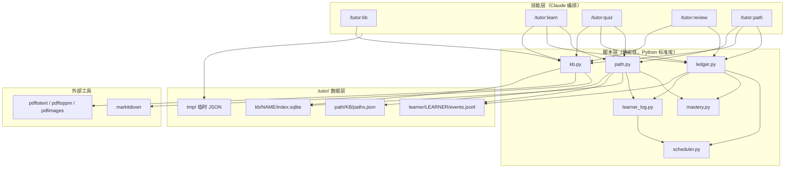
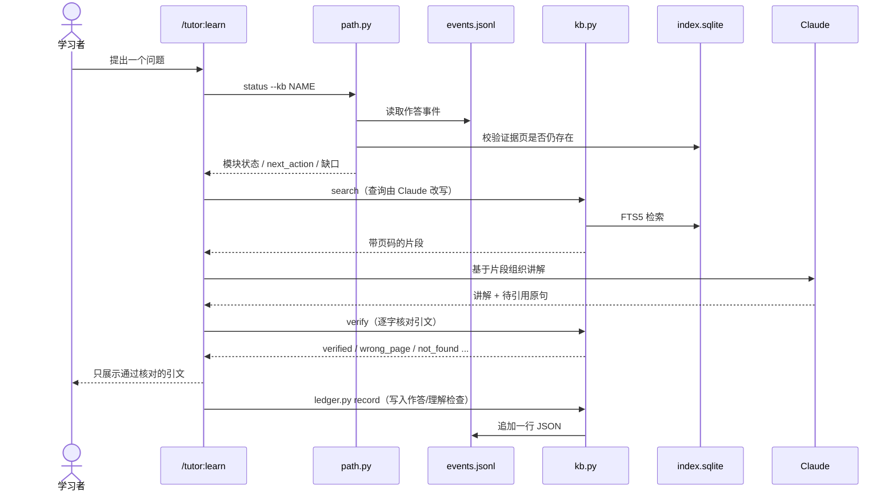

# 整体架构

> 一句话：这是一个没有常驻进程的 Claude Code 插件——技能负责教学编排，Python 命令行脚本负责可复算的状态，二者只通过 `.tutor/` 数据格式和 JSON 接口通信。

## 目录

- [技术栈](#技术栈)
- [入口点](#入口点)
- [组件图](#组件图)
- [主流程：一次 `/tutor:learn` 提问](#主流程一次-tutorlearn-提问)
- [分层与边界](#分层与边界)
- [横切关注点](#横切关注点)
- [关键设计决策](#关键设计决策)

## 技术栈

| 层 | 技术 | 依据 |
| --- | --- | --- |
| 交互层 | Claude Code 技能（`/tutor:kb`、`/tutor:learn`、`/tutor:quiz`、`/tutor:review`、`/tutor:path`） | [README.md:80](../../README.md#L80)；`skills/*/SKILL.md` frontmatter |
| 编排/推理 | Claude 本体完成改写查询、讲解、出题、判分与错因诊断 | [README.md:27](../../README.md#L27)、[CLAUDE.md:5](../../CLAUDE.md#L5) |
| 确定性计算 | Python 3.9+ 标准库脚本，JSON 进 / JSON 出 | [README.md:81](../../README.md#L81)、[CLAUDE.md:26-28](../../CLAUDE.md#L26-L28) |
| 知识库存储 | SQLite + FTS5，页面级索引 | [scripts/kb.py:57-68](../../scripts/kb.py#L57-L68) |
| 学习记录 | 追加式 JSONL 事件日志，状态全部重放得出 | [scripts/learner_log.py:10-11](../../scripts/learner_log.py#L10-L11) |
| 路径定义 | 每个知识库一份 `paths.json`，只存配置不存进度 | [scripts/path.py:3-6](../../scripts/path.py#L3-L6) |
| 外部命令 | poppler（`pdftotext`/`pdftoppm`/`pdfimages`）、`markitdown` | [scripts/kb.py:20-22](../../scripts/kb.py#L20-L22) |

## 入口点

插件没有 `main()` 式总入口；入口由 Claude Code 的技能调用和脚本 CLI 两部分组成。

| 入口 | 路径 | 说明 |
| --- | --- | --- |
| 插件清单 | [.claude-plugin/plugin.json:1-9](../../.claude-plugin/plugin.json#L1-L9) | 名称 `tutor`、版本 0.2.0、Apache-2.0 |
| 市场清单 | [.claude-plugin/marketplace.json:1-17](../../.claude-plugin/marketplace.json#L1-L17) | 让仓库可直接作为 marketplace 安装 |
| `/tutor:kb` | [skills/kb/SKILL.md:1-8](../../skills/kb/SKILL.md#L1-L8) | 建库/增量导入/扫描页转写 |
| `/tutor:learn` | [skills/learn/SKILL.md:1-8](../../skills/learn/SKILL.md#L1-L8) | 基于资料的讲解与费曼检查 |
| `/tutor:quiz` | [skills/quiz/SKILL.md:1-8](../../skills/quiz/SKILL.md#L1-L8) | 出题、判分、错题与错因 |
| `/tutor:review` | [skills/review/SKILL.md:1-8](../../skills/review/SKILL.md#L1-L8) | 按遗忘风险排复习队列 |
| `/tutor:path` | [skills/path/SKILL.md:1-8](../../skills/path/SKILL.md#L1-L8) | 生成/确认路径、诊断、豁免 |
| `kb.py` CLI | [scripts/kb.py:884-910](../../scripts/kb.py#L884-L910) | `ingest/status/search/get/render/register/verify/remove/list` |
| `ledger.py` CLI | [scripts/ledger.py:292-307](../../scripts/ledger.py#L292-L307) | `record/now/state/due/errors/export` |
| `path.py` CLI | [scripts/path.py:1048-1071](../../scripts/path.py#L1048-L1071) | `list/show/validate/save/activate/deactivate/rename/delete/status/resolve` |
| `mastery.py` CLI | [scripts/mastery.py:39-47](../../scripts/mastery.py#L39-L47) | 单函数评分入口，主要供测试与手工核对 |

## 组件图

依赖方向是单向的：技能调用脚本，脚本读写 `.tutor/`；共享的纯库是 `learner_log.py`、`mastery.py`、`scheduler.py`，而 `kb.py` 不导入任何同目录脚本（[scripts/kb.py:24-37](../../scripts/kb.py#L24-L37) 的 import 列表可证）。

## 主流程：一次 `/tutor:learn` 提问

这是最能代表系统协作方式的流程：路径决定“能不能教”，知识库提供“拿什么教”，引文核对决定“能不能说”，账本记录“教过之后的状态”。

依据：技能步骤见 [skills/learn/SKILL.md:16-137](../../skills/learn/SKILL.md#L16-L137)（活动路径 → 找资料 → 讲解 → 引用并核对 → 标注未覆盖 → 费曼检查）；命令形态见 [skills/learn/SKILL.md:18-22](../../skills/learn/SKILL.md#L18-L22)；核对的返回状态见 [scripts/kb.py:776-818](../../scripts/kb.py#L776-L818)；写入前先重放校验见 [scripts/ledger.py:232-241](../../scripts/ledger.py#L232-L241)。

## 分层与边界

| 层 | 所在位置 | 职责 | 边界 |
| --- | --- | --- | --- |
| 技能层 | `skills/*/SKILL.md` | 选择步骤、组织语言、调用脚本、向用户呈现结果 | 不计算掌握度/门槛/排期；不直接读 SQLite；不绕过 `resolve` 判断能否学习 |
| 脚本层 | `scripts/*.py` | 抽取、索引、核对、评分、重放、门槛、排期 | 不做自然语言推理；不调用外部模型 API；只用标准库 |
| 数据层 | `.tutor/` | 保存原始页面、事件日志、路径定义 | 派生状态一律不落盘（[scripts/path.py:5-6](../../scripts/path.py#L5-L6)、[scripts/ledger.py:17-19](../../scripts/ledger.py#L17-L19)） |
| 外部工具层 | poppler、markitdown | 只做格式转换/渲染 | 缺失时由脚本返回带安装提示的错误（[scripts/kb.py:120-134](../../scripts/kb.py#L120-L134)） |

## 横切关注点

### 配置

没有配置文件、没有环境变量清单。脚本通过 CLI 参数接收 `--kb`、`--learner`、`--root` 等；技能内部用 `${CLAUDE_PLUGIN_ROOT}` 定位插件脚本（[skills/learn/SKILL.md:18-22](../../skills/learn/SKILL.md#L18-L22)）。用户级配置只有 Claude Code 的权限允许列表（[README.md:53-61](../../README.md#L53-L61)）。

### 输出与错误处理

所有 CLI 统一“JSON 到 stdout，失败返回 `{"ok": false, "error": ...}` 且退出码 1”：

- 知识库：[scripts/kb.py:9-10](../../scripts/kb.py#L9-L10)
- 账本：[scripts/ledger.py:21-22](../../scripts/ledger.py#L21-L22)
- 路径：[scripts/path.py:13-14](../../scripts/path.py#L13-L14)
- 掌握度：[scripts/mastery.py:12](../../scripts/mastery.py#L12)

读取事件日志时，坏行不会拖垮整条命令：逐行解码、校验，坏行记入 `warnings` 后跳过（[scripts/learner_log.py:84-119](../../scripts/learner_log.py#L84-L119)）；路径状态会把日志警告一并返回（[scripts/path.py:718-719](../../scripts/path.py#L718-L719)）。

### 并发与持久性

- SQLite 连接设置 30 秒超时（[scripts/kb.py:103](../../scripts/kb.py#L103)），适合单用户、低频调用。
- 事件日志追加时先修正缺失的末尾换行，再 `flush` + `fsync`（[scripts/learner_log.py:230-241](../../scripts/learner_log.py#L230-L241)）。
- 路径文件通过临时文件 + 原子替换写入（[scripts/path.py:221-238](../../scripts/path.py#L221-L238)）。

### 语言与引文

讲解、题目、反馈跟随用户最新消息的语言；引文保持原文语言、不翻译（[skills/learn/SKILL.md:10-12](../../skills/learn/SKILL.md#L10-L12)、[CLAUDE.md:8](../../CLAUDE.md#L8)）。这条规则写在每个技能里，而不是脚本里。

### 安全与隐私

无网络请求、无鉴权、无遥测；所有数据留在用户自己的学习文件夹 `.tutor/` 内（[README.md:27](../../README.md#L27)）。引文核对只读取本地索引页。

## 关键设计决策

| 决策 | 代码中的表现 | 证据 | 影响 |
| --- | --- | --- | --- |
| 状态不落盘，全部重放 | `ledger.py` 不保存 state；`path.py` 每次 `status` 从日志重算 | [scripts/ledger.py:17-19](../../scripts/ledger.py#L17-L19)、[scripts/path.py:3-6](../../scripts/path.py#L3-L6)、[docs/solutions/architecture-patterns/derive-path-gates-by-replaying-the-attempt-log.md:1-20](../solutions/architecture-patterns/derive-path-gates-by-replaying-the-attempt-log.md#L1-L20) | 修复算法后历史自动重算；缓存与日志不一致即视为 bug |
| 门槛分两族 | `memory`/`procedure` 走数值门槛；`concept`/`design` 走定性门槛 | [scripts/path.py:47-51](../../scripts/path.py#L47-L51)、[scripts/path.py:498-536](../../scripts/path.py#L498-L536) | 背记与理解不能用同一把尺子 |
| 一个 `question_id` 只算一次证据 | 去重时无提示记录优先于带提示重答 | [scripts/path.py:462-495](../../scripts/path.py#L462-L495) | 重录/重试不能刷门槛 |
| 引文必须逐字核对 | `verify` 返回 `verified`、`verified_case_insensitive`、`verified_elided`、`wrong_page`、`not_found` 等状态 | [scripts/kb.py:776-818](../../scripts/kb.py#L776-L818) | “可信”承诺由脚本兜底，而非提示词自律 |
| 扫描页由 Claude 转写并缓存 | 页面 `origin` 标记 `ai-transcription`，核对时降置信度 | [scripts/kb.py:612-675](../../scripts/kb.py#L612-L675)、[scripts/kb.py:797](../../scripts/kb.py#L797) | 不假装读过；转写只花一次额度 |
| 路径是配置，证据是日志 | `paths.json` 只存模块/知识点/前置/引文；作答只进 `events.jsonl` | [CONCEPTS.md:11-15](../../CONCEPTS.md#L11-L15) | 换路径不丢学习记录；同一知识库可有多条路径 |
| 错题需连续两次答对才毕业 | `GRADUATE_AFTER = 2` | [scripts/ledger.py:7-9](../../scripts/ledger.py#L7-L9)、[scripts/ledger.py:104-112](../../scripts/ledger.py#L104-L112) | 比上游 DeepTutor 更严格（NOTICE 有说明） |
| 掌握度在证据少时封顶 | 1 次作答最多 0.5，2 次最多 0.8 | [scripts/mastery.py:20-36](../../scripts/mastery.py#L20-L36) | 一两次答对不会被当成“掌握” |
| 只用标准库 | 6 个脚本的 import 均来自标准库；无 `requirements.txt` | [README.md:81](../../README.md#L81)、[CLAUDE.md:26-28](../../CLAUDE.md#L26-L28) | 安装零依赖，代价是算法与外部工具需自己封装 |

> 推断项：本文未对“未来版本会如何扩展”做判断；路线图属于设计文档内容，见 [docs/DESIGN.md:98-121](../DESIGN.md#L98-L121)。
