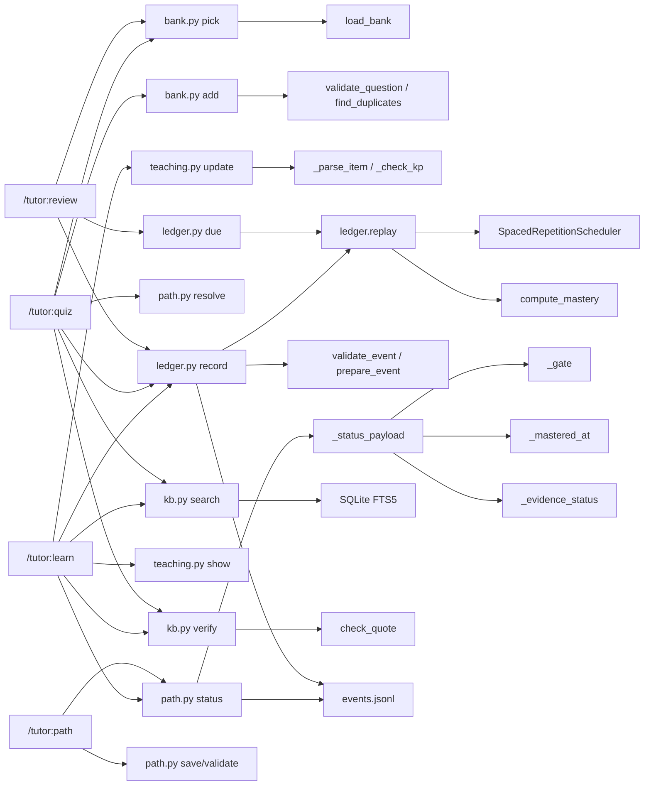

# 关键类与函数

> 筛选标准：被多处调用、承载核心规则、定义公开契约或作为扩展点。按模块分组，签名与源码一致；行号可直接跳转。未列出的辅助函数（格式化、参数解析、文件遍历）不属于理解系统的关键路径。

## 目录

- [掌握度](#掌握度-scriptsmasterypy)
- [调度器](#调度器-scriptsschedulerpy)
- [事件契约](#事件契约-scriptslearner_logpy)
- [账本](#账本-scriptsledgerpy)
- [学习路径](#学习路径-scriptspathpy)
- [题库](#题库-scriptsbankpy)
- [教学档案](#教学档案-scriptsteachingpy)
- [知识库](#知识库-scriptskbpy)
- [调用关系摘要](#调用关系摘要)

## 掌握度 `scripts/mastery.py`

### `compute_mastery(correctness: list[bool | float]) -> float`

- **位置**：[scripts/mastery.py:27-36](../../scripts/mastery.py#L27-L36)
- **职责**：把一串无提示作答结果折算成 0–1 的掌握度。
- **规则**：只取最近 5 次，从旧到新权重 `0.5/0.7/0.85/0.95/1.0`（[scripts/mastery.py:20-22](../../scripts/mastery.py#L20-L22)）；证据数 1 条封顶 0.5、2 条封顶 0.8（[scripts/mastery.py:24](../../scripts/mastery.py#L24)）。
- **调用方**：`ledger.py`、`path.py`（展示用掌握度）。
- **约束**：输入只应包含无提示作答；带提示的记录由调用方过滤（[scripts/learner_log.py:233-235](../../scripts/learner_log.py#L233-L235)）。

## 调度器 `scripts/scheduler.py`

### `class SpacedRepetitionScheduler`

- **位置**：[scripts/scheduler.py:111-419](../../scripts/scheduler.py#L111-L419)
- **职责**：维护每个知识点的复习状态；按知识类型选择间隔序列；给出可提取率、遗忘风险、复习原因与队列。
- **构造**：`SpacedRepetitionScheduler(*, desired_retention: float = DEFAULT_DESIRED_RETENTION)`，默认保留率 0.9（[scripts/scheduler.py:36](../../scripts/scheduler.py#L36)、[scripts/scheduler.py:113-118](../../scripts/scheduler.py#L113-L118)）。
- **状态**：`RepetitionState`（[scripts/scheduler.py:66-80](../../scripts/scheduler.py#L66-L80)）保存稳定度、上次复习、下次到期、连续答对/答错与间隔档位。

### `schedule_review(self, state, knowledge_type, evidence, *, now=None) -> RepetitionState`

- **位置**：[scripts/scheduler.py:200-287](../../scripts/scheduler.py#L200-L287)
- **职责**：根据一次证据更新复习状态：答对升档、答错降档并缩短间隔。
- **输入**：`LearningEvidence`（[scripts/scheduler.py:52-63](../../scripts/scheduler.py#L52-L63)）；`now` 缺省时用证据时间戳。
- **调用方**：`replay`（[scripts/scheduler.py:391-419](../../scripts/scheduler.py#L391-L419)）、`ledger.schedule`（[scripts/ledger.py:116-137](../../scripts/ledger.py#L116-L137)）。
- **副作用**：无 IO，纯状态计算。

### `retrievability(self, state, *, now=None) -> float`

- **位置**：[scripts/scheduler.py:289-294](../../scripts/scheduler.py#L289-L294)
- **职责**：按指数遗忘曲线 `exp(-elapsed / stability)` 估算当前可提取概率，截断到 `[0, 1]`。
- **调用方**：`forgetting_risk`、`review_reason`、队列排序。

### `forgetting_risk(self, state, error_kp_ids, kp_id, *, now=None) -> float`

- **位置**：[scripts/scheduler.py:296-314](../../scripts/scheduler.py#L296-L314)
- **职责**：在可提取率基础上叠加错题加权，得到排序用的风险值。
- **调用方**：`build_review_queue`。

### `build_review_queue(self, states, knowledge_types, error_kp_ids, evidence_log, *, now=None) -> list[ReviewTask]`

- **位置**：[scripts/scheduler.py:352-389](../../scripts/scheduler.py#L352-L389)
- **职责**：为每个知识点生成 `ReviewTask`，附上复习原因与优先级，并按 `review_sort_key` 排序。
- **调用方**：`ledger.build_due`（[scripts/ledger.py:178-196](../../scripts/ledger.py#L178-L196)）。
- **约束**：只生成候选队列；是否到期由调用方用 `due_at <= now` 过滤。

### `replay(self, knowledge_type, evidence, *, now=None, desired_retention=None, initial_state=None) -> RepetitionState`

- **位置**：[scripts/scheduler.py:391-419](../../scripts/scheduler.py#L391-L419)
- **职责**：从零重放一串证据，得到最终状态；可指定初始状态做增量。
- **约束**：`initial_state` 与 `desired_retention` 不能同时给，否则抛 `ValueError`。
- **调用方**：`ledger.replay` 的排期阶段。

## 事件契约 `scripts/learner_log.py`

### `kp_id(kb: str, name: str) -> str`

- **位置**：[scripts/learner_log.py:52-59](../../scripts/learner_log.py#L52-L59)
- **职责**：生成稳定 ID：`<kb>::<规范化名称>`；规范化会去空白、小写、压缩空白（[scripts/learner_log.py:48-49](../../scripts/learner_log.py#L48-L49)）。
- **调用方**：脚本与技能都用它对齐同一个知识点。

### `read_events(path: Path) -> tuple[list[dict], list[str]]`

- **位置**：[scripts/learner_log.py:85-120](../../scripts/learner_log.py#L85-L120)
- **职责**：逐行读取 JSONL，严格解析（拒绝 `NaN`/`Infinity`），跳过坏行并返回警告。
- **返回**：`(events, warnings)`；文件不存在视为空日志。
- **调用方**：`ledger.py`、`path.py`。
- **约束**：读取容忍未知 `origin`（计入掌握度、不开门），写入拒绝（[scripts/learner_log.py:114-118](../../scripts/learner_log.py#L114-L118)）。

### `validate_event(event: dict, defined: set | None) -> None`

- **位置**：[scripts/learner_log.py:140-185](../../scripts/learner_log.py#L140-L185)
- **职责**：校验事件类型、必填字段、枚举、数值范围与引用一致性；不合法直接抛 `ValueError`。
- **调用方**：`prepare_event`、`ledger.record`、测试。

### `prepare_event(raw: dict, existing: list, now: float) -> dict`

- **位置**：[scripts/learner_log.py:188-223](../../scripts/learner_log.py#L188-L223)
- **职责**：补齐 `ts`、`learner`、`kb`、`origin`、`kp` 等默认值，再调用 `validate_event`；是“写入前唯一入口”。
- **约束**：默认 `origin="authored"`；未知来源不能写入。0.3.0 起，作答事件的 `answer_status` 只接受 `sourced`/`unverified`，其他值写入时报错（[scripts/learner_log.py:205-211](../../scripts/learner_log.py#L205-L211)）；读取时不校验该字段，避免一个坏值让整条作答从掌握度和复习里消失。

### `append_line(path: Path, line: str) -> None`

- **位置**：[scripts/learner_log.py:238-249](../../scripts/learner_log.py#L238-L249)
- **职责**：追加一行 JSON 并持久化；若文件末尾缺换行会先补。
- **副作用**：`flush` + `os.fsync`，保证崩溃后日志仍可解析。
- **调用方**：`ledger.run` 的 `record` 分支。

## 账本 `scripts/ledger.py`

### `replay(events: list[dict]) -> dict`

- **位置**：[scripts/ledger.py:63-113](../../scripts/ledger.py#L63-L113)
- **职责**：单次顺序扫描，派生 `kps`（掌握度、作答、错题）与 `errors`（错题状态）。
- **关键规则**：`error` 事件把错题标为 open；之后连续 2 次答对才标为 graduated（[scripts/ledger.py:57](../../scripts/ledger.py#L57)、[scripts/ledger.py:104-112](../../scripts/ledger.py#L104-L112)）。
- **调用方**：`build_state`、`build_due`、`to_markdown`。

### `build_state(events: list[dict], now: float) -> dict`

- **位置**：[scripts/ledger.py:149-175](../../scripts/ledger.py#L149-L175)
- **职责**：返回每个知识点的掌握度、作答次数、最近结果、复习状态与到期时间。
- **调用方**：`ledger.py state` CLI（[scripts/ledger.py:242-250](../../scripts/ledger.py#L242-L250)）。

### `build_due(events: list[dict], now: float, limit: int | None, kb: str | None) -> dict`

- **位置**：[scripts/ledger.py:178-196](../../scripts/ledger.py#L178-L196)
- **职责**：调用调度器生成复习队列，按 `due_at <= now` 过滤，可按知识库筛选并截断。
- **调用方**：`ledger.py due` CLI、`/tutor:review`。

### `run(args, stdin) -> dict`

- **位置**：[scripts/ledger.py:217-263](../../scripts/ledger.py#L217-L263)
- **职责**：CLI 分派；`record` 分支先构造“现有事件 + 新事件”跑一遍重放，通过后才追加。
- **副作用**：仅 `record` 写日志；其余命令只读。

## 学习路径 `scripts/path.py`

### `validate_outline(outline: dict, store: dict, kb: str, conn, defined: dict[str, str])`

- **位置**：[scripts/path.py:338-435](../../scripts/path.py#L338-L435)
- **职责**：校验 Claude 生成的路径大纲：ID 唯一、前置存在、无环、知识点不重复、引文页存在且非空；返回归一化结果与错误/警告。
- **调用方**：`cmd_validate`、`cmd_save`。
- **约束**：引文必须能在索引里找到对应页（[scripts/path.py:294-337](../../scripts/path.py#L294-L337)）。

### `_unique_attempts(attempts: list[dict]) -> list[dict]`

- **位置**：[scripts/path.py:462-479](../../scripts/path.py#L462-L479)
- **职责**：同一 `question_id` 只保留一次；无提示记录优先于带提示重答；无 `question_id` 的原样保留（但后续不计入门槛）。
- **调用方**：`_display_mastery`、`_gate_attempts`。

### `_gate_attempts(attempts: list[dict]) -> list[dict]`

- **位置**：[scripts/path.py:488-500](../../scripts/path.py#L488-L500)
- **职责**：筛出“有资格开门”的作答：先按 `answer_status` 白名单过滤（字段缺失或 `sourced` 才保留），再去重，再要求来源合格且带 `question_id`。
- **规则**：`unverified` 和未知值不开门，但不影响展示掌握度、错题和复习（展示用 `_display_mastery` 不经过这个过滤）；旧日志没有该字段，门槛结果保持不变。
- **调用方**：`_gate`。

### `_gate(kp: dict, attempts: list[dict])`

- **位置**：[scripts/path.py:502-540](../../scripts/path.py#L502-L540)
- **职责**：计算知识点门槛：
  - 数值门槛（`memory`/`procedure`）：掌握度 ≥ 0.9、无提示作答 ≥ 3 次、最近 3 次全对、且没有失败的定性证据。
  - 定性门槛（`concept`/`design`）：最近一次定性考核通过。
- **常量**：[scripts/path.py:47-51](../../scripts/path.py#L47-L51)。
- **返回**：`(gate, gaps, qualitative)`；`gaps` 直接用于向用户解释“还差什么”。
- **调用方**：`_kp_status`。

### `_evidence_status(conn, kp: dict) -> list[dict]`

- **位置**：[scripts/path.py:543-562](../../scripts/path.py#L543-L562)
- **职责**：逐条检查引文来源是否仍存在、页面是否仍非空。
- **输出**：每项带 `valid` 与原因；失效项会阻断门槛。

### `_kp_status(kp: dict, attempts: list[dict], evidence: list[dict]) -> dict`

- **位置**：[scripts/path.py:565-579](../../scripts/path.py#L565-L579)
- **职责**：把门槛、展示掌握度、无提示次数、最近结果、定性结果与证据合并成单个知识点的状态对象。
- **调用方**：`_status_payload`。

### `_mastered_at(path: dict, events: list[dict], evidence_ok: dict, order: list[str]) -> dict`

- **位置**：[scripts/path.py:594-617](../../scripts/path.py#L594-L617)
- **职责**：按日志顺序正向重放，找出“模块解锁且所有知识点门槛通过”的最早事件时间。
- **调用方**：`_status_payload`。
- **约束**：没有通过证据的模块不会得到 `mastered_at`。

### `_status_payload(root: str, kb: str, learner: str, path: dict) -> dict`

- **位置**：[scripts/path.py:636-726](../../scripts/path.py#L636-L726)
- **职责**：路径状态的唯一装配点：模块状态（`locked`/`available`/`in_progress`/`mastered`）、锁定原因、失效证据、下游影响、下一动作。
- **调用方**：`cmd_status`、`cmd_resolve`。
- **约束**：只读，不写回 `paths.json`。

### `cmd_resolve(args) -> dict`

- **位置**：[scripts/path.py:947-991](../../scripts/path.py#L947-L991)
- **职责**：回答“现在能否对某个模块/知识点执行某个动作”，返回 `allowed`、`reason` 与相关状态。
- **原因枚举**：无活动路径、模块锁定、证据失效、已掌握、已通过、未知模块、不在路径内等。
- **调用方**：`/tutor:learn`、`/tutor:quiz`、`/tutor:path`。

## 题库 `scripts/bank.py`

### `load_bank(root: str, kb: str) -> dict`

- **位置**：[scripts/bank.py:83-103](../../scripts/bank.py#L83-L103)，条目校验 [scripts/bank.py:111-137](../../scripts/bank.py#L111-L137)
- **职责**：读取一个知识库的题库。文件不存在视为空库；其余一切异常都报 `BankError`：JSON 损坏、根不是对象、`schema_version` 不是真正的整数或不等于 1、`kb` 不一致、条目缺字段、`question_id` 与键不符、`citation_ok` 不是布尔值。
- **为什么**：把“空库”和“坏库”分开，否则下一次写入会悄悄覆盖损坏的文件。
- **调用方**：所有子命令。

### `validate_question(raw, references: dict, kb: str) -> dict`

- **位置**：[scripts/bank.py:226-282](../../scripts/bank.py#L226-L282)
- **职责**：把一道题规范化并校验：知识点 ID 属于本库且拼写与账本一致（`check_kp`，[scripts/bank.py:212-223](../../scripts/bank.py#L212-L223)）；`format`/`difficulty`/`source_type`/`answer_status` 在白名单内；选择题至少两个选项；简答题可以只有清单；仿写题必须指向已确认的参考题且沿用其知识点、格式与难度；普通题只能是 `sourced`。
- **调用方**：`cmd_add`。

### `find_duplicates(question: dict, questions: dict) -> tuple[str | None, list[dict]]`

- **位置**：[scripts/bank.py:312-324](../../scripts/bank.py#L312-L324)，归一化 [scripts/bank.py:293-296](../../scripts/bank.py#L293-L296)，相似度 [scripts/bank.py:299-309](../../scripts/bank.py#L299-L309)
- **职责**：返回“完全重复的 id”和“近似重复列表”。归一化做 NFKC、折叠大小写、去掉所有空白和标点；相似度是字符二元组的 Jaccard，阈值 `NEAR_DUPLICATE_THRESHOLD = 0.85`（[scripts/bank.py:47](../../scripts/bank.py#L47)）。
- **为什么**：同一道题若以两个 id 入库，路径门槛会把它算成两次证据（[CLAUDE.md:50](../../CLAUDE.md#L50)）。

### `cmd_add(args, stdin, root) -> dict`

- **位置**：[scripts/bank.py:330-377](../../scripts/bank.py#L330-L377)
- **职责**：批量归档题目。同 id 同内容 → `existing`（空操作）；同 id 不同内容 → 整批报错；题干归一化后相同但 id 不同 → `rejected`；近似重复 → `near_duplicates`，除非载荷带布尔值 `allow_near_duplicate: true`（字符串 `"false"` 报错，不能用来绕过）。只要有一道新题就一次性写盘；一道都没有则不写。
- **返回**：`added`、`existing`、`near_duplicates`、`rejected`，以及新增题的公开视图（不含答案）。
- **调用方**：`/tutor:quiz`、`/tutor:review`（先归档、再提问）。

### `cmd_add_reference(args, stdin, root) -> dict`

- **位置**：[scripts/bank.py:384-420](../../scripts/bank.py#L384-L420)
- **职责**：归档学习者确认过的参考题（例题/习题页上的原题）。同 id 同内容幂等，即使 `confirmed_at` 不同也算同一条（[scripts/bank.py:380-381](../../scripts/bank.py#L380-L381)）；同 id 不同内容报错。
- **调用方**：`/tutor:quiz` 的 2b 节。

### `_public(question, with_answers=False)` / `cmd_pick(args)`

- **位置**：[scripts/bank.py:433-438](../../scripts/bank.py#L433-L438)、[scripts/bank.py:481-490](../../scripts/bank.py#L481-L490)
- **职责**：`_public` 剔除 `answer`、`explanation`、`checklist`（[scripts/bank.py:48](../../scripts/bank.py#L48)）；`cmd_pick` 只取 `citation_ok is True` 且不在 `--exclude-question-id` 里的题，默认取 1 道。
- **约束**：`list`、`pick`、普通 `get` 都经过 `_public`；只有 `get --with-answers`（以及显式加了该开关的 `list`/`pick`）才带答案，技能规定作答之后才可用。

### `_set_citation(args, root, ok: bool) -> dict`

- **位置**：[scripts/bank.py:493-510](../../scripts/bank.py#L493-L510)
- **职责**：`invalidate`/`revalidate` 的共同实现：把题的 `citation_ok` 置为假/真，并记录首次失效时间。被标记的题不会被 `pick` 返回，但仍保留在 `list` 里供恢复。

## 教学档案 `scripts/teaching.py`

### `load_store(root, kb, learner) -> dict`

- **位置**：[scripts/teaching.py:120-140](../../scripts/teaching.py#L120-L140)，条目校验 [scripts/teaching.py:98-117](../../scripts/teaching.py#L98-L117)
- **职责**：读取一份档案。文件不存在视为空档案；JSON 损坏、根不是对象、`schema_version` 不是真正的整数 1、知识库或学习者不符、条目缺字段、`outcome` 不在 `helped`/`not_helped`、数字时间戳不是数字，一律报 `TeachingError`。
- **为什么**：把"空"和"坏"分开，否则损坏的档案会被下一次写入悄悄覆盖。档案不是只追加日志，所以不照搬账本的"读取宽容"。
- **调用方**：`show`、`list`、`update`。

### `_parse_item(raw, message) -> dict`

- **位置**：[scripts/teaching.py:247-278](../../scripts/teaching.py#L247-L278)
- **职责**：校验一条操作：`kind`（偏好/观察）、`op`（upsert/remove）、键为 1–64 位 ASCII；字段集合必须与 `kind` 和 `op` 完全吻合（多一个字段就拒绝，如观察不能带 `text`）；`evidence` 非空且长度不超限，并且是 `message` 的逐字子串（[scripts/teaching.py:264](../../scripts/teaching.py#L264)）。
- **约束**：删除也需要 `evidence`，只接受 `kind`、`op`、`key`、`evidence`。
- **调用方**：`cmd_update`。

### `_check_kp(kb, kp, defined)` / `_require_canonical_kp(kb, kp)`

- **位置**：[scripts/teaching.py:227-244](../../scripts/teaching.py#L227-L244)
- **职责**：`_require_canonical_kp` 要求知识点以 `<kb>::` 开头且拼写等于 `learner_log.kp_id` 的规范形式；`_check_kp` 再要求它已在账本的 `kp_define` 集合里（集合来自只读的 `read_events`，[scripts/teaching.py:222-224](../../scripts/teaching.py#L222-L224)）。`show --kp` 只用前一个检查。
- **为什么**：观察与掌握度、错题使用同一个知识点 ID；未登记就报错并提示先登记，脚本自己不写账本。

### `cmd_update(args, stdin) -> dict`

- **位置**：[scripts/teaching.py:285-334](../../scripts/teaching.py#L285-L334)
- **职责**：整批全有或全无：解析所有条目 → 同类同键不得在一批里出现两次 → 校验已登记知识点 → 应用到内存副本（相同内容的 upsert 记为 `unchanged`，不刷新 `updated_at`；对已有观察键换知识点一律拒绝；删除不存在的键报错）→ 检查 6/12 上限 → 一次原子写盘。只有真正改变了内容才写盘。
- **返回**：`recorded`、`unchanged`、`removed`（只含 `kind` 与 `key`），供技能一句话告知。
- **调用方**：`/tutor:learn` 的第 6、7 节。

### `cmd_show(args)` / `cmd_list(args)`

- **位置**：[scripts/teaching.py:166-193](../../scripts/teaching.py#L166-L193)
- **职责**：`show` 返回全部偏好；给了 `--kp` 时再返回该知识点最近 3 条观察，按 `updated_at` 倒序、同时刻按键排序（[scripts/teaching.py:162-163](../../scripts/teaching.py#L162-L163)）。`list` 返回全部条目与键，供学习者查看或指名删除。两者只读。

## 知识库 `scripts/kb.py`

### `extract(path: Path, force_scanned: bool = False)`

- **位置**：[scripts/kb.py:247-257](../../scripts/kb.py#L247-L257)
- **职责**：按扩展名分派：PDF 走 `extract_pdf`，Office/HTML 走 `extract_markitdown`，纯文本走 `extract_plain`。
- **调用方**：`prepare_file`。
- **异常**：不支持的类型抛 `ValueError`。

### `prepare_file(conn, path: Path, force_scanned: bool = False) -> dict`

- **位置**：[scripts/kb.py:331-346](../../scripts/kb.py#L331-L346)
- **职责**：在事务外完成耗时的抽取/哈希/扫描判定，返回待写入的准备结果；内容未变时返回 `unchanged`。
- **调用方**：`cmd_ingest`。

### `cmd_ingest(args) -> dict`

- **位置**：[scripts/kb.py:392-428](../../scripts/kb.py#L392-L428)
- **职责**：遍历文件，逐个“准备 → 写入”，单文件一个事务；汇总每个文件的动作与读取/未读取页。
- **副作用**：写 `sources`、`pages`、`pages_fts`。
- **调用方**：`/tutor:kb`。

### `search_one(conn, query, mode, limit, source_id)`

- **位置**：[scripts/kb.py:517-579](../../scripts/kb.py#L517-L579)
- **职责**：单查询检索：FTS5 匹配 + 中文回退扫描；`all` 模式要求命中全部词。
- **返回**：命中页、片段、来源显示名与页码；用于讲解选材。
- **调用方**：`cmd_search`。

### `check_quote(conn, item: dict) -> dict`

- **位置**：[scripts/kb.py:776-818](../../scripts/kb.py#L776-L818)
- **职责**：核对引文是否真实出现在指定页：
  - 规范化：统一引号、空白、连字符，支持省略号分段（[scripts/kb.py:690-734](../../scripts/kb.py#L690-L734)）。
  - 状态：`verified`、`verified_case_insensitive`、`verified_elided`、`wrong_page`、`not_found`、`too_short`、`invalid`、`unknown_source`、`unknown_page`；扫描页转写额外给 `low_confidence`（[scripts/kb.py:797](../../scripts/kb.py#L797)）。
- **调用方**：`cmd_verify`、`/tutor:learn`、`/tutor:quiz`。
- **约束**：过短引文不允许作为证据；只做本地核对，不访问网络。

### `cmd_verify(args, stdin) -> dict`

- **位置**：[scripts/kb.py:821-838](../../scripts/kb.py#L821-L838)
- **职责**：从 stdin 读取 `{"quotes": [...]}`，逐条调用 `check_quote` 并汇总。
- **调用方**：`/tutor:learn`、`/tutor:quiz` 的引用核对步骤。

### `cmd_render(args) -> dict` / `cmd_register(args, stdin) -> dict`

- **位置**：[scripts/kb.py:612-635](../../scripts/kb.py#L612-L635)、[scripts/kb.py:638-675](../../scripts/kb.py#L638-L675)
- **职责**：渲染扫描页为 PNG 供 Claude 读图；把 Claude 的转写按页登记为 `ai-transcription`，后续检索与核对复用。
- **约束**：渲染结果落在 `.tutor/kb/<name>/scans/<source_id>/`（[scripts/kb.py:435-441](../../scripts/kb.py#L435-L441)）。

## 调用关系摘要

