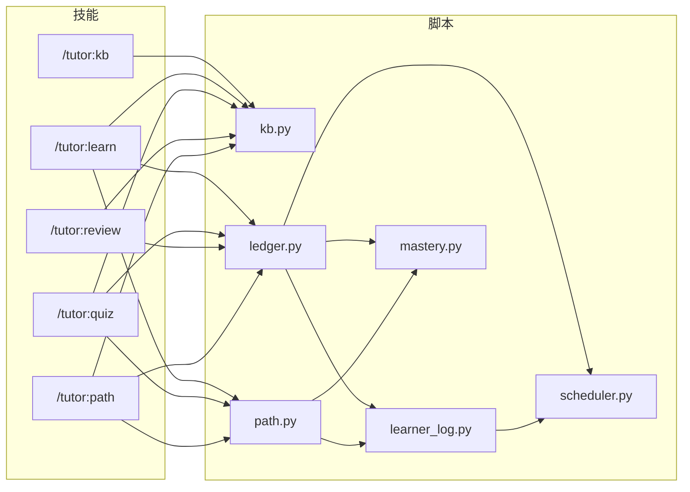

# 依赖关系

> 这个仓库没有包管理清单：根目录不存在 `pyproject.toml`、`setup.py`、`requirements.txt` 或 `package.json`（已用 `ls` 核实）。运行时依赖只有 Python 标准库和三个外部命令，因此没有锁文件与版本解析。

## 内部依赖

- **共享库**：`learner_log.py`（事件契约）、`mastery.py`（评分）、`scheduler.py`（排期）。三者都是纯函数/纯状态模块，可被命令行脚本导入（[CLAUDE.md:26-28](../../CLAUDE.md#L26-L28)）。
- **孤岛**：`kb.py` 不导入任何同目录脚本，因此知识库可以独立运行与测试（[scripts/kb.py:24-37](../../scripts/kb.py#L24-L37)）。
- **导入方式**：脚本通过 `sys.path.insert(0, str(Path(__file__).parent))` 找到同目录模块（[scripts/ledger.py:28-34](../../scripts/ledger.py#L28-L34)、[scripts/path.py:29-35](../../scripts/path.py#L29-L35)），因此必须以 `python3 scripts/<name>.py` 的方式运行，而不是 `python3 -m`。
- **无循环依赖**：技能 → 脚本 → 库 → 数据，单向；测试导入全部模块（[tests/test_ledger.py:1-20](../../tests/test_ledger.py#L1-L20)）。

## 外部依赖

### 运行时（必需）

| 依赖 | 版本 | 声明/依据 | 用途 | 使用的模块 |
| --- | --- | --- | --- | --- |
| Python | 3.9+ | [README.md:47](../../README.md#L47)；代码使用 `list[str]`、`X \| None` 并配 `from __future__ import annotations` | 运行全部脚本 | 全部 |
| SQLite + FTS5 | 随 Python 标准库 | [scripts/kb.py:57-68](../../scripts/kb.py#L57-L68) | 页面全文索引与检索 | `kb.py`、`path.py` |
| Claude Code | 2.1.275+ | [README.md:31](../../README.md#L31)；本机实测 2.1.299 | 加载技能、提供权限与工具 | 全部技能 |
| poppler：`pdftotext` | 本机 26.04.0（`pdftotext -v` 实测） | [scripts/kb.py:20-22](../../scripts/kb.py#L20-L22)、[README.md:48](../../README.md#L48) | PDF 文本层抽取 | `kb.py` |
| poppler：`pdftoppm` | 同上 | [scripts/kb.py:622-628](../../scripts/kb.py#L622-L628) | 扫描页渲染为 PNG | `kb.py` |
| poppler：`pdfimages` | 同上 | [scripts/kb.py:144-155](../../scripts/kb.py#L144-L155) | 判断 PDF 是否有可用图片 | `kb.py` |
| `markitdown` | 本机可用（`markitdown --help` 实测） | [scripts/kb.py:207-221](../../scripts/kb.py#L207-L221)、[README.md:49](../../README.md#L49) | pptx/docx/xlsx/html 转 Markdown | `kb.py` |

### 开发（可选）

| 依赖 | 版本 | 依据 | 用途 |
| --- | --- | --- | --- |
| `unittest` | Python 标准库 | [tests/test_kb.py](../../tests/test_kb.py) 等 | 166 个测试用例 |
| DeepTutor 源码 | 1.6.15 | [NOTICE:4-5](../../NOTICE#L4-L5)、[tests/golden/generate.py](../../tests/golden/generate.py) 导入 `deeptutor.learning.*` | 生成黄金向量；不是运行时依赖 |
| `pytest` | 未声明 | 仓库仅有 `.pytest_cache/` 痕迹 | 本地可选运行器；测试本身基于 `unittest`，不依赖 pytest |

### 版本管理说明

- 没有锁文件，也没有“声明版本 → 解析版本”的过程；外部命令版本由操作系统/用户环境决定。
- 脚本对缺失命令返回带安装提示的错误，而不是在导入期崩溃（[scripts/kb.py:120-134](../../scripts/kb.py#L120-L134)）。
- 调度算法从 DeepTutor 1.6.15 移植，但删除了上游的 `LEARNING_DEBUG` 环境变量开关（[scripts/scheduler.py:114-117](../../scripts/scheduler.py#L114-L117)），避免环境差异改变排期。

## 与上游 DeepTutor 的关系

| 项 | 说明 |
| --- | --- |
| 许可证 | Apache-2.0；本仓库保留 LICENSE 与 NOTICE（[NOTICE:1-2](../../NOTICE#L1-L2)） |
| 适配范围 | `deeptutor/learning/mastery.py` → `scripts/mastery.py`；`scheduler.py` → `scripts/scheduler.py`；`models.py` → `scripts/ledger.py` 与 `scripts/learner_log.py`（[NOTICE:13-18](../../NOTICE#L13-L18)） |
| 源码位置 | `DeepTutor-main/`，被 `.gitignore:5` 排除，不随插件分发 |
| 使用方式 | 只作算法与提示词的一手核对依据；运行时不导入、不调用 |
| 已知偏离 | 错题毕业阈值改为连续 2 次答对（[scripts/ledger.py:7-9](../../scripts/ledger.py#L7-L9)）、增加路径门槛与引文核对、严格事件校验 |

> 结论：这是一个“零第三方包依赖、依赖三个系统命令”的项目；真正的耦合风险不在包版本，而在 poppler/markitdown 是否安装、以及 Claude Code 的权限配置是否允许技能调用脚本。
