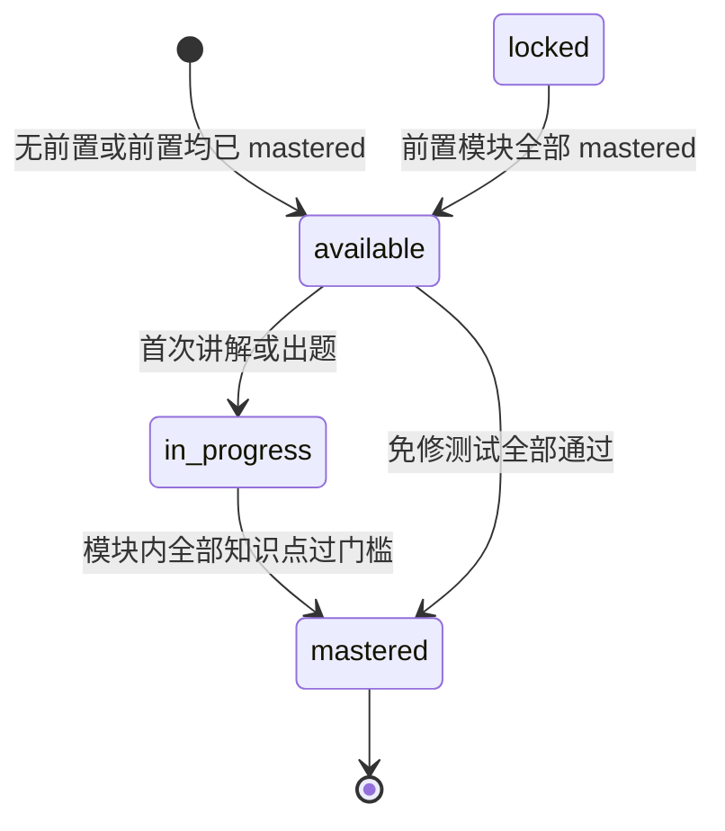
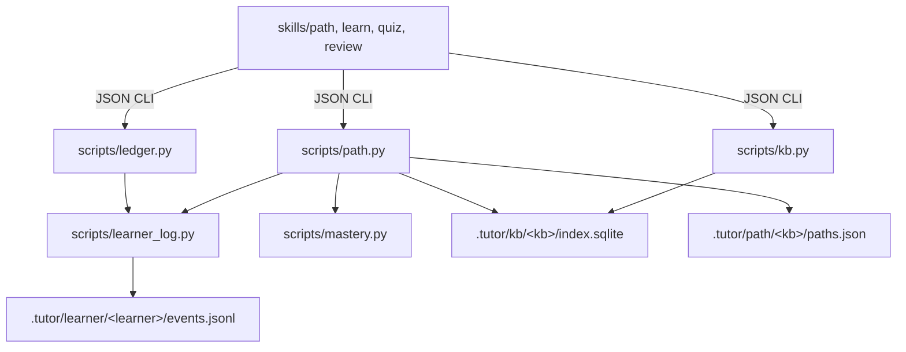

# V0.2.0 学习路径 - Plan

## Goal Capsule

- **Objective:** 学习者能在一个已建库上，按自己的目标生成并确认一条学习路径；之后讲解与出题只在可学模块内推进，模块内全部知识点通过各自门槛才解锁下一模块；诊断用于定位起点，免修测试可以跳过已会的模块；没有路径时，四个技能保持 0.1.4 的行为。
- **Means:** 新增 `/tutor:path` 与 JSON CLI `scripts/path.py`；路径定义按知识库存为配置，模块状态由事件日志重放派生 (KTD1, KTD3, KTD7).
- **Product authority:** `docs/DESIGN.md` 第 6 节 0.2.0 行与 Product Contract 的 R1–R24。产品行为以 R 为准；实现机制在 R 的约束内以 KTD 为准。
- **Execution profile:** `code`.
- **Stop conditions:** 路径定义无法通过 KTD4 的校验；门槛重放结果不确定；真实会话出现未被解释的 `permission_denials`。
- **Tail ownership:** `ce-work` 不提交、不打 tag、不发 release；发布由用户单独授权。

---

## Product Contract

### Summary

V0.2.0 新增 `/tutor:path` 与学习路径：从目标与资料生成模块/知识点大纲，用户确认后保存；learn/quiz 在激活路径内推进，模块内全部知识点通过双轨门槛才解锁下一模块；review 继续按遗忘风险独立排程。没有路径时，四个技能保持 0.1.4 的行为。

### Problem Frame

0.1.x 的四项核心是自由调用：学习者可以随时让 Claude 讲任何内容、出任何题，系统按知识点记录掌握度，但没有“先学什么、现在能不能前进”的结构。熟悉的材料容易被反复讲，难的知识点容易被绕开；复习队列知道哪些内容到期，不知道哪些内容还没学完。

DeepTutor 里已经有前置关系与模块阈值，但前置关系只做一致性校验、不拦截学习（`DeepTutor-main/deeptutor/learning/objective_relations.py:1-5`），`LearningModule.pass_threshold` 也从未被 `learning/policy.py` 读取。照搬这些字段不会产生推进规则。

### Key Decisions

- **新建 `/tutor:path`，路径可选；无路径时四技能保持 0.1.4 行为** (session-settled: user-directed — chosen over 扩展现有 learn 与路径必需: 职责清楚且不破坏已有数据)。Governs R1, R2, R19, R20.
- **模块级解锁，且模块内全部知识点各自过门槛才算完成** (session-settled: user-directed — chosen over 80% 解锁与模块平均达标: 与“硬性掌握门槛”一致)。Governs R10.
- **双轨门槛：memory/procedure 用数值 0.9；concept/design 用费曼复述定性判定** (session-settled: user-directed — chosen over 统一数值与统一费曼: 沿用 `DeepTutor-main/deeptutor/learning/policy.py:33-46`)。Governs R9, R12, R16.
- **全路径诊断只定位；免修测试独立触发，每个知识点至少 3 题** (session-settled: user-directed — chosen over 诊断即免修: `scripts/mastery.py:24` 的置信上限让短诊断无法达到 0.9)。Governs R13, R14.
- **大纲生成后逐模块确认、可编辑，确认才保存启用** (session-settled: user-directed — chosen over 自动保存: 防止错误大纲污染学习记录)。Governs R3, R5.
- **一个知识库可有多条命名路径，同一时间只激活一条** (session-settled: user-directed — chosen over 单路径与多路径同时激活: 目标可切换且进度不丢)。Governs R1, R22.
- **费曼复述按知识点逐个进行** (session-settled: user-directed — chosen over 每模块一次: 定性门槛需要逐点证据)。Governs R16, R17.
- **门槛与解锁由脚本重放事件判定，Claude 只负责教学与定性判定，不自行宣布掌握** — 项目原则：可信承诺的代码默认从严；DT 的 policy 也由引擎判定。Governs R8, R12, R21.

### Requirements

**路径身份与兼容**

- R1. 用户可在已建库上创建带名称的学习路径，路径由学习目标与该库资料生成；同一库可有多条路径，同一时间只有一条激活，切换不丢失其他路径的进度。
- R2. 没有激活路径时，`/tutor:learn`、`/tutor:quiz`、`/tutor:review` 的行为与 0.1.4 完全一致。
- R3. 路径大纲生成后必须逐模块展示，用户确认或编辑后才能保存启用。
- R4. 路径数据是增量数据：已有 `.tutor` 学习者事件无需迁移即可继续使用，0.1.x 数据可读写。

**大纲与依赖**

- R5. 每个模块包含 id、标题、顺序和知识点列表；每个知识点包含 id、类型（memory/concept/procedure/design）、学习目标、至少一处资料依据（文件与页码）。
- R6. 知识点可声明前置知识点，模块可声明前置模块；知识点前置只影响模块内的教学顺序，不单独拦截；模块前置的作用由 R10 承担。
- R7. 保存路径时必须拒绝重复 id、未知前置、自指和环，错误信息指出具体 id；无法在资料中找到依据的知识点不得进入路径。

**门槛与解锁**

- R8. 模块状态由脚本从事件日志与路径定义派生，至少包含 locked、available、in_progress、mastered；技能不得自行推断或写入状态。
- R9. `memory`/`procedure` 的量化门槛为掌握度 ≥ 0.9，且最近 3 次无提示尝试全部为 correct（至少 3 次）；沿用现有置信上限与最近 5 次加权。
- R10. 模块完成的条件是模块内每个知识点都通过各自门槛；只有完成后才解锁以它为前置的模块。
- R11. learn/quiz 对 locked 模块拒绝讲解与出题；review 不受模块锁限制。
- R12. `concept`/`design` 的定性门槛由费曼复述判定，结果以 `qualitative` 评估写入事件日志，包含通过与否和理由；只有 `correct` 计为通过；Claude 的口头结论不能直接改掌握度。

模块生命周期（R8、R10、R14）：



**诊断与免修**

- R13. 创建路径后可运行全路径诊断（5–10 题，由易到难，覆盖各模块），可重复运行；作答按普通 attempt 记录并展示掌握度，但不进入 R9/R12 门槛；诊断只用于确定起点和薄弱模块，不产生免修。
- R14. 免修测试是独立动作：对指定 available 模块，memory/procedure 知识点按 3–5 题出题；concept/design 知识点必须完成一次免修费曼复述并写 qualitative；每个知识点通过各自门槛才把模块标为 mastered 并解锁后续；失败不设时间冷却，模块保持 available，重试使用全新题目。
- R15. 诊断题与免修题必须能在资料中找到依据并带来源引用；无法引用资料时不得出题。

**费曼正式阶段**

- R16. 每个 `concept`/`design` 知识点讲解后必须完成一次费曼复述；判定标准是用户用自己的话、无关键遗漏、无实质误解。
- R17. 未通过时换讲法重讲并允许重试，重试次数记录；通过前该知识点不计入模块完成。
- R18. 费曼复述必须由用户实际作答；用户未作答时技能不得写入通过结果。

**四技能集成**

- R19. 新增 `/tutor:path`，负责创建与确认路径、切换路径、查看进度、触发诊断与免修测试；不负责日常讲解与日常出题（诊断题与免修题除外）。
- R20. learn/quiz 读取激活路径，只在 available/in_progress 模块内工作，优先处理未掌握且前置已满足的知识点；review 继续按调度器的到期顺序。
- R21. 路径状态、门槛与下一步由 JSON CLI 输出，技能只消费结果，不自行计算。
- R22. 激活路径、路径定义与进度按知识库隔离；切换只改变激活指针。

**进度展示**

- R23. `/tutor:path` 展示每条路径的模块状态、每个模块的门槛缺口（哪些知识点未过、还差什么）、以及当前下一个可执行动作。
- R24. 模块完成数与路径进度从事件日志重放得出，不持久化不可重建的状态。

### Key Flows

- F1. 建路径
  - **Trigger:** 用户在已建库上运行 `/tutor:path` 并要求新路径。
  - **Steps:** 询问学习目标 → 读取该库资料 → 生成模块/知识点草案 → 逐模块说明顺序与依据 → 用户改名、调序、合并或删除 → 结构校验 → 保存并激活 → 询问是否现在做诊断。
  - **Covers:** R1, R3, R5, R7, R19.
- F2. 全路径诊断
  - **Trigger:** 用户在路径创建后选择诊断。
  - **Steps:** 按模块生成 5–10 道由易到难的题，每题带来源 → 用户作答 → 逐题记录 attempt → 计算起点与薄弱模块 → 展示从哪个模块开始、哪些知识点需要重点补。
  - **Covers:** R13, R15.
- F3. 模块内推进
  - **Trigger:** 用户运行 `/tutor:learn` 或 `/tutor:quiz`。
  - **Steps:** 读取激活路径与模块状态 → 目标模块 locked 时拒绝并给出当前可学模块 → 选择第一个未掌握且前置已满足的知识点 → 讲解或出题 → concept/design 走费曼复述 → 写入 attempt 或 qualitative → 脚本重算门槛 → 模块完成则解锁后续。
  - **Covers:** R6, R8, R9, R10, R11, R12, R16, R17, R20.
- F4. 免修测试
  - **Trigger:** 用户在 `/tutor:path` 指定一个 available 模块要求免修。
  - **Steps:** memory/procedure 知识点生成 3–5 题并带来源，concept/design 知识点要求一次免修费曼复述 → 用户作答 → 记录 attempt 或 qualitative → 脚本判定每个知识点门槛 → 全部通过则标为 mastered 并解锁后续，否则保持 available 并展示缺口。
  - **Covers:** R14, R15.
- F5. 切换路径
  - **Trigger:** 用户运行 `/tutor:path` 切换到另一条路径。
  - **Steps:** 列出该库路径及其状态 → 用户选择 → 更新激活指针 → 展示新路径的下一步；旧路径进度保留。
  - **Covers:** R1, R22.

### Acceptance Examples

- AE1. 无路径兼容
  - **Given:** 用户只有 0.1.x 的 `.tutor` 数据，没有路径。
  - **When:** 运行 `/tutor:learn` 或 `/tutor:quiz`。
  - **Then:** 行为与 0.1.4 一致，不出现门槛或锁定错误；`/tutor:path` 提示可以创建路径。
  - **Covers:** R2, R4.
- AE2. 越级被拦
  - **Given:** 模块 2 尚有知识点未过门槛，模块 3 以模块 2 为前置。
  - **When:** 用户要求学习模块 3。
  - **Then:** 技能拒绝讲解与出题，指出模块 2 的未过知识点与下一步动作；review 仍可复习模块 3 的到期内容。
  - **Covers:** R10, R11, R20.
- AE3. 短诊断不免修
  - **Given:** 诊断中某知识点只答对 2 题。
  - **When:** 诊断结束。
  - **Then:** 该知识点掌握度最高 0.8，模块保持 available，不因诊断直接标为 mastered。
  - **Covers:** R9, R13.
- AE4. 免修成功
  - **Given:** 用户对某 available 模块发起免修测试；memory/procedure 知识点连续答对至少 3 题且最近 5 次内没有失败尝试；concept/design 知识点的免修费曼复述判定为 correct。
  - **When:** 脚本重算门槛。
  - **Then:** 模块标为 mastered，以它为前置的模块变为 available。
  - **Covers:** R14.
- AE5. 费曼不通过
  - **Given:** 某 `concept` 知识点讲解后，用户的复述遗漏关键区别或含误解。
  - **When:** Claude 判定。
  - **Then:** 写入 qualitative 不通过及理由，换讲法重讲；该知识点不计入模块完成，重试次数累加。
  - **Covers:** R16, R17.
- AE6. 大纲编辑破坏依赖
  - **Given:** 用户在大纲确认时删除被其他模块依赖的模块。
  - **When:** 保存路径。
  - **Then:** 校验失败，指出被依赖的模块 id 与依赖方；不保存，允许继续编辑。
  - **Covers:** R7.
- AE7. 无依据不出题
  - **Given:** 某知识点在资料中找不到可引用页码。
  - **When:** 生成诊断题或免修题。
  - **Then:** 不出该知识点的题，并说明缺少依据；该知识点不能被判定为已掌握。
  - **Covers:** R5, R15.
- AE8. 编辑已掌握模块
  - **Given:** 模块 1 已 mastered，用户给它新增一个未学过的知识点。
  - **When:** 保存编辑后的路径。
  - **Then:** 按新定义重算，模块 1 回到 in_progress，依赖它的模块重新 locked；新知识点过门槛后才恢复。
  - **Covers:** R7, R10, R24.
- AE9. 证据失效
  - **Given:** 路径中某知识点的引用页在库重建后消失。
  - **When:** 运行 `/tutor:path` 查看进度或生成题目。
  - **Then:** 该知识点标为证据失效，门槛不通过，不出题；原本已 mastered 的模块及传递下游随之回落并输出 `invalidated_by`；修复该知识点引用后按既有 attempt 恢复，无需重做教学。
  - **Covers:** R5, R15, R23.

### Success Criteria

- 用真实课程（此前验证用的 16 个 PDF 资料）走通“建路径 → 诊断 → 完成一个模块 → 尝试越级被拦 → 免修复核”完整一轮。
- 门槛、解锁与下一步均由 CLI 输出可复核；同一事件日志重放结果一致。
- 现有 106 个测试全绿，新增路径校验、双轨门槛、诊断/免修与模块解锁的单元测试。
- 无路径时，四技能按 0.1.4 行为通过真实会话回归（learn、quiz、review 各一次）。

### Scope Boundaries

**Deferred for later**

- 路径可视化与图形化进度。
- 自适应排程、动态难度与跨路径的进度汇总/联动（同一知识点在不同路径间天然共享证据，但不做路径间状态同步）。
- 模块内部前置依赖的硬拦截（本版只排序）。
- 多学习者的路径进度界面；CLI 保留 `--learner`，技能层固定 `default`。

**Outside this product's identity**

- 通用课程管理、多用户、云同步。
- 引入新的模型 API 或外部服务。

### Dependencies / Assumptions

- 推理全部由 Claude 完成，脚本只用 Python 标准库；不新增依赖。
- 路径绑定已 ingest 的知识库；未建库时不能创建路径。
- 定性判定依赖 Claude 按标准执行；脚本只保证写入与状态由事件派生，不能消除模型误判，需要理由记录与抽查。
- 只含图片的页面仍不可检索（0.1.0 已知限制），因此不能作为依据出题。
- 技能层固定使用 `default` learner；路径定义按知识库共享，进度按 learner 的日志计算。

### Sources / Research

- `docs/DESIGN.md` 第 6 节 0.2.0 行与第 4.1 节。
- `DeepTutor-main/deeptutor/learning/policy.py:33-46`、`:82-92`（双轨门槛）。
- `DeepTutor-main/deeptutor/learning/objective_relations.py:1-5`（前置只校验不拦截）。
- `DeepTutor-main/deeptutor/learning/models.py:103`（`pass_threshold` 定义）。
- `DeepTutor-main/deeptutor/capabilities/mastery/prompts/en/mastery_loop.yaml:113-115`（probe 策略）。
- `scripts/ledger.py:49-58`、`:103-127`、`:147-217`、`:232-306`（事件契约、校验与重放）。
- `scripts/mastery.py:24-36`（置信上限与加权）。
- `scripts/kb.py:3`、`:58-66`、`:98`（KB 存储位置与 `sources`/`pages` 表）。
- `skills/learn/SKILL.md:1-20`（技能 frontmatter 与 `.tutor/tmp/` 传参规则）。
- `README.md:93-95`（单元测试与 walkthrough 命令）。
- `docs/verification/0.1.0.md`（已知限制）。
- `CHANGELOG.md` 0.1.4 段（当前行为基线）。

---

## Planning Contract

### Key Technical Decisions

- KTD1. **路径定义按知识库存为配置，不新增事件类型。** 路径定义与激活指针存 `.tutor/path/<kb>/paths.json`，写入用同目录临时文件加 `os.replace`；`ledger.SCHEMA_VERSION` 保持 1，attempt 事件增加可选 `origin` 字段，现有校验容忍未知字段。理由：路径是配置，作答是证据；编辑路径不需要日志迁移，0.1.x 数据可直接读 (R4)。拒绝：新增 `path_*` 事件并把 schema 升到 2，因为需要迁移且把配置写进证据流。Governs R1, R4, R22, R24.
- KTD2. **抽取 `scripts/learner_log.py` 共享事件读取与校验。** 把 `SCHEMA_VERSION`、`KNOWLEDGE_TYPES`、`ERROR_TYPES`、`RESULTS`、`ASSESSMENT_TYPES`、`TEXT_FIELDS`、`FUTURE_SLACK`、`LedgerError`、`kp_id`、`normalize_name`、`log_path`、`classify_error`、`loads_strict`、`_reject_constant`、`_num`、`read_events`、`validate_event`、`prepare_event`、`_attempt_score`、`mastery_scores`、`append_line` 移到纯函数库（`learner_log` 单向依赖 `scheduler` 与 `mastery`，不反向依赖 `ledger.py`）；`ledger.py` 与 `path.py` 各自导入，不互相导入。行为保持不变：现有 106 个测试的断言不改即通过。理由：路径门槛与 ledger 必须使用同一套事件校验，否则同一日志会得出两套掌握度。Governs R8, R24.
- KTD3. **状态派生与 mastered 的单调性。** 门槛按 R9/R12 判定；只有 `origin` 属于 learn/quiz/review/exemption 的 attempt 参与门槛，`diagnostic` 的 attempt 只计入掌握度展示，避免诊断直接产生免修 (R13)。状态按判定顺序派生：任一模块前置未 mastered ⇒ locked（优先于 mastered）；否则模块内全部知识点过门槛 ⇒ mastered；否则模块内任一知识点有过 attempt ⇒ in_progress；否则 available。对同一份路径定义，已 mastered 的模块不因后续 attempt 失败而回退；路径定义编辑或证据失效按当前定义与有效证据重算，可能回落 (KTD8/AE9)。证据失效使该模块及传递下游失去 mastered，并输出 `invalidated_by`。review 的 attempt 可计入 available/in_progress 模块的门槛，但不解锁 locked 模块。理由：状态必须可重放 (R8/R24)，且一次复习失手不应把后续模块重新锁上。Governs R8, R9, R10, R12, R24.
- KTD4. **路径保存校验与知识点身份。** 知识点 id 为 `<kb>::<规范化名称>`，与 ledger 一致；每个知识点必须有类型、学习目标与至少一条 `{source_id, page}` 证据。`save` 向 `.tutor/kb/<kb>/index.sqlite` 核对每个 `source_id + page` 存在且该页 `text` 非空；缺失即拒绝，并指出知识点与来源。已有 `kp_define` 时类型必须一致；类型是知识点身份的一部分，改类型必须同时改名，从而产生新 id。`save` 先完成全部校验并写临时路径文件，再通过 `learner_log` 的写入路径追加缺失的 `kp_define`，最后 `os.replace`；若替换失败，输出已写入定义的名字与类型，提示下次保存沿用。已产生 attempt 的知识点冻结名称与类型：改名或改类型按“删旧 + 加新”处理，旧证据保留在日志中但不再属于新知识点。证据在 `status` 时再次核对；失效按 R9/R12 的门槛不通过处理，并输出 `evidence_invalid`。理由：attempt 只能引用已定义的 kp，类型决定门槛轨道；引用失效时不能把掌握度建立在无法核对的引文上。Governs R5, R7, R15.
- KTD5. **费曼判定写入现有 `qualitative` attempt。** concept/design 知识点讲解后，learn 必须要求用户复述；Claude 按“自己的话、无关键遗漏、无实质误解”判定，写入 `attempt`（`assessment_type: qualitative`，`result` 为 correct/partial/incorrect，附 `feedback`）。重试次数等于该知识点的 qualitative 事件数，不新增字段。用户未作答时不写事件 (R18)。理由：复用 0.1.x 已有事件类型，定性判断无法由脚本替代。Governs R12, R16, R17, R18.
- KTD6. **诊断与免修作为普通 attempt 记录。** 诊断由 `/tutor:path` 选 5–10 题覆盖模块，由易到难，可重复运行；每题附原文引文并经 `kb.py verify` 核对；attempt 标 `origin: diagnostic`，记入日志与掌握度展示，但只用于定位，不参与 R9/R12 门槛与 mastered 判定。免修只对 available 模块，开始前告知总题量：memory/procedure 每知识点 3–5 题；concept/design 必须包含一次费曼复述并写 qualitative；attempt 标 `origin: exemption`；失败不设冷却，重试用全新 `question_id`。`origin` 只允许 learn/quiz/review/diagnostic/exemption，由 `learner_log.validate_event` 校验；不新增 `session` 字段。两者都不直接改状态，状态只看门槛 (R13/R14)。Governs R13, R14, R15.
- KTD7. **`path.py` 的 JSON CLI 命令面。** 统一信封：成功 `{"ok": true, ...}`，失败 `{"ok": false, "error": "..."}` 并以 1 退出。`--learner` 默认 `default`，与 ledger 一致，`status` 回显 learner。无激活路径时，`status` 返回 `active_path_id: null`、`next_action: null`；`resolve` 返回 `allowed: true`、`reason: "no_active_path"`，让 learn/quiz 走 0.1.4 行为。命令面如下；理由是 R21 要求技能只消费结果，原子命令让多轮流程可恢复。Governs R2, R8, R11, R19, R20, R21, R22, R23.

| 命令 | 作用 | 关键输出 |
|---|---|---|
| `list --kb K` | 列出路径与激活项 | `active_path_id`, `paths[]` |
| `show --kb K [--path P]` | 定义详情 | `modules[]` 含知识点与证据 |
| `validate --kb K < outline.json` | 只校验不写 | `ok`, `errors[]`, `warnings[]`, `summary` |
| `save --kb K [--activate] < outline.json` | 新建或覆盖定义 | `path_id`, `created`, `kps_defined` |
| `activate --kb K --path P` | 设激活指针 | `active_path_id` |
| `deactivate --kb K` | 清激活指针 | `active_path_id: null` |
| `rename --kb K --path P --name N` | 改路径名 | `path_id`, `name` |
| `delete --kb K --path P` | 删定义 | `deleted`, `active_path_id` |
| `status --kb K [--path P] [--learner L]` | 状态、缺口与下一步 | `modules[]`, `progress`, `next_action` |
| `resolve --kb K (--module M \| --kp X) [--learner L]` | 能否讲解/出题 | `allowed`, `reason` |

- KTD8. **编辑、停用与删除语义。** `save` 用现有 id 覆盖定义；`validate` 与 `save` 展示受影响模块。删除被依赖的模块、删除被模块内知识点前置引用的知识点、成环、重复 id 都拒绝并指出 id (R7)。已 mastered 模块新增未过门槛的知识点后，按新定义重算并回落，下游重新 locked；删除未过门槛的知识点时按剩余知识点重算。停用只清激活指针；删除移除定义；两者都不删日志中的 attempt，重建含相同知识点的路径会继承已有证据。路径名在知识库内唯一（忽略大小写与首尾空白）；删除激活路径后指针置空。路径文件损坏或 active 指针悬空时返回 `ok: false` 并说明，不静默当作无路径。Governs R1, R2, R7, R22, R23.
- KTD9. **技能集成与边界。** 路径激活时，learn/quiz 先读 `status`/`resolve`，只处理 available/in_progress 模块；locked、mastered 或路径外主题拒绝，并给出可学模块与下一步。review 保持 0.1.4，不按模块锁过滤。无激活路径时 learn/quiz/review 不改变既有流程，行为与 0.1.4 一致 (R2)。`/tutor:path` 只负责路径与诊断/免修，不讲解、不出日常题。理由：R20/R21 的职责分离，保证无路径回归。Governs R2, R11, R19, R20, R21.
- KTD10. **进度展示与缺口。** `status` 为每个模块输出 `status`、`mastered_at`、`locked_by`、`invalidated_by`；为每个知识点输出 `knowledge_type`、`gate`、`pass`、`mastery`、`unaided_attempts`、`last_unaided`、`qualitative`、`gaps[]` 与证据状态。`gaps` 用机器可读代码（`mastery_below`、`unaided_below`、`recent_failure`、`qualitative_missing`、`qualitative_not_correct`、`evidence_invalid`）加数值，技能负责按用户语言渲染。`next_action` 按模块顺序取第一个 available/in_progress 且未 mastered 的模块，再取其中第一个未过门槛且模块内前置已过的知识点，动作是 learn 或 quiz；模块可免修时附 `exemption_available`；全部 mastered 时 `next_action: null` 并标 `path_complete`。理由：R23 要展示“还差什么”，数字与下一步都由脚本给，技能不改写门槛。Governs R23, R24.

### High-Level Technical Design

技能只通过 JSON CLI 读状态、写路径与作答；路径定义、事件日志与知识库索引是三个独立的数据面。



路径定义的一等字段如下；`display` 与 `unit` 由 `save` 从知识库解析后写入，供展示与生成 `kp_define` 的 sources 字符串。

```json
{
  "schema": 1,
  "kb": "bio",
  "active_path_id": "p_1a2b3c4d",
  "paths": [{
    "id": "p_1a2b3c4d",
    "name": "Midterm",
    "created_at": 1761400000,
    "updated_at": 1761400000,
    "modules": [{
      "id": "m1",
      "title": "Foundations",
      "prerequisites": [],
      "knowledge_points": [{
        "kp": "bio::photosynthesis",
        "name": "Photosynthesis",
        "knowledge_type": "concept",
        "objective": "Explain the light and dark reactions.",
        "prerequisites": [],
        "evidence": [{"source_id": "lecture", "page": 3, "display": "lecture.pdf", "unit": "page"}]
      }]
    }]
  }]
}
```

`status` 的重放步骤：

1. 读取路径定义并按 KTD4 校验结构与证据。
2. 用 `learner_log.read_events` 读取该 learner 的事件，跳过并报告坏行。
3. 按知识点收集 attempt；无提示 attempt 用于掌握度，最近的用于门槛。
4. 按 `read_events` 返回的文件顺序向前重放（与 `ledger.py state` 一致，不按 ts 排序）：更新当前知识点的门槛，再按模块拓扑顺序标记已满足前置且全部知识点过门槛的模块，写入 `mastered_at`。
5. 由 `mastered_at` 与 attempt 是否存在派生四个状态，计算缺口与 `next_action`。

### System-Wide Impact

- **数据生命周期：** 路径定义是配置，attempt 是不可变证据；删除路径不删除证据，重建同名知识点会继承进度。
- **Agent/tool parity：** 所有门槛、状态与下一步来自 CLI JSON；技能只做语义映射（主题→知识点）与语言渲染。
- **共享工作区：** 路径按知识库隔离，进度按 learner 日志隔离；两者通过 `kb` 名与 `--learner` 对齐。
- **兼容性：** `SCHEMA_VERSION` 保持 1；没有路径时 learn/quiz/review 走 0.1.4 路径。
- **权限：** learn/quiz/path 三个技能需要新增 `Bash(python3 *scripts/path.py*)`；路径大纲写入 `.tutor/tmp/`，沿用现有 `Edit(**/.tutor/tmp/*)` 规则。

### Sequencing

U1 → U2 → U3 → U4/U5/U6（可并行）→ U7 → U8。U1 必须先完成，否则路径门槛与 ledger 会各自实现事件校验。

---

## Implementation Units

### U1. 共享事件日志库

- **Goal:** 让 `path.py` 与 `ledger.py` 共用一套事件读取、校验、写入与掌握度计算，ledger 的外部行为不变。
- **Requirements:** R4, R8, R24.
- **Files:** `scripts/learner_log.py`（新建）、`scripts/ledger.py`、`tests/test_ledger.py`。
- **Approach:** 把 KTD2 列出的符号从 `ledger.py` 原样移入 `learner_log.py`；`ledger.py` 改为导入这些符号并保留全部 CLI 命令。新增可选字段校验：`origin` 必须在 learn/quiz/review/diagnostic/exemption 内；不新增 `session`。不改变 `SCHEMA_VERSION`、事件类型或现有错误信息。
- **Patterns:** 沿用 `ledger.py` 现有的 `ok/error` 信封与坏行警告风格；不引入新依赖。
- **Test Scenarios:** 现有 35 个 ledger 测试不改断言通过；坏行仍产生 warning 而不中断；带合法 `origin` 的 attempt 可写入并回放；非法 `origin` 被拒绝；`path.py` 尚未存在时 `learner_log` 可独立导入。
- **Verification:** `python3 -I -W error::ResourceWarning -m unittest discover -s tests`；并用 0.1.4 的 `.tutor` 样本跑 `ledger.py state`，确认输出与 0.1.4 一致。
- **Dependencies:** 无。

### U2. 路径定义存储与校验 CLI

- **Goal:** 提供 `list/show/validate/save/activate/deactivate/rename/delete`，以严格校验和原子写入管理每知识库的路径配置。
- **Requirements:** R1, R3, R4, R5, R6, R7, R19, R22.
- **Files:** `scripts/path.py`（新建）、`tests/test_path.py`（新建）、`tests/walkthrough.sh`。
- **Approach:** 实现 KTD1 的 `paths.json`、KTD4 的校验与证据核对、KTD7 的命令与信封、KTD8 的编辑/停用/删除语义。大纲通过 stdin 读取；`validate` 返回全部错误与 warning；`save` 先完成全部校验并写临时路径文件，再追加缺失的 `kp_define`，最后 `os.replace`；替换失败时报告已写入定义。知识库缺失、路径文件损坏、active 指针悬空都在这里处理。
- **Patterns:** 复用 `argparse` 子命令、`Path` 文件操作、`ok/error` JSON 与 `SCHEMA_VERSION` 风格；测试用临时目录建一个含 `sources`/`pages` 行的小索引。
- **Test Scenarios:** 重复模块 id、重复知识点 id、未知/自指/成环前置、空模块、无证据、证据页码在索引中不存在、类型与既有 `kp_define` 冲突、路径名重复（忽略大小写）、删除仍被同模块知识点前置引用的知识点都拒绝并指出 id；合法路径保存后可 `show`；`save --activate` 与 `activate/deactivate` 切换指针；`rename` 不改变 id；`delete` 删除激活路径后指针为空；`list` 按知识库隔离；损坏文件返回 `ok:false` 且不覆盖；大纲保存后未定义知识点出现在事件日志。
- **Verification:** `python3 -I -W error::ResourceWarning -m unittest discover -s tests -p "test_path.py"`; `bash tests/walkthrough.sh`.
- **Dependencies:** U1.

### U3. 状态派生、缺口与 resolve

- **Goal:** 从路径定义与事件日志派生模块状态、每知识点缺口、路径进度、下一步与可学性判断。
- **Requirements:** R6, R8, R9, R10, R11, R12, R20, R21, R23, R24.
- **Files:** `scripts/path.py`、`tests/test_path.py`。
- **Approach:** 实现 KTD3 的优先级与向前重放、KTD4 的证据复核、KTD10 的输出字段与 `next_action`，以及 `resolve` 的 `allowed/reason`。`status` 与 `resolve` 只读；不写路径或事件。
- **Patterns:** 复用 `mastery.compute_mastery` 的无提示 attempt 口径；模块拓扑顺序用一次 Kahn 排序，环在保存时已拒绝。
- **Test Scenarios:** 2 次全对不到 0.9；3 次全对过门槛；最近 3 次含 partial 不通过；一次旧失败后连续 5 次全对通过；qualitative 仅 correct 通过；locked 模块即使有 review attempt 仍 locked；前置全 mastered 后 available；首次 attempt 后 in_progress；全部知识点过门槛后 mastered 且保持；路径编辑新增知识点后回落、下游重新 locked（AE8）；证据失效时门槛不通过（AE9）；模块内前置只影响 `next_action` 顺序不拦截；`resolve` 对 locked/mastered/路径外分别给出 reason；无激活路径时 `active_path_id: null` 且 `resolve` 允许；1 个知识点的模块收到 3 条 origin: diagnostic 全对仍 available；含 concept 知识点的模块纯答题不免修；证据失效使传递下游回落并输出 `invalidated_by`、修复后恢复；同一日志重复运行输出一致；两个 learner 的进度互不影响。
- **Verification:** `python3 -I -W error::ResourceWarning -m unittest discover -s tests -p "test_path.py"`；用 0.1.4 的 `.tutor` 样本跑 `path.py status`；同一日志连跑两次 `path.py status`，JSON 逐字段一致。
- **Dependencies:** U2.

### U4. `/tutor:path` 技能

- **Goal:** 让用户能新建、逐模块确认、编辑、切换、停用与删除路径，并运行诊断和免修；技能只调用 CLI。
- **Requirements:** R1, R3, R13, R14, R15, R19, R23.
- **Files:** `skills/path/SKILL.md`（新建）。
- **Approach:** 按 `skills/learn/SKILL.md:1-20` 的 frontmatter 与传参规则写；`allowed-tools` 含 `Bash(python3 *scripts/path.py*)`、`Bash(python3 *scripts/kb.py*)`、`Bash(python3 *scripts/ledger.py*)`、`Edit(**/.tutor/tmp/*)`、`Read`。命令分派：查看/新建/编辑/切换/停用/删除/诊断/免修。新建流程按 F1 逐模块确认；诊断按 F2 用 `kb.py verify` 核对引用并写 `origin: diagnostic`；免修按 F4 写 `origin: exemption`；进度与下一步只渲染 `status` 的 JSON。技能不计算门槛、不写状态。
- **Patterns:** 一次 Bash 只跑一个脚本；大纲与事件 payload 写入新的 `.tutor/tmp/` 文件再用 `<` 重定向；路径名与模块标题用用户语言。
- **Test Scenarios:** 真实会话新建路径并在保存前改名/调序/删模块；删除被依赖模块触发 AE6；切换路径后旧进度仍在；停用后 learn/quiz 回到 0.1.4；诊断 5–10 题、每题带引用；免修 3–5 题/知识点并先报总题量；无依据的知识点被拒绝（AE7）；`permission_denials` 为空。
- **Verification:** `claude -p "/tutor:path" --plugin-dir . --output-format json`，在临时项目上跑建路径、诊断、免修三段；检查 `permission_denials`。
- **Dependencies:** U2, U3.

### U5. learn 技能的路径集成与费曼正式化

- **Goal:** 路径激活时 learn 只在可学模块内讲解，concept/design 必须完成费曼复述；没有路径时行为不变。
- **Requirements:** R2, R11, R12, R16, R17, R18, R20, R21.
- **Files:** `skills/learn/SKILL.md`。
- **Approach:** 更新 `skills/learn/SKILL.md` 的 `allowed-tools`，加入 `Bash(python3 *scripts/path.py*)`；开头读取 `path.py status --kb NAME`；`active_path_id` 为空则按现有流程继续。路径激活时用 `next_action` 或 `resolve --kp` 选目标；locked/mastered/路径外拒绝并展示可学模块。concept/design 讲解后插入强制费曼步骤，按 KTD5 写 qualitative；用户不复述则不写事件。每次作答后用 `status` 展示缺口与下一步。
- **Patterns:** 保留现有 `kp_define` 与 attempt 写入顺序；路径知识点直接使用路径里的名称、类型与来源，不重新命名。
- **Test Scenarios:** 无路径时讲解与引文核对与 0.1.4 一致；锁定模块被拒绝并指出前置缺口；mastered 模块被拒绝并指向 review；concept 费曼通过/partial/不通过三条路径；重试次数累加；用户拒绝作答时不写入通过；memory/procedure 不要求费曼；路径外主题被拒绝。
- **Verification:** 真实会话分别跑无路径与有路径的 learn；检查 `permission_denials`、attempt 事件与 `status` 输出。
- **Dependencies:** U3.

### U6. quiz 技能的路径集成

- **Goal:** 路径激活时 quiz 只对可学知识点出题，并让 attempt 推动门槛；没有路径时行为不变。
- **Requirements:** R2, R11, R15, R20, R21.
- **Files:** `skills/quiz/SKILL.md`。
- **Approach:** 更新 `skills/quiz/SKILL.md` 的 `allowed-tools`，加入 `Bash(python3 *scripts/path.py*)`；开头读取 `status`；有激活路径时用 `next_action` 或 `resolve` 确定知识点，题目必须带路径证据中的 `source_id/page` 并经 `kb.py verify`；写 attempt 时保留 `origin: quiz`。答完后调用 `status` 报告门槛与下一步，不自行宣布掌握。锁定、mastered、路径外主题按 KTD9 拒绝。
- **Patterns:** 沿用现有题目文件与 `question_id` 约定；路径知识点不新建名称，直接复用路径 id。
- **Test Scenarios:** 无路径 quiz 与 0.1.4 一致；数值知识点 2 次全对后仍不通过、第 3 次通过；锁定模块被拒绝；mastered 模块被拒绝并指向 review；路径外主题被拒绝；无引用题目不出（AE7）；`origin: quiz` 写入后可回放。
- **Verification:** 真实会话跑无路径与有路径的 quiz；检查 `permission_denials` 与 `status`。
- **Dependencies:** U3.

### U7. 回归与真实课程演练

- **Goal:** 证明脚本、技能与真实会话在无路径和有路径两种模式下都符合 R1–R24 与 AE1–AE9。
- **Requirements:** 全部（验证覆盖）。
- **Files:** `tests/walkthrough.sh`、`docs/verification/0.2.0.md`（新建）。
- **Approach:** 扩展 walkthrough：建一个小 KB、保存路径、写诊断/免修 attempt、跑 `status` 与 `resolve`，断言关键 JSON。用 0.1.4 的 `.tutor` 样本跑 `ledger.py state` 与 `path.py status` 验证兼容。真实课程上按 Success Criteria 跑一轮，并把命令、输出摘要与 `permission_denials` 记入验证文档。
- **Patterns:** walkthrough 只跑脚本，不调 Claude；真实会话在临时/课程项目上跑，不写入本仓库的 `.tutor`。
- **Test Scenarios:** 无路径 learn/quiz/review 各一次；建路径→诊断→完成一个模块→越级被拦→免修复核；停用后回到无路径；删除路径后重建继承进度；坏路径文件让技能停下而非降级。
- **Verification:** `bash tests/walkthrough.sh`; `python3 -I -W error::ResourceWarning -m unittest discover -s tests`; 真实会话检查。
- **Dependencies:** U4, U5, U6.

### U8. 文档与版本

- **Goal:** 让 0.2.0 的用户入口、变更记录与版本号一致。
- **Requirements:** R19.
- **Files:** `CHANGELOG.md`、`README.md`、`.claude-plugin/plugin.json`、`docs/DESIGN.md`。
- **Approach:** CHANGELOG 增加 0.2.0 段（英文，与现有段落一致）；README 增加 `/tutor:path`、路径与免修/诊断说明及 `path.py` 命令；`plugin.json` 版本改为 0.2.0；DESIGN 第 6 节标注 0.2.0 已实现。不写 release notes 文件，不提交、不打 tag。
- **Patterns:** 沿用 README 现有技能表与命令块；CHANGELOG 保持英文。
- **Test Scenarios:** 人工核对 README 命令可复制执行；`plugin.json` 是合法 JSON；CHANGELOG 段落与 git 历史无冲突。
- **Verification:** 人工 review；`python3 -c "import json; json.load(open('.claude-plugin/plugin.json'))"`.
- **Dependencies:** U4, U5, U6.

---

## Verification Contract

| 门 | 命令 | 适用 |
|---|---|---|
| 全量单元测试 | `python3 -I -W error::ResourceWarning -m unittest discover -s tests` | 每个 unit；必须 106 个既有测试加新增测试全绿 |
| 路径单测 | `python3 -I -W error::ResourceWarning -m unittest discover -s tests -p "test_path.py"` | U2, U3 |
| 脚本演练 | `bash tests/walkthrough.sh` | U2, U7 |
| 黄金向量变异检查 | `python3 tests/golden/mutation_check.py` | 回归；调度器未改也必须全绿 |
| 无路径真实会话 | 在临时项目运行 `/tutor:learn`、`/tutor:quiz`、`/tutor:review`，`--output-format json` | U5, U6, U7；行为与 0.1.4 一致 |
| 路径真实会话 | 运行 `/tutor:path` 建路径、诊断、免修；再跑 learn/quiz 越级 | U4, U7 |
| 权限检查 | 每次真实会话读取 `permission_denials`，必须为空 | U4–U7 |
| 数据兼容 | 用 0.1.4 的 `.tutor` 样本跑 `ledger.py state` 与 `path.py status` | U1, U3, U7 |
| 重放确定性 | 同一日志连跑两次 `path.py status`，JSON 逐字段一致 | U3 |

真实会话命令形态（在临时项目目录运行，替换引号内内容）：

```bash
claude -p "/tutor:path" --plugin-dir /path/to/deep-tutor-with-claude-code --output-format json
claude -p "/tutor:learn demo photosynthesis" --plugin-dir /path/to/deep-tutor-with-claude-code --output-format json
claude -p "/tutor:quiz demo photosynthesis" --plugin-dir /path/to/deep-tutor-with-claude-code --output-format json
```

---

## Definition of Done

全局：

- R1–R24 全部为真；AE1–AE9 全部通过。
- 全量单元测试全绿：106 个既有测试加新增路径测试。
- 四个技能的真实会话通过，`permission_denials` 为空；无路径的 learn/quiz/review 与 0.1.4 行为一致。
- `ledger.SCHEMA_VERSION` 保持 1；0.1.x 的 `.tutor` 数据可直接读写。
- 同一事件日志的 `path.py status` 输出确定且可重复；模块状态只由路径定义与事件派生。
- 没有遗留的实验代码、临时 KB、`.tutor/tmp/` 草稿或调试输出。
- `ce-work` 不提交、不打 tag、不发布；发布是用户单独授权的后续动作。

按 unit：

- U1：ledger 的全部既有测试不改断言通过；`path.py` 通过 `learner_log` 读取事件。
- U2：所有校验失败都指出具体 id；路径文件原子写入；损坏文件不被覆盖。
- U3：四个状态、缺口、`next_action` 与 `resolve` 覆盖 AE1–AE9；无路径返回 `active_path_id: null`。
- U4：技能只消费 CLI；保存前逐模块确认；诊断与免修每题可核对引用；无门槛计算。
- U5：concept/design 讲解后必须费曼；未作答不写通过；锁定与路径外拒绝。
- U6：quiz 只对可学知识点出题；尝试写入后可推动门槛；无路径不变。
- U7：walkthrough 与真实会话记录完整；无路径回归通过。
- U8：CHANGELOG、README、`plugin.json` 版本与 DESIGN 状态一致。
