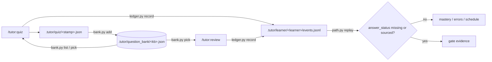

# V0.3.0 题库与例题仿写 - Plan

## Goal Capsule

- **Objective:** 学习者能把课程材料里的例题、习题抽成参考题清单,按其题型和难度得到新的仿写题;所有出过的题(普通 quiz 题与仿写题)归入每个知识库一份的题库,之后测验和复习按知识点、题型、难度从题库取题,不必重新生成。
- **Means:** 新增 `scripts/bank.py` 与 `.tutor/question_bank/<kb>.json`;attempt 事件增加可选 `answer_status` (KTD1, KTD4).
- **Product authority:** `docs/DESIGN.md` 第 6 节 0.3.0 行与本 Product Contract 的 R1–R19。对应 DeepTutor 的 `DeepTutor-main/deeptutor/agents/question/mimic_source.py`。题库与仿写之外的行为保持 0.2.0。
- **Execution profile:** `code`.
- **Stop conditions:** 题库格式无法满足 R9/R13;带 `answer_status` 的门槛重放改变了 0.2.0 对无此字段事件的任何结论;真实技能会话出现未解释的 `permission_denials`。
- **Tail ownership:** `ce-work` 不提交、不打 tag、不发 release;发布由用户单独授权。
- **Open blockers:** 无。

---

## Product Contract

### Summary

0.3.0 新增每个知识库一份的题库和例题仿写。学习者从库内例题/作业题确认一份参考题清单,据此仿写出同题型、同难度的新题;`/tutor:quiz` 出的所有题与仿写题都归档进题库,quiz 与 review 按知识点、题型、难度从题库取题。答案没有原文依据的仿写题只作练习,不进路径门槛。

### Problem Frame

现在 `/tutor:quiz` 每次现场出题,题目只散落在一次次的 `.tutor/quiz/<时间戳>.json` 里。学习者无法按知识点、题型、难度找回某类题,也无法让练习贴近课内题目的风格。学习者目前没有真题,可用的参考材料只有课件、讲义和 Lab 里的例题与习题。

仿写出的新题没有原文答案,这和项目「可信」的承诺直接相关:一道答案可能出错的题不能影响模块解锁。

### Key Decisions

- **参考题来自库内例题/作业题,不依赖外部真题** (session-settled: user-directed — chosen over 以自己的错题为模板、两者都做: 学习者尚无真题,库内例题自带页码出处,以后的真题走同一条导入路径). Governs R1, R2.
- **推理得出的答案允许入库,必须标注未核对** (session-settled: user-directed — chosen over 答案必须锚定原文才能入库: 学习者接受带标注的推理答案,以换取更多可练习的仿写题). Governs R6, R7.
- **未核对的仿写题只练习,不进路径门槛** (session-settled: user-directed — chosen over 与普通题相同计分: 保持 0.2.0 的严格线,一个答案可能错的题不能解锁模块). Governs R7, R8.
- **题库是独立存储,不是现有 quiz 记录之上的目录** (session-settled: user-directed — chosen over 在现有记录上加字段并建目录视图: 学习者看到了「多一套数据格式和迁移责任」的代价后仍选择独立存储,以便直接筛选和抽题). Governs R9–R13.
- **普通 quiz 出的题也进同一个题库** (session-settled: user-directed — chosen over 只收仿写题: 避免题目分散在两处记录). Governs R10, R12.

### Actors

- A1. 学习者:确认参考题清单,作答,按条件取题。
- A2. Claude:抽取参考题、仿写、出题、判分、写入题库。

### Requirements

**参考题清单**

- R1. 学习者可以让 Claude 从一个知识库里抽出疑似例题/习题,每道参考题带原文、文件和页码,页码上的原文由 `kb.py verify` 核对。
- R2. 参考题入清单前必须经学习者确认;未确认的不用于仿写。清单里可以标注题型与难度,由 Claude 给出、学习者可改。

**仿写出题**

- R3. 仿写题保持参考题的题型(选择、填空、简答)与难度,并在题库里指回它的参考题和参考题的源页码。
- R4. 简答题的答案要点清单在出题时写定、之后不改(与 `/tutor:quiz` 现有规则一致)。
- R5. 库内找不到可作参考的例题时,明确说明,不凭通用知识编题。
- R6. 仿写题的答案状态只有两种:`sourced`(答案要点能在库内某页查到,引文经 `kb.py verify`)和 `unverified`(由 Claude 推理得出)。每道仿写题必须标明「AI 变式,非原题」和它的答案状态。
- R7. `unverified` 题的答案状态在学习者看到的题目、反馈和题库列表中都可见。
- R8. `unverified` 题的作答计入掌握度展示、错题本和复习排程,但不计入路径门槛(0.2.0 的「连续 3 次无提示答对」与费曼检查)。门槛仍只由答案状态为 `sourced` 的题和普通 quiz 题开启。

**题库**

- R9. 每个知识库有一份题库,每道题有稳定的 `question_id`,记录知识点、题型、难度、来源页码、题目、答案或要点清单、来源类型(普通 quiz / 仿写)、答案状态,仿写题另记参考题。
- R10. `/tutor:quiz` 新出的每一道题都写入题库;仿写题也写入同一份题库。已有的 `.tutor/quiz/` 文件原样保留,不迁移。
- R11. 题库可以按知识点、题型、难度、来源类型、答案状态筛选和归档查看。
- R12. `/tutor:quiz` 与 `/tutor:review` 可以从题库按上述条件取题;复用已有的题时沿用原 `question_id`,错题重测规则不变。
- R13. 题库格式带版本号;读取到未知版本或损坏的题库时报错,不当作空库。

**与已有规则的衔接**

- R14. 路径门槛中同一 `question_id` 只算一次证据的规则不变;从题库反复抽同一道题不产生额外的门槛证据。
- R15. 有激活路径时,出题与取题仍只限于 `available`/`in_progress` 模块,仿写与取题不绕过路径的锁定规则。没有路径时行为与 0.2.0 一致。
- R16. 题库里的题引用的页码若在知识库重建后失效,该题标为证据失效并不再被取用,直到引文恢复。
- R17. 答案显示与泄露规则沿用 0.1.3:作答前不展示答案、要点清单或解析,题库浏览视图默认也不显示答案。

**语言与归属**

- R18. 讲解、出题、反馈的语言跟随用户当前使用的语言;引文保持原文语言、不翻译。
- R19. NOTICE 与说明保留 DeepTutor 出处,并写明仿写与题库的设计与 `mimic_source.py` 的差异(不调用外部解析服务,参考题来自已建库的页面)。

### Key Flows

- F1. 建参考题清单
  - **Trigger:** 学习者要求从某个知识库找例题作为仿写依据。
  - **Actors:** A1, A2
  - **Steps:** Claude 在库中检索例题/习题页面;抽出候选并核对原文;学习者逐条确认或剔除、修正题型与难度;确认后的参考题存入清单。
  - **Outcome:** 清单中只有已确认、带页码出处的参考题。
  - **Covered by:** R1, R2, R5
- F2. 仿写并作答
  - **Trigger:** 学习者要求针对某知识点做仿写练习。
  - **Actors:** A1, A2
  - **Steps:** 选出参考题;仿写新题并标注答案状态;题目写入题库;学习者作答;判分并记录到 ledger,错题照常诊断。
  - **Outcome:** 题库新增题目;`unverified` 题的作答不进门槛。
  - **Covered by:** R3, R4, R6, R7, R8, R9
- F3. 从题库取题复习
  - **Trigger:** 学习者要求按知识点/题型/难度练习,或 review 需要重测错题。
  - **Actors:** A1, A2
  - **Steps:** 按条件从题库取题;失效引文的题被跳过;作答照常记录。
  - **Outcome:** 不重新生成已有的题,题号保持不变。
  - **Covered by:** R11, R12, R14, R16

### Acceptance Examples

- AE1. **Covers R6, R8.** 给定一道 `unverified` 的仿写题挂在 `procedure` 知识点上,当学习者连续三次无提示答对,该知识点的数值门槛仍不通过;掌握度展示与复习排程照常更新。
- AE2. **Covers R12, R14.** 给定题库里一道 `sourced` 的题已被答对一次,当学习者再次抽到同一道题并答对,门槛证据中它仍只算一次。
- AE3. **Covers R16.** 给定某道题引用的页面在重建知识库后变为空页,当学习者按该知识点取题,这道题被跳过并提示引文失效。
- AE4. **Covers R10.** 给定 0.2.0 时期留下的 `.tutor/quiz/` 文件,升级后这些文件不被改动,题库只收录升级之后新出的题。
- AE5. **Covers R5.** 给定知识库里没有任何例题或习题页面,当学习者要求仿写,Claude 说明库内没有可作参考的题,不凭空出题。

### Success Criteria

- 学习者能在不重新生成的前提下,按知识点、题型、难度从题库取到题,题号稳定,错题重测规则与 0.1.x 一致。
- 在真实技能会话中跑通 F1–F3,`permission_denials` 为空。
- 一道 `unverified` 题无论答对多少次都不会解锁模块(由测试覆盖)。

### Scope Boundaries

**Deferred for later**

- 以学习者自己的错题为模板的「同构变式」出题。
- 按范围、题型与难度配比组卷并导出为文档(打印或限时作答)。
- 学习者拿到真题后的专门导入(沿用 0.1.0 的扫描页流程与本版本的参考题清单即可)。
- 多学习者的题库视图。
- 题型扩展到判断题、多选题、计算题的自动数值核对。

**Outside this version**

- 调用 MinerU 或其他外部解析服务;全部推理由 Claude 完成。
- 新的 Web 界面、嵌入向量检索。

### Dependencies / Assumptions

- 假设:库内的例题/习题能被检索到并抽成独立题目;若某知识库几乎没有这类页面,仿写功能对它几乎无用(见 R5)。
- 假设:仿写题型只覆盖现有 quiz 的三种(选择、填空、简答)。
- 依赖:0.2.0 的 ledger 事件格式、`question_id` 去重规则和路径门槛重放(`scripts/learner_log.py`、`scripts/path.py`)。

### Outstanding Questions

**Resolved (2026-11-09, user-confirmed)**

- 题库与 ledger 的衔接:attempt 事件新增**可选** `answer_status` 字段,取值 `sourced` / `unverified`;缺省按 `sourced` 处理。`path.py` 的门槛取题过滤 `unverified`,掌握度展示、错题本与复习排程不变。不改 `SCHEMA_VERSION`;旧日志无此字段仍按原规则计门槛(R8)。
- 存放位置与格式:每个知识库一份 `.tutor/question_bank/<kb>.json`,根对象含 `schema_version`、`kb`、`questions`(以 `question_id` 为键)和 `references`;临时文件加原子替换写入。未知版本或损坏时报错,不当作空库(R9, R13)。`/tutor:quiz` 在写完 `.tutor/quiz/<stamp>.json` 后立即把该次全部新题写入题库(R10)。
- 参考题清单:与题库同文件的 `references` 字段;只保存学习者已确认的参考题,每条带 `reference_id`、`source_id`、页码、题型、难度与原文引句(R2)。
- 重名与近重复:题干归一化后完全相同则拒绝入库;对同一知识库内已有题目计算归一化字符 bigram 的 Jaccard 相似度,达到 0.85 视为近重复,默认拒绝并返回最相近的 `question_id`,调用方可显式传 `allow_near_duplicate: true` 覆盖(R3)。
- 命令面:新增 `scripts/bank.py`(JSON 进 JSON 出);`skills/quiz/SKILL.md` 增加参考题清单、仿写出题与题库浏览/取题流程,`skills/review/SKILL.md` 增加从题库取题重测。题库默认不返回答案(R17);引文失效由技能在询问前用 `kb.py verify` 发现,再调用 `bank.py invalidate`,恢复后用 `revalidate`(R16)。

### Sources / Research

- `DeepTutor-main/deeptutor/agents/question/mimic_source.py:1-20`:参考题经解析和抽取后转成带 `question_type`、`difficulty` 的模板,类型无法识别时降级为 `written`。
- `skills/quiz/SKILL.md`:现有出题、答案要点写定、`question_id` 规则和 `.tutor/quiz/<时间戳>.json` 的写法。
- `docs/solutions/architecture-patterns/derive-path-gates-by-replaying-the-attempt-log.md`:门槛由事件日志重放得出,同一 `question_id` 只算一次证据。
- `CONCEPTS.md`:Attempt、Gate、Evidence、Replay、Question bank、Reference question、Answer status 的含义。
- `scripts/learner_log.py:139-215`:事件字段校验与 `prepare_event` 的写入校验位置。
- `scripts/path.py:452-495`:门槛资格、`question_id` 去重与诊断/免修不开启门槛的现有规则。
- `scripts/path.py:221-245`:同目录临时文件加 `os.replace` 的原子写入写法。
- `scripts/kb.py:821-835`:`verify` 的 JSON 输入与 `all_verified` 输出。
- `skills/review/SKILL.md`:复习队列、错题重测与 attempt 记录的现有流程。

---

## Planning Contract

**Product Contract preservation:** unchanged. The four Outstanding Questions were resolved as implementation decisions; no R/A/F/AE meaning changed.

### Key Technical Decisions

- KTD1. 题库是按知识库一份的版本化 JSON 文件,原子替换写入。路径 `.tutor/question_bank/<kb>.json`;根对象含 `schema_version`、`kb`、`questions`、`references`。缺失文件按空库处理;未知版本或 JSON 损坏报错,不建空库。(R9, R13)
- KTD2. `question_id` 是题目的唯一身份。以相同载荷重复写入同一 id 是无操作;相同 id 不同载荷报错,防止已固定的答案要点被改写。(R4, R14)
- KTD3. 查重在同一知识库内按归一化题干进行:完全相同拒绝;字符 bigram 的 Jaccard 相似度达到 0.85 时拒绝并返回最相近的 `question_id`,载荷传 `allow_near_duplicate: true` 可覆盖。(R3)
- KTD4. `answer_status` 是 attempt 的可选字段,只在写入时校验为 `sourced` / `unverified`;`path.py` 用白名单取门证据:只有缺失字段(旧日志)或显式 `sourced` 的 attempt 算数,`unverified` 和任何未知值都不开门槛。旧日志因此保持 0.2.0 的门槛结论。(R8, R14)
- KTD5. 题库读取默认不返回答案材料:`list`、`pick`、`get` 省略 `answer`、`explanation`、`checklist`,只有显式 `--with-answers` 才返回。(R17)
- KTD6. 引文失效由技能发现并持久化:`pick` 跳过 `citation_ok: false` 的题;技能在提问前用 `kb.py verify` 核对,失败时调用 `invalidate`,恢复后调用 `revalidate`。(R16)
- KTD7. 新增 `scripts/bank.py` 作为独立 JSON CLI,不导入 `kb.py`、`ledger.py` 或 `path.py`;纯函数留在同一模块,供测试导入。(项目模块化规则)
- KTD8. 复习现场生成的题也入库,`source_type` 记为 `quiz`,attempt 的 `assessment_type` 仍为 `review`;题库的来源类型因此保持 R9 的两种取值。(R9, R12)

### Assumptions

- `.tutor/quiz/` 里的旧文件不迁移;题库只收录升级之后新出的题 (R10, AE4).
- 题库与 quiz 文件的 `source` 使用同一结构 `{source_id, display, page, quote}`;`quote` 是答案所依据的原文片段。
- `format` 取值 `multiple_choice`、`fill_in_blank`、`short_answer`;`difficulty` 取值 `easy`、`medium`、`hard`。
- 与 `path.py` 一致,不做跨进程锁;并发写入不在本版本范围。

### High-Level Technical Design

题库本身不判定引文是否仍然有效;它保存 `citation_ok`,技能用 `kb.py verify` 更新这个标记。这样 `bank.py` 不依赖知识库索引的内部结构。

---

## Implementation Units

### U1. 题库存储与 JSON CLI

- **Goal:** 建立每个知识库一份的版本化题库,提供写入、筛选、取题、引文失效标记与参考题清单的 JSON 命令。
- **Requirements:** R9, R11, R12, R13, R16, R17.
- **Dependencies:** 无。
- **Files:** `scripts/bank.py`, `tests/test_bank.py`.
- **Approach:**
  - 题库路径与知识库名校验沿用 `scripts/path.py` 的 `check_kb` / `store_path` 形状;写入用同目录临时文件、`fsync` 和 `os.replace`。
  - 命令面:`add`(整批题目)、`add-reference`、`list`、`get`、`pick`、`invalidate`、`revalidate`、`references`。
  - `add` 校验 R9 字段,做 KTD2 的 id 幂等检查和 KTD3 的查重;返回 `added`、`existing`、`near_duplicates`、`rejected`。干净题照常入库;精确重复进 `rejected`,近重复进 `near_duplicates`;结构错误(字段非法、同 id 不同内容、批内重复 id)整批失败且不写盘。
  - `pick` 按 `--kp`、`--format`、`--difficulty`、`--source-type`、`--answer-status` 过滤,跳过 `citation_ok: false`,支持 `--limit` 与可重复的 `--exclude-question-id`。
  - 默认输出不含答案材料 (KTD5);所有失败返回 `{"ok": false, "error": ...}` 并以 1 退出,与现有脚本一致。
- **Patterns to follow:** `scripts/path.py` 的 `load_store` / `_write_temp` / `commit_store`;`scripts/kb.py` 的 `parser()` 与错误处理;`scripts/learner_log.py` 的 `normalize_name`。
- **Test scenarios:**
  - 新根目录下 `add` 一道题后,文件位于 `.tutor/question_bank/<kb>.json`,含 `schema_version: 1` 和该题。
  - 相同 id 相同载荷重复 `add` 返回 `existing`,文件不变。
  - 相同 id 不同 prompt 返回错误,原题不被改写。
  - 同一知识库已有 "Explain the light reactions.",再写入仅大小写/空白不同的题干被拒绝。
  - 相似度 0.85 以上的改写进 `near_duplicates`,默认不入库,也不影响同批的干净题;带 `allow_near_duplicate: true` 时写入。
  - `list` 按 kp/format/difficulty/source_type/answer_status 过滤,结果不含 `answer`、`explanation`、`checklist`。
  - `get --with-answers` 返回答案材料;不带时不含。
  - `pick` 跳过 `citation_ok: false` 的题并遵守 limit 与 exclude。
  - `invalidate` 后 `pick` 不再返回该题,`revalidate` 后恢复。
  - `schema_version: 99` 或损坏 JSON 报错,且不覆盖原文件。
  - `add` 的 `source_type: mimic` 缺 `reference_id` 或引用不存在的参考题时报错。
  - 参考题 `add-reference` 重复写入同一 `reference_id` 不产生第二条。
- **Verification:** `tests/test_bank.py` 全部通过;在临时根目录手工跑一遍 add → list → pick → invalidate → revalidate,输出是合法 JSON。

### U2. 门槛排除未核对答案

- **Goal:** 让 `unverified` 作答继续计入掌握度、错题本与复习,但不进入路径门槛。
- **Requirements:** R8, R14.
- **Dependencies:** 无。
- **Files:** `scripts/learner_log.py`, `scripts/path.py`, `tests/test_ledger.py`, `tests/test_path.py`.
- **Approach:**
  - `answer_status` 只在 `prepare_event` 写入时校验为 `sourced` / `unverified`;读取不校验,任何值都不让整条 attempt 消失。
  - `path._gate_attempts` 用白名单取门证据:只保留缺失 `answer_status` 或值为 `sourced` 的 attempt,`unverified` 与未知值都不算;`_display_mastery` 仍接收全部 attempts。
  - 不修改 `SCHEMA_VERSION`,不新增事件类型。
- **Patterns to follow:** `scripts/learner_log.py` 现有的 `origin` 写入校验、读取容忍;`scripts/path.py` 的 `_eligible` / `_unique_attempts`。
- **Test scenarios:**
  - `record` 接受 `answer_status: "unverified"`,state 的 mastery 计入该次作答。
  - `record` 拒绝 `answer_status: "unknown"`.
  - 三道 `unverified` 且无提示答对的 `procedure` 题不通过数值门槛,但 `mastery` 大于 0.
  - 同样三道题标为 `sourced` 时通过门槛。
  - 无 `answer_status` 的 0.2.0 事件行为与改动前一致。
  - `unverified` 的错误答案仍出现在 `errors` 中,且 `due` 的复习排程包含该知识点。
  - 同一 `question_id` 先有 `unverified` 答对、后有 `sourced` 答对时,门槛只按 `sourced` 记录计算。
  - `unverified` 的 qualitative 答对不替代费曼检查。
- **Verification:** `tests/test_ledger.py` 与 `tests/test_path.py` 全部通过;旧事件重放结果与 0.2.0 相同。

### U3. quiz 技能:归档、参考题与仿写

- **Goal:** `/tutor:quiz` 新出的每道题进入题库;学习者能从库内例题确认参考题,并据此得到标注答案状态的仿写题;可按条件浏览题库。
- **Requirements:** R1–R7, R10, R11, R12, R17.
- **Dependencies:** U1, U2.
- **Files:** `skills/quiz/SKILL.md`.
- **Approach:**
  1. 计划阶段对每个候选知识点用 `bank.py pick --kp` 查复用候选,避免重复生成;用户要浏览题库时用 `bank.py list --kb NAME` 与 `bank.py references --kb NAME`,再按 kp/format/difficulty/source_type/answer_status 过滤。
  2. 写 `.tutor/quiz/<stamp>.json` 时,`source` 用 `{source_id, display, page, quote}`,`format`/`difficulty` 用固定取值。
  3. 写完立即用一次 `bank.py add` 归档整批题;`existing` 表示复用,`near_duplicates`/`rejected` 时改用已有题或重写题干。
  4. 参考题:在库内检索例题/习题页,抽候选并 `kb.py verify`;让学习者逐条确认;确认后 `bank.py add-reference`。库内没有可作参考的题时明说,不编题。
  5. 仿写:按参考题的题型与难度生成新题,题干标「AI 变式,非原题」;答案能锚定原文时先核对再标 `sourced`,否则标 `unverified`;入库时带 `source_type: "mimic"` 与 `reference_id`。
  6. 判分后按答案状态记录 attempt:普通题与 `sourced` 仿写题写 `answer_status: "sourced"`,`unverified` 仿写题写 `"unverified"`;题目、反馈和题库列表都显示该状态。
  7. 浏览题库只调用 `list --kb` 与 `references`,不调用 `get --with-answers`;作答后才可读取答案。
- **Patterns to follow:** `skills/quiz/SKILL.md` 现有的取时间戳、写 quiz 文件、事件文件与逐条记录规则;`skills/path/SKILL.md` 的锁定与 `gaps` 呈现方式。
- **Test scenarios:**
  - `Covers AE1 / R8.` 一道 `unverified` 仿写题连续三次无提示答对,路径门槛仍未通过,掌握度与复习日期更新。
  - `Covers AE4 / R10.` 0.2.0 留下的 `.tutor/quiz/` 文件在升级后未被改动。
  - `Covers AE5 / R5.` 库内没有例题页时,仿写请求得到明确说明,题库不新增题。
  - 参考题未经学习者确认时不出现在 `references`.
  - 仿写题的 `format` 与 `difficulty` 与参考题一致,`reference_id` 指向已确认参考题。
  - 题库浏览输出不含答案或要点清单。
- **Execution note:** 指令文件变更,以真实会话验证为主;先跑题库命令的 happy path,再跑一次完整的参考题 → 仿写 → 作答 → 判分。
- **Verification:** 真实 `claude -p` 会话跑通 F1–F3,`permission_denials` 为空;题库新增记录与 `.tutor/quiz/` 文件一致。

### U4. review 技能:从题库取题

- **Goal:** 复习优先复用题库中同知识点、同题型、同难度的题,保持 `question_id`;引文失效的题被跳过;现场新出的题也入库。
- **Requirements:** R12, R14, R16.
- **Dependencies:** U1, U2.
- **Files:** `skills/review/SKILL.md`.
- **Approach:**
  1. 取到复习队列后,对每个知识点调用 `bank.py pick --kb NAME --kp <kp> --limit 1`,排除本次已用过的题。
  2. 提问前用 `kb.py verify` 核对题目引文;失败时 `bank.py invalidate` 并取下一道,恢复时 `revalidate`。
  3. 没有可用题时按现有规则现场出题,写定要点后 `bank.py add` 以 `source_type: "quiz"` 入库。
  4. 记录 attempt 时保留原 `question_id` 与 `assessment_type: "review"`;`unverified` 题同样写 `answer_status`,不计门槛。
- **Patterns to follow:** `skills/review/SKILL.md` 现有的队列、错题重测与记录流程;U3 的题库命令用法。
- **Test scenarios:**
  - `Covers AE2 / R14.` 同一道 `sourced` 题被抽到并再次答对,门槛证据仍只算一次。
  - `Covers AE3 / R16.` 题目引用的页面变空后,`pick` 跳过该题,并在下一次提问前提示引文失效。
  - 队列项在题库中无同 kp 题时,现场生成并入库,下一次复习可复用。
  - 复用题作答记录沿用原 `question_id`,错题毕业规则不变。
- **Execution note:** 指令文件变更;用一条真实复习会话验证取题、失效跳过与记录。
- **Verification:** 真实会话跑通取题与记录;`ledger.py errors` 与 `path.py status` 的输出符合 0.2.0 规则。

### U5. 版本、文档与发布前验证

- **Goal:** 将插件版本升到 0.3.0,补齐 CHANGELOG、NOTICE、README 与 DESIGN 状态,并跑完整个验证面。
- **Requirements:** R18, R19.
- **Dependencies:** U1, U2, U3, U4.
- **Files:** `.claude-plugin/plugin.json`, `CHANGELOG.md`, `NOTICE`, `README.md`, `docs/DESIGN.md`, `CONCEPTS.md`.
- **Approach:**
  - `plugin.json` 版本改 `0.3.0`;CHANGELOG 增加 0.3.0 段;README 功能列表加入题库与仿写;DESIGN 第 6 节 0.3.0 行标「已实现」。
  - NOTICE 写明仿写与 `mimic_source.py` 的差异:不调用外部解析服务,参考题来自已建库页面,答案状态区分 `sourced` / `unverified`。
  - CONCEPTS.md 的三个条目已存在,只校对措辞与实现一致。
  - 不提交、不打 tag、不发 release。
- **Test expectation:** none -- 版本与文档变更,由完整测试套件和真实会话覆盖。
- **Verification:** `plugin.json` 版本为 0.3.0;CHANGELOG/NOTICE/README/DESIGN 互相一致;全量测试与黄金向量检查通过。

---

## Verification Contract

| 检查 | 命令 | 适用 |
|---|---|---|
| 单元测试 | `python3 -I -W error::ResourceWarning -m unittest discover -s tests` | U1–U4 |
| 黄金向量变异检查 | `python3 tests/golden/mutation_check.py` | U2 改动重放后 |
| 真实 quiz 会话 | `claude -p "/tutor:quiz <kb> <topic> 3" --plugin-dir . --output-format json` | U3, U4 |
| 权限检查 | 读取上一条输出的 `permission_denials`,必须为空 | U3, U4 |
| 版本一致性 | `plugin.json` 的 `version` 与 CHANGELOG 最新段一致 | U5 |

真实会话在临时项目根目录运行,先 `kb.py ingest` 一个 fixture,再跑 quiz 与 review;不得改动仓库自带的 `.tutor/` 数据。

## Definition of Done

- R1–R19 均有实现或测试/会话证据;U1–U5 全部完成。
- 单元测试与黄金向量检查通过;无 `unverified` 题能通过路径门槛(测试覆盖)。
- 真实 quiz 与 review 会话跑通 F1–F3,`permission_denials` 为空。
- 题库未知版本/损坏时报错;`list`/`pick` 默认不泄露答案。
- CHANGELOG、NOTICE、README、DESIGN、CONCEPTS 与实现一致,版本为 0.3.0。
- 没有遗留的临时脚本、调试输出或未使用代码;`.tutor/quiz/` 旧文件未被改动。
- 不提交、不打 tag、不发 release;发布由用户单独授权。
