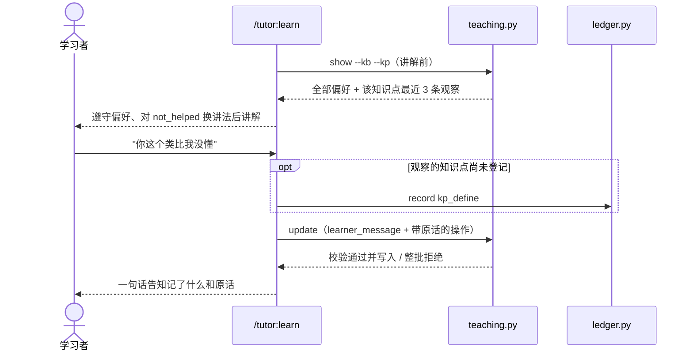

# Teaching Feedback Profile - Plan

## Goal Capsule

- **Objective:** 学习者在 `/tutor:learn` 里说出的教学偏好，以及"某种讲法对某个知识点有效或无效"，能在之后的讲解中被记住并遵守，而不必每次重说。
- **Means:** 新增独立脚本 `scripts/teaching.py` 与每个知识库、每位学习者一份的档案文件 (KTD1, KTD2)，由 `/tutor:learn` 读取、记录、列出和删除。
- **Product authority:** 项目负责人，依据本次 brainstorm 的对话决定；覆盖路线图 0.4.0（`docs/DESIGN.md` 第 6 节）的"偏好 + 观察"，不含入门画像。
- **Execution profile:** `code`；新脚本测试先行。
- **Stop conditions:** 档案的任何操作改变了任何知识点的掌握度、门槛或复习排期；真实 `/tutor:learn` 会话出现未解释的 `permission_denials`；原话校验被绕过后仍写入记录。
- **Tail ownership:** `ce-work` 不提交、不打 tag、不发 release，也不改版本号；发布由用户单独授权。
- **Open blockers:** 无。

**Product Contract preservation:** restructured, no scope change — R1–R15、AE1–AE7 的含义与编号不变；原 Outstanding Questions 的四个待规划问题已由 KTD1–KTD9 回答，按"就地解决"删除该节。

---

## Product Contract

### Summary

每个知识库、每位学习者有一份教学档案，存两类内容：学习者明确提出的教学偏好，以及按知识点记录的观察（某种讲法有效或无效）。`/tutor:learn` 讲解前读取档案并遵守，对讲法无效的知识点换一种讲法。所有记录都必须引用学习者当前消息里的原话，记录后告知学习者，学习者可以查看和删除。这一版不影响掌握度，也不改 `/tutor:quiz`、`/tutor:review`、`/tutor:path`。

### Problem Frame

学习者在讲解中常说"多用例子""这个类比我没懂"。这些话今天只留在当次对话里，下次开口前讲师不记得，也可能对同一个知识点重复同样的讲法。路线图 0.4.0 要求记录哪些讲解方式有效、哪些无效，并据此换讲法，且必须引用学习者原话；上游 DeepTutor 的 `teaching.py` 是对应实现（`DeepTutor-main/deeptutor/learning/teaching.py:1-5`）。

### Key Decisions

- **偏好与观察都挂在"知识库 + 学习者"上，不挂在学习路径上。** (session-settled: user-approved — chosen over 按学习者跨所有知识库、按学习路径（上游做法）: 本插件的路径可选且一个知识库可有多条，挂在路径上会让无路径的自由学习得不到这个功能) Governs R14.
- **只有 `/tutor:learn` 读写档案；`/tutor:quiz`、`/tutor:review` 不读不写。** (session-settled: user-approved — chosen over quiz/review 只读、三个技能都可读写: 讲解是"讲法"所在，改动面最小) Governs R7, R14.
- **只在学习者主动说出时记录，讲师不追问"有帮助吗"。** (session-settled: user-approved — chosen over 每次讲解后固定回访、再读账本错题信号: 固定回访会打断学习且答案易敷衍，上游也不加强制反思) Governs R1, R2, R3, R10.
- **记录后告知，学习者可查看和删除。** (session-settled: user-approved — chosen over 记录前先征得同意、静默记录: 前者频繁打断，后者学习者无法纠正) Governs R12, R13.
- **0.4.0 范围是偏好 + 观察，不含入门画像。** (session-settled: user-approved — chosen over 只做偏好、偏好 + 观察 + 入门画像: 入门画像要改 `/tutor:path` 的路径生成，范围明显更大) Governs R1, R2.
- **观察仍挂在账本里的知识点上，必要时先登记。** (session-settled: user-approved — chosen over 按话题标签记录、不写账本: 与掌握度、错题使用同一个知识点 ID) Governs R4.
- **所有记录一律要原话，不设"暂定"类观察。** 上游允许无原话的暂定观察（`teaching.py:22`），这里不收，因为学习者没有说出口的东西不是学习者的反馈。Governs R3.

### Requirements

**记录**

- R1. 学习者明确提出的教学要求（如"多用例子""先给直觉再给公式"）可记为一条教学偏好，附学习者的原话。
- R2. 学习者对某个知识点说出某种讲法有效或无效时，可记为一条观察，写明知识点、讲法和结果（有效或无效），附学习者的原话。
- R3. 每条记录的原话必须是学习者当前这条消息里的逐字片段；不满足就不记录。讲过了、学习者沉默、问题没被回答，都不构成证据。
- R4. 观察只能挂在账本里已登记的知识点上；记录观察时该知识点若未登记，在同一步登记后再记录，不等学习者要求追踪。
- R5. 档案不给掌握度加分，不影响路径门槛、错题和复习排期。
- R6. 偏好最多 6 条、观察最多 12 条；写满后拒绝新增并提示先删除旧的。同一条重复写入相同内容不产生变化。

**使用**

- R7. `/tutor:learn` 在讲解前读取当前知识库和学习者的档案：遵守全部偏好，并参考与当前知识点相关的最近 3 条观察（对应上游 `teaching.py:127`）。
- R8. 对某知识点记为"无效"的讲法，下次讲同一个点时换一种，并补上缺失的前置知识或联系，不重复同样的措辞；记为"有效"的讲法在相关时保留。
- R9. 学习者当前的明确要求优先于已记录的旧偏好；确需偏离旧偏好时，讲师简要说明。
- R10. 档案为空时，讲师不编造反馈，也不额外加入反思提问。
- R11. 档案只调整讲法，不改变路径门槛、出题、引文核对和掌握度。

**透明与控制**

- R12. 每次记录后，讲师用一句话告知记了什么，并带上那句原话。
- R13. 学习者可以让讲师列出全部已记录内容，也可以让它删除某一条；删除必须出自学习者的明确要求，并带其原话。
- R14. 没有活动路径时同样可用；切换或删除路径不影响档案；不同知识库、不同学习者的档案互不影响。
- R15. 没有档案等同于空档案，旧数据无需迁移；档案损坏时报明确错误，不当作空档案。

### Acceptance Examples

- AE1. **Covers R1, R3, R12.** 学习者说"能不能多用例子讲"，讲师记一条偏好，原话为"多用例子讲"，并告知已记录。
- AE2. **Covers R2, R8.** 学习者对知识点"卡尔文循环"说"你这个类比我没懂"，讲师记一条观察（讲法：类比；结果：无效），告知后换一种讲法，并补上缺的前置知识。之后再讲这个点，不再用类比开头。
- AE3. **Covers R3.** 讲师讲完某个知识点，学习者没有回复，不产生任何记录。
- AE4. **Covers R6.** 偏好已满 6 条，学习者又提出新偏好，讲师提示先删除一条旧的，不静默覆盖。
- AE5. **Covers R13.** 学习者说"忘掉多用例子那条"，讲师删除该偏好并确认；之后的讲解不再受它影响。
- AE6. **Covers R9.** 旧偏好是"讲简短些"，学习者本次说"这次详细讲"，讲师按本次要求详细讲，并说明这次偏离了旧偏好。
- AE7. **Covers R4.** 学习者对一个尚未登记的知识点说"这个讲法没用"，讲师先登记该知识点，再记录观察。

### Success Criteria

- 档案的存取与校验有自动化测试，至少覆盖：原话校验、数量上限、删除、空档案、损坏档案、知识库与学习者隔离。
- 在真实 `/tutor:learn` 会话中，写入、读取并换讲法、列出、删除都能完成，且 `permission_denials` 为空（遵循 `CLAUDE.md` 的真实会话验证教训）。
- 记录从不改变任何知识点的掌握度或门槛状态。

### Scope Boundaries

**推迟到以后：**

- 入门画像（已有基础、目标水平、时间预算）及其对 `/tutor:path` 路径生成的影响。
- `/tutor:quiz`、`/tutor:review`、`/tutor:path` 读取或写入档案。
- 讲解后固定回访，以及用账本错题记录自动提示换讲法。
- 跨知识库共用的偏好。
- 学习者没有说出口的"暂定"观察。

**不属于本产品：** 档案不评估学习者是否理解，也不给掌握度加分。

**考虑过、不做（计划层）：**

- 不并发加锁：档案只靠原子替换保证文件完整；单用户、低频调用，两个会话同时写同一份档案的丢更新风险可接受。若出现真实冲突报告再重新评估。
- 不让 `teaching.py` 写账本：知识点登记由技能调用 `ledger.py` 完成，脚本只校验知识点已登记，保持脚本间只通过数据格式和 JSON 接口沟通。

### Dependencies / Assumptions

- 上游设计依据：`DeepTutor-main/deeptutor/learning/teaching.py`（更新校验 `14-52`、原话必须出自当前消息 `55-65`、数量上限 `96-99`、读取指引 `110-170`）和 `DeepTutor-main/deeptutor/learning/models.py:497-523`（偏好与观察的字段）。上游挂在学习路径上（`models.py:523-557`），本计划有意改为按知识库 + 学习者。
- 已核实：`/tutor:learn` 目前只在学习者要求追踪的理解检查时才登记知识点（`skills/learn/SKILL.md:105-116`），所以 R4 需要它在记录观察前补登记。
- 已核实：账本按学习者存放在 `.tutor/learner/<learner>/events.jsonl`（`scripts/learner_log.py:70-74`），题库按知识库存放在 `.tutor/question_bank/<kb>.json`（`scripts/bank.py:74-75`）。
- 局限：原话校验由脚本检查"原话是否出现在传入的学习者消息里"，但那条消息由 Claude 传入，所以它能强制引用的格式，不能独立证明学习者真的说过。这一点在对用户的文档里要如实写明。

---

## Planning Contract

### Key Technical Decisions

- KTD1. **新增独立脚本 `scripts/teaching.py`，不扩展 `bank.py`、`ledger.py` 或 `path.py`。** 它是 JSON 进 JSON 出的命令行脚本，只导入纯库 `learner_log`（知识点 ID 规范、学习者名规则、事件读取）；与其他脚本只通过 `.tutor/` 数据格式沟通 (`CLAUDE.md` 的模块化约定)。结构沿用 `scripts/bank.py`（错误类、专用参数解析器、`emit`/`main`、原子写）。Governs R5, R11, R14.
- KTD2. **档案存为 `.tutor/teaching/<kb>/<learner>.json`，单文件，`schema_version` 1。** 不并入账本事件日志：账本只追加、不能删除，而 R13 要求学习者说"忘掉这条"时记录真正消失。路径按"知识库 + 学习者"分开，隔离由路径本身保证 (R14)。读取从严：文件不存在视为空档案，JSON 损坏、版本不符、知识库或学习者不符、条目残缺一律报错，不当作空档案 (R15)，沿用 `bank.py:83-137` 的做法。写入用临时文件 + `os.replace`。Governs R13, R14, R15.
- KTD3. **原话校验在脚本里：`update` 载荷带 `learner_message`，每条记录（含删除）的 `evidence` 必须是它的逐字子串，且不能为空。** 比较前不做任何归一化，保持最严。这只能强制"引用格式"，不能证明消息真实（见 Dependencies / Assumptions 的局限），测试要覆盖"原话不在消息里 → 整批拒绝"。Governs R3, R13.
- KTD4. **观察的知识点必须已在账本登记，由脚本只读校验。** 脚本用 `learner_log.read_events` 取该学习者账本里的 `kp_define` 事件，要求知识点 ID 以 `<kb>::` 开头且与 `learner_log.kp_id` 的规范拼写一致（沿用 `bank.py:212-223` 的 `check_kp`）；未登记就报错并在错误信息里说明先登记。登记本身由技能调用 `ledger.py record` 完成，脚本从不写账本。Governs R4.
- KTD5. **`update` 是一整批操作，全有或全无。** 任何一条非法（字段、原话、知识点、键重复）或应用后超出上限（偏好 6、观察 12）都使整批失败且不写盘；相同键相同内容的 upsert 是空操作；同一类别同一键在一批里只能出现一次（沿用上游 `teaching.py:62-64`）。观察的键绑定到它第一次写入的知识点：对已有键用另一个知识点 upsert 一律拒绝并指名两个知识点，避免两个知识点的观察悄悄互相覆盖。Governs R6.
- KTD6. **条目字段与长度沿用上游。** 键为 `[A-Za-z0-9_-]{1,64}`；偏好存 `text`（≤400）、`evidence`（≤300）；观察存 `kp`、`strategy`（≤300，必填）、`outcome`（`helped` 或 `not_helped`，不设 `unknown`，因为没有原话就不记录）、`evidence`（≤300）；两类都存 `updated_at`（epoch 秒）。观察不设自由文本 `text`：`kp`、`strategy`、`outcome`、`evidence` 已装下 R2 要求的全部内容，上游多出的这个字段没有消费者（偏离上游 `models.py:508-520`）。Governs R1, R2.
- KTD7. **两个读取命令：`show` 给讲解用，`list` 给学习者查看用。** `show --kb K [--kp ID]` 返回全部偏好，以及（给了 `--kp` 时）该知识点最近 3 条观察，按 `updated_at` 倒序、同时刻按键排序；不给 `--kp` 就只返回偏好。`list --kb K` 返回全部偏好和观察及其键，供学习者查看和指名删除。两者都只读。Governs R7, R13.
- KTD8. **使用与记录的纪律写在 `/tutor:learn` 技能里，不由脚本强制。** 讲解前先 `show`、遵守偏好、对 `not_helped` 的讲法换法并补前置；只有学习者当前消息里有可引用的原话时才 `update`；记录后一句话告知；档案为空不编造。这些是技能指令，靠真实会话验证 (U5)，与 0.3.0 题库"归档后再提问"同类的已知局限。Governs R7, R8, R9, R10, R12.
- KTD9. **测试用 `--now` 覆盖时间，沿用 `ledger.py` 的做法。** 不引入时钟注入框架；`--now` 仅用于确定性排序测试。Governs R7.

### High-Level Technical Design

`/tutor:learn` 一轮里档案的读写时机（技能负责编排，脚本负责校验与存取）：

### Assumptions

- 档案按 `--learner`（默认 `default`）分文件，学习者名规则与 `learner_log.log_path` 一致，用同一校验避免路径穿越。
- 技能传学习者消息的方式沿用现有教训：先用 Write 写进 `.tutor/tmp/` 下的新文件，再用 `<` 重定向，不用 heredoc（`CLAUDE.md` 0.1.0 教训）。
- 观察的键由技能按 `<知识点短名>-<讲法短名>` 一类的 ASCII 短词自拟；脚本只校验键的字符集和长度。

### Risks & Dependencies

- **技能纪律无法由脚本强制。** 讲师可能漏读档案、漏记录或在没有原话时硬记；脚本只能拦住"原话不在消息里"。缓解：U3 把读取、记录、告知写成明确的编号步骤，U5 用真实会话验证，并把残余局限写进 `docs/verification/0.4.0.md`。
- **真实会话会重复记录同一条。** 0.3.0 验证记录过同一次作答被记两次（`docs/verification/0.3.0.md`）。`update` 对相同键相同内容是空操作 (KTD5)，天然幂等，所以重复记录不会膨胀档案。
- **权限。** 技能的 `allowed-tools` 只在该技能那一轮生效，且命令要写全参数，否则被拒绝（`CLAUDE.md` 0.1.0、0.3.0 教训）。U3、U4 同步更新技能与 README 的权限写法。

---

## Implementation Units

### U1. 档案存取与读取命令

- **Goal:** 建立 `teaching.py` 的存储层与只读命令，使空档案、损坏档案、隔离、读取排序都有确定行为。
- **Requirements:** R5, R7, R13, R14, R15；KTD1, KTD2, KTD6, KTD7, KTD9.
- **Dependencies:** 无。
- **Files:**
  - Create: `scripts/teaching.py`
  - Create: `tests/test_teaching.py`
- **Approach:**
  - 照 `scripts/bank.py` 的骨架：错误类、专用参数解析器（用法错误也输出 JSON 并退出码 1）、`emit`、`main`、`--root` 与 `--learner` 参数（默认值同 `ledger.py`）。
  - 路径函数返回 `.tutor/teaching/<kb>/<learner>.json`；知识库名与学习者名用与现有脚本相同的字符集规则校验。
  - 读取函数实现 KTD2 的"缺失为空、其余一律报错"，包括 `schema_version` 必须是真正的整数（不接受 `true` 或 `1.0`，`CLAUDE.md` 0.3.0 教训）。
  - 写入函数先写同目录临时文件再 `os.replace`，失败时清理临时文件。
  - 实现 `show`（KTD7 的排序与截断）和 `list`；本单元不含 `update`，但写入函数在这里建好供 U2 使用。
- **Patterns to follow:** `scripts/bank.py:58-62`（参数解析器）、`:83-137`（严格读取）、`:140-162`（原子写）、`:570-599`（`emit`/`main`）；`tests/test_bank.py` 的 `run_cli` 辅助与临时目录结构。
- **Test scenarios:**
  - 不存在档案时 `show` 与 `list` 返回空的偏好与观察，`ok` 为真，且不创建任何文件。 (Covers AE3 的"无档案无记录"一侧。)
  - 手工放一份有 2 条偏好、4 条观察（其中 3 条属于同一知识点）的档案：`show --kp` 返回全部偏好和该知识点最近 3 条，按 `updated_at` 倒序；不给 `--kp` 时只有偏好。
  - 同一 `updated_at` 的两条观察按键排序，结果稳定。
  - 损坏的 JSON、`schema_version` 为 `true`/`1.0`/2、`kb` 或 `learner` 与路径不符、偏好缺 `text`、观察 `outcome` 不是 `helped`/`not_helped`：每种都返回 `ok: false` 且退出码 1，不当作空档案。
  - 知识库 A 的档案不出现在知识库 B 的 `show` 里；学习者 `default` 与 `alice` 互不可见。
  - 非法知识库名或学习者名（以点开头、含斜杠）被拒绝。
  - `list` 的输出包含每条记录的键，且不包含 `learner_message` 之类无关字段。
- **Verification:** 新测试全部通过；对一个手工构造的档案文件，`show` 与 `list` 的输出与 KTD7 描述一致；脚本不读写账本、题库或路径文件。

### U2. `update` 命令：原话、知识点、上限、删除

- **Goal:** 实现带校验的写入：偏好与观察的 upsert、删除，原话必须在学习者消息里，观察的知识点必须已登记，整批全有或全无。
- **Requirements:** R1, R2, R3, R4, R6, R13；KTD3, KTD4, KTD5.
- **Dependencies:** U1.
- **Files:**
  - Modify: `scripts/teaching.py`
  - Modify: `tests/test_teaching.py`
- **Approach:**
  - 载荷为 `{learner_message, updates: [...]}`；每条操作有 `kind`（`preference` 或 `observation`）、`op`（`upsert` 或 `remove`）、`key`；偏好 `upsert` 需 `text`、`evidence`，观察 `upsert` 需 `kp`、`strategy`、`outcome`、`evidence`；`remove` 需 `evidence` 且不接受其他字段（沿用上游 `teaching.py:32-52` 的语义，但 `evidence` 对两种操作都必填）。
  - 校验顺序：载荷结构 → 每条字段 → 原话子串 → 观察的知识点（用 `learner_log.read_events` 的 `kp_define` 集合，并检查规范拼写） → 已有键的知识点绑定（KTD5） → 应用到内存副本 → 检查 6/12 上限 → 一次性原子写。任何一步失败都不写盘。
  - 相同键相同内容的 `upsert` 保持原 `updated_at` 不变（空操作），不刷新时间；内容不同才更新 `updated_at`。
  - 删除不存在的键报错，避免学习者以为删了。
  - 返回 `recorded`（本批真正改变的键）、`unchanged`（空操作的键）、`removed`，供技能一句话告知。
- **Execution note:** 先写失败测试，再实现；原话校验与整批回滚是最容易写松的两处，先有测试再写代码。
- **Patterns to follow:** `scripts/bank.py:330-377`（批量入库与整批失败边界）、`:212-223`（知识点规范校验）；`scripts/learner_log.py:85-124`（`read_events` 返回 `(events, warnings)`）。
- **Test scenarios:**
  - Covers AE1. 学习者消息"能不能多用例子讲"，偏好 `upsert` 带原话"多用例子讲"：写入成功，`recorded` 含该键，档案里存有原话。
  - Covers AE2. 已登记知识点 `bio::calvin cycle`，消息"你这个类比我没懂"，观察 `upsert`（`strategy: 类比`、`outcome: not_helped`、原话"类比我没懂"）：写入成功，`show --kp` 返回它。
  - `upsert` 或 `remove` 的 `evidence` 缺失或为空字符串：整批拒绝，不写盘。`updates` 为空列表或缺失同样整批拒绝。
  - 已有观察键 `k1` 属于 `bio::a`，再用 `k1` 为 `bio::b` upsert：整批拒绝，错误信息同时点名 `bio::a` 与 `bio::b`，档案不变；用 `k1` 为 `bio::a` 更新内容则成功。
  - 原话不是消息的逐字子串（多一个空格、改了标点、整句改写）：整批拒绝，档案不变。
  - 批里一条合法、一条原话不在消息里：整批拒绝，合法那条也没写入。
  - Covers AE7. 观察的知识点没在账本 `kp_define` 里：拒绝，错误信息说明先登记；先在测试里往账本写一条 `kp_define` 再重试则成功。
  - 观察的知识点拼写不规范（大小写或多余空白与 `kp_id` 的规范形式不同）：拒绝并提示规范形式。
  - 观察缺 `strategy`、`outcome` 为 `unknown`、观察带了 `text`、偏好带了 `kp`：各自拒绝。
  - Covers AE4. 已有 6 条偏好再 `upsert` 第 7 条新键：整批拒绝并提示先删除；更新其中已有的键不算新增，仍成功。同理 12 条观察。
  - 同一批里偏好与观察使用同一个键字符串：允许（类别不同）；同类别同键出现两次：拒绝。
  - 相同键相同内容再次 `upsert`：`unchanged` 含该键，`updated_at` 不变，文件内容不变。
  - Covers AE5. `remove` 带原话"忘掉多用例子那条"、键存在：该键从档案消失，`show` 不再返回；键不存在：报错。`remove` 不带 `evidence` 或原话不在消息里：拒绝。
  - 并发形态的幂等：连续两次提交同一批，第二次全部落在 `unchanged`，档案不变（对应真实会话重复记录）。
  - 记录前后账本文件字节级不变，`ledger.py state` 的掌握度与到期队列不变。 (Covers R5.)
- **Verification:** 新增测试全部通过；任一失败路径之后档案文件与调用前字节一致；整批拒绝时不遗留临时文件。

### U3. `/tutor:learn` 技能：读取、记录、告知、列出与删除

- **Goal:** 让 `/tutor:learn` 在讲解前读取档案并遵守，在学习者给出反馈的那一轮记录并告知，并支持列出与删除。
- **Requirements:** R1, R2, R3, R4, R7, R8, R9, R10, R12, R13；KTD8.
- **Dependencies:** U1, U2.
- **Files:**
  - Modify: `skills/learn/SKILL.md`
- **Approach:**
  - `allowed-tools` 增加 `Bash(python3 *scripts/teaching.py*)`。
  - 在"找资料"之前新增读取步骤：取得当前知识点 ID：有活动路径时用路径里的；否则先运行 `ledger.py state`，从已登记的知识点里挑与学习者话题匹配的 ID，没有匹配就不带 `--kp`。然后运行 `teaching.py show --kb NAME [--kp ID]`；找到资料后若才确定知识点，用该 `--kp` 重新运行 `show`，再写讲解；写明偏好全部遵守、`not_helped` 的讲法必须换法并补前置、`helped` 的讲法相关时保留、档案为空不编造也不加反思提问；学习者当前明确要求优先于旧偏好，偏离时简要说明。
  - 在理解检查之后新增"教学反馈"节：只在学习者当前消息里有可引用的原话时才记录；先按 R4 检查知识点是否已登记，未登记则用现有 `kp_define` 方式登记；`learner_message` 与操作写进 `.tutor/tmp/` 下的新文件再用 `<` 重定向；命令写全参数 `--kb`；记录后一句话告知并带原话。
  - 新增"查看与删除"小节：学习者要求列出时运行 `teaching.py list --kb NAME` 并逐条展示键、内容和原话；学习者要求删除时只在其消息里有明确的删除要求时才 `remove`，原话取自其当前消息。
  - 规则里写明：档案只调整讲法，不改变路径门槛、引文核对和掌握度；不追问"有帮助吗"；沉默与没回答不是证据。
  - 保持与现有"每次 Bash 调用只跑一条脚本命令"等约定一致，并同步该技能的语言规则。
- **Patterns to follow:** `skills/learn/SKILL.md:16-39`（活动路径小节的写法）、`:40-45`（传数据的约定）、`:97-138`（理解检查与登记知识点）；`skills/quiz/SKILL.md:73-91`（脚本命令写全参数）。
- **Test scenarios:** Test expectation: none -- 技能文件是给 Claude 的指令，行为由 U5 的真实会话验证，不能用单元测试覆盖。
- **Verification:** 技能文件的每条脚本命令都带全参数且与 `teaching.py` 的接口一致；步骤顺序与 `High-Level Technical Design` 的时序图一致；`allowed-tools` 可被一次 `claude -p` 会话实际使用而不产生 `permission_denials` (在 U5 确认)。

### U4. 文档与打包

- **Goal:** 让用户文档、权限示例、出处声明和术语表与新功能一致，且不改版本号。
- **Requirements:** R12, R13；与 KTD3 的局限披露。
- **Dependencies:** U2, U3.
- **Files:**
  - Modify: `README.md`
  - Modify: `NOTICE`
  - Modify: `CHANGELOG.md`
  - Modify: `CONCEPTS.md`
- **Approach:**
  - `README.md`：权限示例加入 `Bash(python3 *scripts/teaching.py*)`；`/tutor:learn` 一行说明记住偏好与讲法反馈；"What is checked"里如实写明：每条记录都要引用学习者当前消息里的原话，脚本能检查原话是否出现在传入的消息里，但那条消息由 Claude 传入，所以这只是格式约束，不能独立证明学习者真的说过。
  - `NOTICE`：在适配清单里加 `deeptutor/learning/teaching.py` → `scripts/teaching.py` 与 `skills/learn/SKILL.md`，并在"与上游的差异"里写明：挂在知识库 + 学习者而非学习路径；所有记录都要原话，不收暂定观察；删除也要原话；不碰学习者入门画像。
  - `CHANGELOG.md`：新增 `## 0.4.0` 草稿段，写明新增命令、行为、数据文件位置和已知局限；不改 `.claude-plugin/plugin.json` 的版本号。
  - `CONCEPTS.md`：追加"Teaching profile""Teaching preference""Teaching observation"三个术语的定义，格式沿用现有条目。
- **Patterns to follow:** `CHANGELOG.md` 0.3.0 段的写法与语言；`NOTICE` 现有适配条目格式；`CONCEPTS.md` 现有条目格式。
- **Test scenarios:** Test expectation: none -- 纯文档改动；一致性由 U5 的检查清单核对。
- **Verification:** README 的权限 JSON 仍是合法 JSON；NOTICE 与 CHANGELOG 对新增脚本与数据文件的描述同 `scripts/teaching.py` 的实际接口一致；`.claude-plugin/plugin.json` 版本号未变。

### U5. 演练脚本与真实会话验证

- **Goal:** 用端到端脚本演练和真实技能会话证明 AE1–AE7 在整条链路上成立，并记录结果与残余局限。
- **Requirements:** R1–R15 的端到端覆盖；Success Criteria 全部。
- **Dependencies:** U3, U4.
- **Files:**
  - Modify: `tests/walkthrough.sh`
  - Create: `docs/verification/0.4.0.md`
- **Approach:**
  - `walkthrough.sh` 在现有第 11 节之后新增一节：先登记知识点，再用 `teaching.py` 依次完成记录偏好、记录观察、`show --kp`、`list`、删除、超上限被拒、原话不匹配被拒，并断言账本的 `state` 在整个过程中掌握度不变。
  - 真实会话按 `CLAUDE.md` 的方法在一个临时学习文件夹里运行 `claude -p "/tutor:learn ..." --plugin-dir <repo> --output-format json`，场景对应 AE1、AE2、AE3、AE5、AE6、AE7 以及一个自由学习下读到旧观察的场景，并检查 `permission_denials`。记录每个会话的结果，包括任何重复记录或步骤遗漏。
  - `docs/verification/0.4.0.md` 按 `docs/verification/0.3.0.md` 的格式写：检查与结果表、真实会话摘要、观察到的非缺陷、已知局限（含 KTD3 的原话局限与 KTD8 的技能纪律局限）。
- **Execution note:** 真实会话是这一版的唯一技能行为证据；若会话暴露技能步骤遗漏，回到 U3 修技能，再重跑受影响的会话。
- **Patterns to follow:** `tests/walkthrough.sh:74-120`（path 小节的断言写法）；`docs/verification/0.3.0.md`。
- **Test scenarios:**
  - Covers AE1, AE2, AE5, AE7. 脚本演练中偏好与观察的记录、读取、删除和未登记知识点被拒，均有断言。
  - Covers R5. 演练全程 `ledger.py state` 的掌握度与到期队列与记录前一致。
  - 真实会话 Covers AE1, AE2, AE5, AE6, AE7：每个场景的最终回合 `permission_denials` 为空，档案文件内容与场景预期一致。
  - 真实会话 Covers AE3：学习者对一次讲解不作任何反馈，档案文件不变、没有 `update` 调用。
  - 真实会话（自由学习、无活动路径）：已有一条某知识点 `not_helped` 的观察，学习者再问该话题，讲师先匹配到已登记的知识点、读到观察并换讲法。
- **Verification:** `bash tests/walkthrough.sh` 退出码 0 且新增断言全部通过；`docs/verification/0.4.0.md` 记录了每个真实会话的结果，包括未能复现或有保留的项目。

---

## Verification Contract

| 检查 | 命令 | 适用 |
| --- | --- | --- |
| 全部单元测试 | `python3 -I -W error::ResourceWarning -m unittest discover -s tests` | 每个单元完成后；U1、U2 必跑新测试文件 |
| 新测试文件单跑 | `python3 -I -W error::ResourceWarning -m unittest discover -s tests -p "test_teaching.py"` | U1、U2 |
| 黄金向量变异检查 | `python3 -I tests/golden/mutation_check.py` | U5（调度器未改，确认仍 19/19） |
| 端到端演练 | `bash tests/walkthrough.sh` | U5 |
| 真实技能会话 | `claude -p "/tutor:learn ..." --plugin-dir . --output-format json`，检查 `permission_denials` | U5；每个场景一次 |
| 插件清单 | `claude plugin validate .` | U4、U5 |
| Python 3.9 兼容 | `/usr/bin/python3 -I -W error::ResourceWarning -m unittest discover -s tests` | U5（项目声明支持 3.9） |

## Definition of Done

- 全部单元测试通过，新增 `tests/test_teaching.py` 覆盖 R3、R4、R6、R13、R15 及隔离与幂等，且失败路径之后档案字节不变。
- `teaching.py` 不读写账本、题库、路径文件之外的数据，也不改变任何知识点的掌握度、门槛或复习排期 (R5, R11)。
- 脚本演练全部断言通过；真实 `/tutor:learn` 会话覆盖 AE1、AE2、AE5、AE6、AE7，最终回合 `permission_denials` 为空，结果写入 `docs/verification/0.4.0.md`。
- README、NOTICE、CHANGELOG、CONCEPTS 与实现一致；原话校验的局限已在用户文档中如实写明。
- 版本号、提交、tag 与 release 均未动，等待用户单独授权。
- 清理：没有遗留的实验代码、临时文件或未使用的参数。
