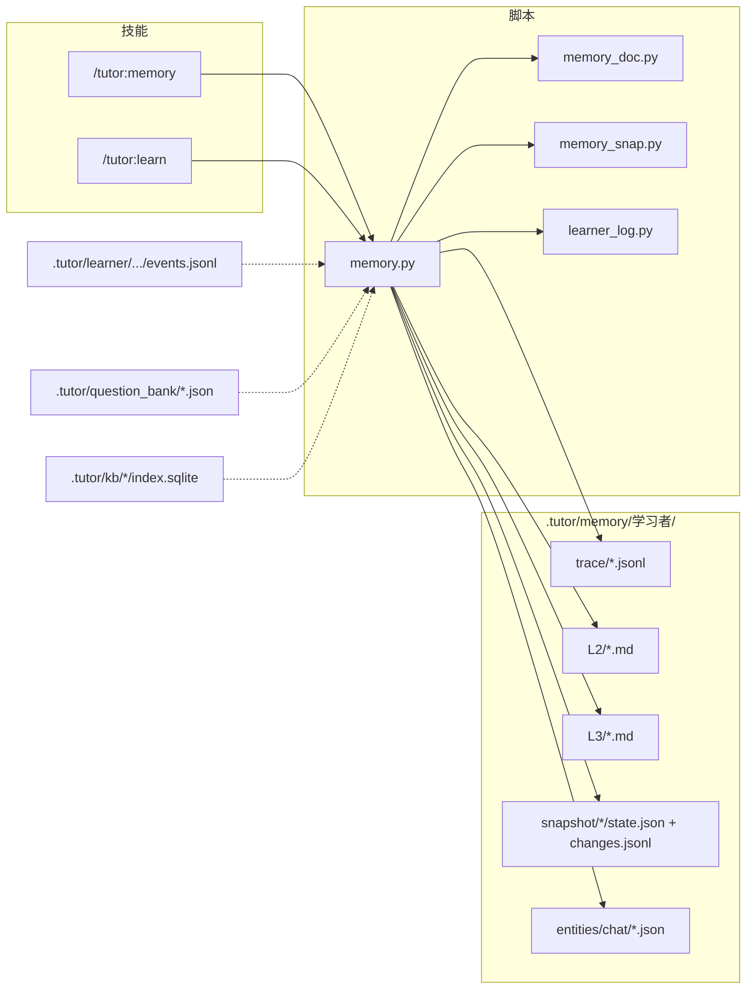
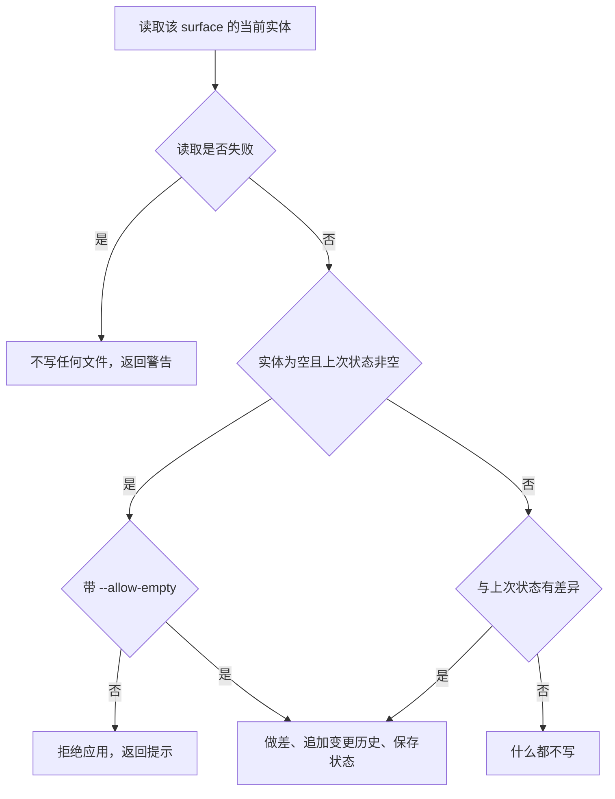

# Memory Data Layer - Plan

## Goal Capsule

- **Objective:** 学习者的学习活动（讲解、测验、知识库使用）与明确表达的偏好，被记成与 DeepTutor 记忆系统同格式的数据，学习者能随时查看、手工修改，`/tutor:learn` 能在需要个性化时用上它。
- **Means:** 两个纯库（`memory_doc.py`、`memory_snap.py`）、命令行脚本 `memory.py` 与技能 `/tutor:memory`，数据放在 `.tutor/memory/<学习者>/` (KTD1, KTD2)。
- **Product authority:** 项目负责人，依据本次 brainstorm 的对话；行为依据是 `docs/upstream-behavior/memory.md` 的清单（M 编号）和 `docs/ROADMAP-1to1-DRAFT.md`。项目目标是逐模块 1:1 复刻 DeepTutor、只换推理（`CLAUDE.md`）。
- **Execution profile:** `code`；确定性部分测试先行。
- **Stop conditions:** 任一纯函数与上游行为不符且无法在清单里标为"有意偏离"；空读取或适配器失败被当成"全部被删除"；记忆的任何操作改变了掌握度、门槛、错题或复习排期；真实技能会话出现未解释的 `permission_denials`。
- **Tail ownership:** `ce-work` 不提交、不打 tag、不发 release，也不改版本号；发布由用户单独授权。
- **Open blockers:** 无。

**Product Contract preservation:** restructured, no scope change — R1–R27、AE1–AE12 的含义与编号不变；原 Outstanding Questions 的五个待规划问题已由 KTD1–KTD14 回答，按"就地解决"删除该节。

---

## Product Contract

### Summary

0.5.0 建立记忆的**数据层与读写**，不含整合：与上游兼容的标识符、L2/L3 带脚注 Markdown、L1 追加式事件，以及 `chat`/`quiz`/`kb` 三个 surface 的快照实体和差异；新技能 `/tutor:memory` 供学习者查看、手工编辑和写偏好；`/tutor:learn` 每次调用写一份`chat` 实体，并在讲解类请求前按需读取 L3 记忆。自动生成 L2/L3 内容的整合放到 0.6.0，所以 0.5.0 结束时 L2/L3 只有手工写入的内容。

### Problem Frame

本插件现在只有账本和 0.4.0 的教学档案，没有跨功能的"这个学习者最近在做什么、有什么稳定偏好"的记忆，也没有上游那种每条断言都带来源脚注、可审计可编辑的文档形态。项目目标是 1:1 复刻 DeepTutor，记忆系统是第一组复刻。上游整合的输入是工作区里的"快照实体"而不是事件流，所以数据层必须先于整合存在，并且格式要与上游兼容，整合才有地方落盘、验收才有黄金向量可对。

### How This Work Fits Together

<!-- ce-section: work-relationships -->

当前计划只覆盖记忆系统的**数据层与读写**。下面是对周围工作的当前理解，不是已定的路线图：

- 整合（update/audit/dedup/merge 与违禁措辞守卫）：**依赖**本计划的数据格式与实体；放到下一个次版本，期间 L2/L3 只有手工内容。
- 对应上游行为清单中 M20–M33、M51–M66 的部分：**仍待排期**，本计划不实现。
- 路线图里原 0.6.0 及以后的模块：**顺延一个次版本**，`docs/DESIGN.md` 第 6 节要同步改动。

### Key Decisions

- **0.5.0 只做数据层与读写，整合拆到下一个次版本。** (session-settled: user-approved — chosen over 一个版本做完整套记忆: 清单 74 条工作量大，拆开后每个版本都能独立验收) Governs R7, R12, R22.
- **只启用 `chat`、`quiz`、`kb` 三个 surface；`notebook`、`book`、`partner`、`cowriter` 保留名字但不产生数据。** (session-settled: user-approved — chosen over 七个都启用、再加一个 path surface: 后四个没有对应功能，会长期为空) Governs R7.
- **L1 追加失败只返回警告，不报错，技能必须把警告展示给用户。** (session-settled: user-approved — chosen over 追加失败就报错: 保持上游"记录失败不能打断学习"的契约) Governs R5.
- **`chat` surface 在 0.5.0 里只有 `learn` 每次调用写的 `chat` 实体；账本里的 learn/费曼作答、`kb` 查询事件和教学档案保持可读，留给下一个次版本整合时读取；不读项目外的 Claude Code 会话记录。** (session-settled: user-approved — chosen over 只用已有结构化记录、读取你给出的会话记录路径、把账本作答也做成 chat 实体: 全部在项目内、可复算，范围最小，代价是只覆盖通过插件技能发生的对话) Governs R9, R21.
- **`chat` 实体粒度为"每次 `learn` 调用一个"，记学习者问题原话、涉及知识点、讲解要点摘要和费曼检查结果。** (session-settled: user-approved — chosen over 只存知识点与结果、存完整问答文本: 保留学习者自己的话，又不存讲解全文) Governs R9.
- **`learn` 讲解前先查概览，L3 有内容且本次是讲解类请求才读，纯事实查询跳过。** (session-settled: user-approved — chosen over 每次都读、只在学习者明确要求时读: 对应上游"不要每轮都读，也不用于纯事实问题"的行为描述) Governs R22.
- **`learn` 里的教学偏好只写教学档案；L3 偏好只由 `/tutor:memory` 显式写。** (session-settled: user-approved — chosen over 同时写两处、每次问学习者写哪里: 避免重复与不一致，也保持 0.4.0"不追问"的决定) Governs R24.
- **教学档案与 L3 偏好并存，`learn` 讲解前两处都读。** (session-settled: user-approved — chosen over 合并成一套、淘汰教学档案: 教学档案是有意偏离，保留原话要求、知识点绑定和真删除) Governs R22, R24.
- **手工编辑同时提供按条目的 add/edit/delete 批量操作和整篇覆盖。** (session-settled: user-approved — chosen over 只做按条目操作: 与上游工作台行为一致) Governs R18.
- **记忆按学习者隔离，不按知识库隔离。** 上游记忆本来就是跨功能的（L3 是跨 surface 的综合），所以不能像教学档案那样挂在知识库上；学习者名规则与账本一致。这是本计划的推断，不是对话里选的，见 Dependencies / Assumptions。Governs R26.

### Requirements

**数据格式（与上游兼容）**

- R1. 标识符与上游同形：trace id 为 `<surface>:<ULID>`，条目 id 为 `m_<ULID>`，ULID 是 26 位 Crockford base32，前 10 位编码毫秒时间戳，按时间自然排序（M1, M2）。
- R2. 引用有四种合法形式：条目 id、trace id、快照引用（`surface:任意实体 id`）、L3 用的裸 surface 名（白名单）；其他一律非法（M3）。
- R3. L2/L3 文档是 Markdown：`# 标题`、`## 小节`、`- 文本 [^1], [^3] <!--m_id-->`；脚注编号按全文首次出现顺序分配，引用同一来源的条目共用一个编号；条目 id 随往返解析不丢；`序列化(解析(x))` 对任何由序列化产生的文档幂等；没有条目的小节不输出（M4, M5, M7）。
- R4. 增删改以批量操作表达：`add`（小节、文本、refs）、`edit`（目标 id、新文本、新 refs）、`delete`（目标 id、原因）。文本 1–240 字符，小节名 1–80 字符，add/edit 的 refs 非空且每个合法，目标 id 必须存在，删除原因只能是 `contradicted`/`superseded`/`stale`/`low-signal`；整批要么全部生效要么都不生效，同一批里对同一 id 同时 edit 和 delete 整批拒绝；新条目 id 由系统分配（M8–M11）。

**L1 事件**

- R5. L1 事件含 `id`、`ts`（UTC ISO）、`surface`、`kind`、`payload`，可选 `session_id`、`turn_id`；每个 surface 每个 UTC 日期一个追加式 JSONL 文件。追加失败不得打断产生它的功能：命令返回警告，技能把警告展示给学习者，不能悄悄丢（M12–M14）。
- R6. L1 事件可按时间读取（可选起始时间，跳过更早日期的文件，坏行跳过）、按 id 反查（跨 surface）、计数、取某 surface 最新时间戳（M15）。

**快照与实体**

- R7. 启用 `chat`、`quiz`、`kb` 三个 surface；其余四个（`notebook`、`book`、`partner`、`cowriter`）只保留名字：在标识符与引用的合法名称、路径布局里有效，概览里照上游列出为空行（不存在、0 条），不产生任何实体与事件。
- R8. 实体有 `id`、`label`、`ts`、`content`、`metadata`、`fingerprint`；指纹是对各部分按顺序取 `sha1`（部分之间以 NUL 分隔，`None` 跳过，字典与列表按排序后的 JSON 序列化）的前 16 位十六进制（M69, M70）。
- R9. `chat` 实体：每次 `/tutor:learn` 调用产生一个。内容包括学习者提问的原话（不改写）、涉及的知识点、讲解要点摘要（每条带资料出处）、费曼检查结果；摘要由 Claude 写，写入后不改变任何掌握度。
- R10. `quiz` 实体：每次已作答的测验作答一个，来自账本作答与题库，内容含题干、学习者答案、正确答案、解析、难度、是否答对；未作答的题永远不进入实体（遵守"答案不能在作答前泄露"）（M72）。
- R11. `kb` 实体：每个知识库一个（以 `.tutor/kb/` 下的知识库目录为准），内容含库名与来源数量；`ts` 取该库来源的最早导入时间。知识库查询不在实体里，而是 `kb` surface 上 `query` 类的 L1 事件：由 `/tutor:learn` 在学习者提问时通过记忆脚本发出，payload 带学习者的提问原话；`kb.py search` 本身不写 L1，`quiz`、`review` 里 Claude 自拟的检索词不产生查询事件（M73）。
- R12. 快照刷新读取当前实体，与上次保存的状态做差（`added`/`removed`/`modified`，各自按 id 排序），把变化追加到变更历史并保存新状态；没有变化时不写变更历史；读取失败或适配器返回空时，不得被当成"全部被删除"（只有学习者显式带 `--allow-empty` 才按全部移除处理，见 KTD10）（M17, M67, M68, M74）。
- R13. 差异预览只读，不写状态与变更历史；变更历史可分页读取，新的在前，单页上限 1000 条（M18, M19）。

**L2/L3 读写**

- R14. 记忆文件在 `.tutor/memory/<学习者>/` 下：`trace/<surface>/<YYYY-MM-DD>.jsonl`、`L2/<surface>.md`、`L3/<recent|profile|scope|preferences>.md`、`snapshot/<surface>/` 的状态与变更历史（M14, 路径布局）。
- R15. 读取 L3：把四个 L3 文档按 `---` 分隔拼接成一份；全部为空时返回固定提示"尚无记忆"（M35）。
- R16. 概览：每个 L2 surface 与 L3 槽位一行，含是否存在、更新时间、条目数、积压（L2 为自上次更新以来的 L1 事件数，L3 恒为 0）（M41）。
- R17. 写偏好：只在学习者明确表达偏好时调用，不得猜测；`add` 或 `edit`，文本 ≤240 字符，`edit` 必须带目标 id；先写一条 `preference_stated` 的 L1 事件，再把偏好写进 L3 `preferences.md` 的 `Preferences` 小节并引用该事件；`add` 幂等：按空白拆分后用单空格连接、不分大小写（KTD12 的去重键）与已有条目文本相同时返回 `duplicate` 并指向已有条目，不重复追加（M38–M40）。
- R18. 手工编辑：按条目 id 的 add/edit/delete 批量操作（批量里的 delete 仍须带 R4 规定的删除原因），整篇覆盖保存，以及按 id 单独删除一条（M42, M45）；单独删除不需要原因，学习者说"删掉这一条"时走这一条路径。
- R19. 近期回顾只读"邮票"（标签与时间，不读正文）：`recent`（最近碰过什么，跨 surface，默认 7 天、20 条、上限 100）与 `recent_queries`（知识库里最近问过什么，用学习者原话）；每条带 `days_ago`（整天数，未来时间戳记为 0）；同一 surface 同一标签去重只留最新；没有可用时间戳的项丢弃；标签 ≤200 字符（M44）。

**技能行为**

- R20. 新技能 `/tutor:memory`：看概览、读 L3、读单个 L2/L3 文档、手工编辑与删除条目、整篇覆盖、写偏好、近期回顾、刷新快照与查看变更；每个写操作后用一句话告知结果。
- R21. `/tutor:learn` 每次调用在输出长讲解之前写一个 `chat` 实体（R9，顺序见 KTD11）；该步骤不得因一轮会话在讲解后结束而遗漏。
- R22. `/tutor:learn` 讲解前先查概览：L3 有内容且本次是讲解类请求才读取 L3，纯事实查询（某个公式、某页写了什么）跳过；同时继续读教学档案；记忆为空或读取失败时不编造、不加反思提问。
- R23. `chat` 实体不得包含学习者没说过的话：摘要只描述讲解了什么，不对学习者的理解程度下结论，不出现"掌握了"一类判断。
- R24. 在 `learn` 中学习者说出的教学偏好只写教学档案（0.4.0 行为不变）；L3 偏好只由 `/tutor:memory` 显式写入。
- R25. 记忆条目的语言跟随学习者当前使用的语言；学习者原话保持原文，不翻译。
- R26. 记忆按学习者隔离；不同学习者互不可见。
- R27. 记忆的任何操作都不改变掌握度、路径门槛、错题与复习排期。

### Acceptance Examples

- AE1. **Covers R3.** 一份含两个小节、三条带脚注条目的文档解析后再序列化，得到的文本与原文逐字节相同；两条引用同一来源的条目共用同一个脚注编号。
- AE2. **Covers R4.** 一批操作里对同一个条目既有 edit 又有 delete，整批被拒绝，文档不变；一批里有一条 add 的文本超过 240 字符，整批被拒绝，其他合法条目也没写入。
- AE3. **Covers R5.** 写 L1 事件时目标目录不可写，命令返回成功的主体结果并带 `warnings`，`/tutor:memory` 或 `/tutor:learn` 把警告告诉学习者，学习功能本身不中断。
- AE4. **Covers R12.** `quiz` 适配器读取账本失败（抛出错误）：快照刷新捕获后不写状态文件也不写变更历史，不记任何 `removed`，状态文件保持不变。
- AE5. **Covers R12.** 实体没有任何变化时再次刷新：变更历史文件的字节不变。
- AE6. **Covers R17.** 学习者通过 `/tutor:memory` 写"回答用中文"，再写一次仅大小写或首尾及多余空白不同、内容相同的"  回答用中文 "：第二次返回 `duplicate` 并指向第一条，L3 偏好里仍是一条。
- AE7. **Covers R22.** L3 有内容时，学习者问"这个公式的单位是什么"，`learn` 不读 L3；学习者问"讲讲渗透作用"，`learn` 先读 L3 再讲解。
- AE8. **Covers R21, R9.** 一轮单次的 `claude -p "/tutor:learn ..."` 讲解结束后，`.tutor/memory/<学习者>/` 里有一个新的 `chat` 实体，含学习者提问原话与讲解要点。
- AE9. **Covers R18.** 学习者说"删掉第二条偏好"，`/tutor:memory` 先列出条目取得 id，再按 id 单独删除（不需要原因）；删除一个不存在的 id 报错，文档不变。一批里的 delete 若缺删除原因，整批被拒绝（R4）。
- AE10. **Covers R24.** 学习者在 `learn` 里说"多用例子讲"，只在教学档案里多出一条偏好，L3 `preferences.md` 不变。
- AE11. **Covers R10.** 一道已出但未作答的题，不会出现在 `quiz` 实体里，实体内容中不含它的答案。
- AE12. **Covers R19.** 同一知识库一周内被查询五次同一句话，`recent_queries` 只返回最新的一条。

### Success Criteria

- R1–R4、R8、R12、R13、R19 的纯函数部分有测试，其用例取自上游 `tests/services/memory/` 中对应的测试（`test_ids.py`、`test_document.py`、`test_ops.py`、`test_recall.py`）；上游没有单独的快照差异测试，差异向量由自拟场景交给上游代码运行得出，并有变异检查证明测试能抓到常见改动。
- `/tutor:memory` 的各个操作与 `learn` 的读写在真实会话中跑通，最终回合 `permission_denials` 为空（遵循 `CLAUDE.md` 的真实会话验证教训）；单轮会话也能产生 `chat` 实体（AE8）。
- 记忆的任何命令都不改变账本、掌握度与门槛状态（R27）。

### Scope Boundaries

**推迟到下一个次版本（整合）：**

- `update`/`audit`/`dedup`/`merge` 四种整合模式，及其分块、引用池校验、行编辑、`meta.json` 已见集合（上游清单 M20–M33、M51–M66）。
- L3 违禁措辞守卫（M26），以及依赖整合的"预览→应用"两步流程（M43）。
- 整合结束后提示去重与合并（M61 的有意偏离）。

**推迟到对应功能复刻之后：**

- `notebook`、`book`、`partner`、`cowriter` 四个 surface 的实体与适配器。

**不做：**

- 运行管理器、事件回放、撤销检查点（M33, M49）；记忆设置页、工作台界面、API（M50）；v1 与 `tutorbot` 迁移（M46）；多用户路径覆盖（M47）；进程内锁（M48）。
- 读取项目外的 Claude Code 会话记录（已决定不读）。
- 解析上游旧格式脚注（M6；插件没有旧数据，已决定不做，需要时只改解析器）。
- 把 `learn` 中的教学偏好同时写进 L3（已决定只写教学档案）。

### Dependencies / Assumptions

- 行为依据：`docs/upstream-behavior/memory.md`（M1–M74，含第 6 节已确认的决定）。上游源码位于 `DeepTutor-main/deeptutor/services/memory/`，自带 20 个测试文件、158 个测试函数（`DeepTutor-main/tests/services/memory/`），是黄金向量来源。
- 假设（本计划的推断，未经对话确认）：记忆目录按学习者分（`.tutor/memory/<学习者>/`），学习者名规则与账本一致；上游记忆是单用户全局，这里没有"用户"概念，学习者是最接近的对应。
- 已核实：账本按学习者存放在 `.tutor/learner/<学习者>/events.jsonl`（`scripts/learner_log.py:70-74`），教学档案在 `.tutor/teaching/<kb>/<学习者>.json`（`scripts/teaching.py:80-82`），`/tutor:learn` 目前读教学档案并在讲解前先读路径状态（`skills/learn/SKILL.md:40-53`）。
- 已核实：上游 L2 整合的输入是快照实体而不是 L1 事件流（`DeepTutor-main/deeptutor/services/memory/consolidator/modes/update.py:150-157`），所以本计划的 `chat`/`quiz`/`kb` 实体格式要为 0.6.0 的整合预留同样的输入形态。
- 局限：`chat` 实体只覆盖通过插件技能发生的对话；摘要由 Claude 写，不能保证覆盖对话的全部要点；`quiz` 实体含正确答案，只在已作答后产生，但它存进 `.tutor/memory/` 后，任何读取该目录的命令都不得把正确答案展示给未作答的题（R10）。

---

## Planning Contract

### Key Technical Decisions

- KTD1. **脚本划分：两个纯函数库加一个命令行脚本。** `scripts/memory_doc.py`（标识符、文档解析与序列化、批量操作）、`scripts/memory_snap.py`（实体与指纹、快照差异、近期回顾的整形）是纯库；`scripts/memory.py` 是命令行，只导入这两个库和纯库 `learner_log`。知识库索引、题库、账本只通过数据格式读取（只读 SQLite、题库 JSON、`learner_log.read_events`），不导入 `kb.py`、`bank.py`、`ledger.py`，符合 `CLAUDE.md` 的模块化约定。Governs R1–R4, R8, R12, R13, R19.
- KTD2. **存储布局。** 全部在 `.tutor/memory/<学习者>/` 下：`trace/<surface>/<日期>.jsonl`、`L2/<surface>.md`、`L3/<槽位>.md`、`snapshot/<surface>/state.json` 与 `changes.jsonl`、`entities/chat/<实体 id>.json`。学习者名规则复用 `learner_log` 的校验，`--learner` 默认 `default`，与账本命令一致。Governs R14, R26.
- KTD3. **黄金向量用上游原代码生成。** 新增 `tests/golden/generate_memory.py`：给上游包打桩（只设置 `__path__`，不执行 `__init__.py`，`memory.paths` 打桩成带 `SURFACES` 的最小模块），再加载上游的 `ids`、`document`、`ops`、`snapshot/diff`、`snapshot/entity`、`recall`，并用 `ast` 取出 `adapters._sha1` 的函数体运行；`recent()`/`recent_queries()` 会延迟导入 `snapshot.adapters`（依赖多用户路径）和 `trace`，所以再向 `sys.modules` 注入假的 `snapshot.adapters`（只有 `read_stamps`）和假的 `trace`（只有 `iter_since`），并把 `recall._now` 与差异模块的时钟补丁成固定值，移植的 `memory_snap` 同样接受注入的 `now`。生成 `tests/golden/memory_vectors.json`，记录上游版本与源文件 SHA-256。已验证这种打桩方式能加载并运行上游的文档、标识符、批量操作和快照差异模块。`tests/test_golden_memory.py` 复现全部向量；`tests/golden/mutation_check.py` 扩展到对 `memory_doc.py`、`memory_snap.py` 的变异。`recent()` 与 `recent_queries()` 的端到端行为取自上游 `test_recall.py` 的用例，移植成本地测试。`generate_memory.py` 必须用 Python ≥3.10 运行（上游要求 ≥3.11 的语法），生成后的向量与移植代码的测试则要在 `/usr/bin/python3`（3.9）下也通过。Governs R1–R4, R8, R12, R13, R19.
- KTD4. **时间与随机可注入。** ULID 生成函数接受 `now_ms` 和随机数参数；命令行的 `--now`（epoch 秒）只用于测试，沿用 `ledger.py` 的做法。
- KTD5. **L1 追加不让调用失败。** `emit` 和 `preference` 里的 L1 追加失败时，命令仍返回成功的主体结果，并在 JSON 的 `warnings` 里写明原因；技能必须把 `warnings` 展示给学习者。偏好仍然写入（引用的 trace id 可能指向一条没落盘的事件，这是上游同样的行为）。Governs R5, R17.
- KTD6. **原子写与追加。** 文档、状态、实体用临时文件加 `os.replace`（沿用 `scripts/bank.py:140-162` 的写法）；JSONL 追加是单次 `write` 一整行，不加锁（单用户、一次性进程）。
- KTD7. **`chat` 实体由脚本从结构化载荷生成。** `chat-put --call-id ID` 的载荷含 `question`（学习者提问原话，原样保存）、`kps`（知识点 id 列表，可空）、`points`（讲解要点，最多 8 条，每条 ≤240 字符并带出处字符串）、可选 `check`（知识点与费曼结果）。实体 id 为 `learn-<call-id>`，调用编号字符集 `[A-Za-z0-9_-]{1,64}`；`label` 取提问前 80 字；`ts` 为首次写入时间（同一 id 再次写入相同载荷不改文件字节；载荷变化时更新内容与 `ts`，快照记为 `modified`）；`content` 由脚本按固定模板渲染。同一个 id 再次写入就原地替换，快照差异里记为 `modified`，所以同一次调用多次写入不会产生多个实体。摘要是否带掌握度判断由技能规则约束，脚本不校验（违禁措辞守卫属于整合版本）。Governs R9, R23.
- KTD8. **`quiz` 实体从账本与题库组装。** 取账本里 `assessment_type` 为 `quiz` 或 `review` 的作答事件，一个事件一个实体，实体 id 为事件 id，题库按 `kp` 的 `<知识库>::` 前缀找 `.tutor/question_bank/<知识库>.json`，用 `question_id` 取正确答案、解析、难度；题库里没有这道题就只用作答事件里已有的字段。指纹取题干、学习者答案、正确答案、是否答对的 `sha1`（沿用上游 `adapters.py:571` 的组成）。实体只由已存在的作答产生，所以未作答的题不会进入。Governs R10.
- KTD9. **`kb` 实体读知识库索引。** 对 `.tutor/kb/<名>/index.sqlite` 只读打开，实体 id 为库名，内容为库名与来源数量加最多 20 个来源显示名，`ts` 取 `sources.ingested_at` 的最小值，指纹取排序后来源 `sha256` 列表的 `sha1`。索引打不开按适配器失败处理（KTD10）。Governs R11.
- KTD10. **快照刷新的空读取守卫（比上游更严，有意偏离）。** 适配器读取失败时，刷新不写状态也不写变更历史，返回警告。读取成功但得到零个实体、而上次保存的状态非空时，同样拒绝应用并提示，只有带 `--allow-empty` 才接受为"全部移除"。上游读取失败会返回空列表并被记成全部删除（`adapters.py:658-666`），而 0.6.0 的整合依赖这份状态。Governs R12.
- KTD11. **`learn` 的新步骤放在长讲解之前。** 知识库查询事件在学习者提问时发出；L3 读取在讲解之前；`chat` 实体在讲解之前写：此时 `check` 缺省，要点标为计划讲的内容，出处只取已被 `kb.py` 引文核对确认的页面；费曼检查记录后，技能在同一对话里用同一个 `learn-<call-id>` 原地重写一次（尽力而为，单轮会话可能没有这一步）。0.4.0 的真实会话证明，放在讲解之后的记录步骤会被单轮会话跳过（`docs/solutions/logic-errors/skill-recording-flow-order-and-single-message-evidence-2026-11-22.md`）。代价是摘要描述"计划讲什么"，不是讲完后的事后总结，这一点写进技能的说明。Governs R9, R21, R22.
- KTD12. **偏好写入路径。** `preference` 命令先 `emit` 一条 `chat` surface 的 `preference_stated` 事件，再用 `add`/`edit` 批量操作把偏好写进 L3 `preferences.md` 的 `Preferences` 小节并引用该事件的 trace id；`add` 的去重键是"按空白拆分再用单空格连接、再转小写"（上游 `store.py:35-37`）。Governs R17.
- KTD14. **兼容性。** 只用标准库，`from __future__ import annotations`，Python 3.9 可运行（项目声明支持 3.9）。移植上游数据类时去掉 `slots=True`（上游 `entity.py:50`、`recall.py:45` 用了，3.9 导入即报 TypeError），保留 `frozen=True`；从 U2 起就在 `/usr/bin/python3` 下跑测试，不等到 U7。

### High-Level Technical Design

数据与脚本的关系（实线是读写，虚线是只读数据来源）：

快照刷新的决定顺序：

### Assumptions

- `ledger.py now` 给出的 `stamp` 可作为 `learn` 的调用编号（字符集满足 KTD7）。
- 上游版本 1.6.15 的纯模块在本计划实现期间不变（`NOTICE` 已记录版本）。

### Risks & Dependencies

- **黄金向量依赖上游内部布局。** 打桩加载要求上游纯模块的导入路径不变。缓解：向量文件记录源文件 SHA-256，生成脚本在上游文件变化时报出具体哪一个。
- **`memory.py` 体量。** 命令多，容易膨胀成难测的大文件。缓解：纯逻辑都在两个库里，命令行只做参数、读写与组装；U3、U4 分两个单元分别带测试。
- **`learn` 的步骤变多，单轮会话容易漏步。** 缓解：KTD11 把新步骤放在长讲解之前，U7 用真实单轮会话验证 AE8，并检查 `permission_denials`。
- **`quiz` 实体含正确答案。** 只对已存在的作答产生，目录内的读取命令不展示实体正文，但数据本身在 `.tutor/memory/` 里；这一点写进用户文档。

---

## Implementation Units

### U1. 标识符、文档与批量操作库

- **Goal:** 移植上游的标识符、L2/L3 文档解析与序列化、批量操作，并用上游原代码生成的黄金向量证明一致。
- **Requirements:** R1, R2, R3, R4；KTD1, KTD3, KTD4, KTD14.
- **Dependencies:** 无。
- **Files:**
  - Create: `scripts/memory_doc.py`
  - Create: `tests/test_memory_doc.py`
  - Create: `tests/golden/generate_memory.py`（本单元写文档、标识符、批量操作部分）
  - Create: `tests/golden/memory_vectors.json`（生成物，提交）
  - Create: `tests/test_golden_memory.py`
- **Approach:**
  - 照上游 `ids.py`、`document.py`、`ops.py` 的行为移植，`Surface` 白名单是七个 surface 名（`paths.py:48-56`）；类型、常量、错误信息保持可对照。
  - ULID 生成接受 `now_ms` 与随机数参数（KTD4）；`new_entry_id`、`new_trace_id` 在默认参数下取当前时间与 `secrets`。
  - 批量操作的校验顺序与上游一致，整批要么全应用要么都不应用；新条目 id 由系统分配。
  - 生成脚本按 KTD3 打桩加载上游，针对每个场景记录"输入 → 上游输出"，对随机 id 的场景用注入的随机数，或只比较结构。
- **Execution note:** 先写生成脚本和向量，再写移植代码，让向量先红后绿。
- **Patterns to follow:** `tests/golden/generate.py` 的向量记录与来源 SHA-256 写法；`tests/test_golden.py` 的断言结构；`scripts/bank.py` 的错误类写法。
- **Test scenarios:**
  - Covers AE1. 样例文档（两个小节、三条带脚注条目）`解析` 再 `序列化` 与原文逐字节相同；引用同一来源的两条共用一个脚注编号；与上游输出一致。
  - 没有条目的小节不被序列化输出；没有引用的条目行尾只有 id 注释。
  - 标识符：26 位字符集、单调性（同一毫秒窗口内排序）、`is_entry_id`、`is_trace_id`、`is_snapshot_ref`、裸 surface 名白名单（七个合法，未知词拒绝）、`is_valid_ref` 四种形式，非法形式一律假。
  - Covers AE2. 同一批里对同一 id 既 edit 又 delete，整批拒绝，文档不变；一批里有一条 add 文本超过 240 字符，整批拒绝，其他合法条目也没写入。
  - 批量操作：add 缺 refs、edit 目标不存在、delete 原因不在枚举内、小节名超 80 字符，各自整批拒绝；成功批次新条目 id 合法且按顺序追加。
  - 向量里所有场景在移植代码上与上游输出逐项一致（`test_golden_memory.py`）。
- **Verification:** 新测试与黄金向量全部通过；`generate_memory.py` 对上游文件内容变化能指出是哪个文件；移植代码不导入任何其他脚本。

### U2. 实体、指纹、差异与近期回顾库

- **Goal:** 移植上游的快照实体类型、指纹、快照差异和近期回顾的整形逻辑，并用黄金向量和移植用例证明一致。
- **Requirements:** R8, R12（差异部分）, R13, R19（整形部分）；KTD1, KTD3, KTD4, KTD14.
- **Dependencies:** U1（surface 名与引用校验）。
- **Files:**
  - Create: `scripts/memory_snap.py`
  - Create: `tests/test_memory_snap.py`
  - Modify: `tests/golden/generate_memory.py`（加差异、指纹、回顾整形部分）
  - Modify: `tests/golden/memory_vectors.json`（重新生成）
  - Modify: `tests/test_golden_memory.py`
- **Approach:**
  - `Entity`、`EntityStamp`、`ChangeEntry` 字段与上游 `entity.py:19-92` 一致；指纹函数按 M70 的定义（部分之间以 NUL 分隔，`None` 跳过，字典与列表按排序后的 JSON，取前 16 位十六进制）。
  - 差异函数接受注入的时间戳；结果顺序是 `added`、`removed`、`modified`，各自按 id 排序（M68）。
  - 回顾整形：`days_ago`（未来时间戳记 0）、标签清理（单行、≤200 字符）、限制夹取（默认 20、上限 100）、按时间倒序并对同一 surface 同一标签去重、丢弃无可用时间戳的项（M44）；输入是"邮票列表"和"事件列表"，不碰文件。
- **Execution note:** 同 U1，先向量后代码。
- **Patterns to follow:** U1 的向量与断言；上游 `snapshot/diff.py`、`recall.py` 的结构。
- **Test scenarios:**
  - 指纹：对一组字典、列表、`None`、含中文的输入，与上游 `_sha1` 输出一致；改变任一部分得到不同指纹。
  - 差异：新增、删除、修改、无变化各一例，及三者混合；每类内部按 id 排序；删除项使用旧标签，缺旧标签时退回 id。
  - 空实体对非空状态产生全部 `removed`（这是纯函数的正常行为，守卫在 U4）。
  - Covers AE12. 同一 surface 同一标签的多条记录只返回最新一条；不同 surface 同标签各保留。
  - 回顾：默认 7 天窗口外的丢弃；无时间戳的丢弃；未来时间戳的 `days_ago` 为 0；限制为 0、负数、超过 100 时夹取到默认或上限；标签含换行与连续空白被压成一行并截断到 200。
  - 从上游 `test_recall.py` 移植的端到端用例在本地数据源下行为一致。
- **Verification:** 新测试与黄金向量通过；库不做任何文件读写。

### U3. `memory.py`：存储、L1、L2/L3 与偏好

- **Goal:** 命令行脚本的第一部分：记忆目录布局、L1 事件追加与读取、L2/L3 文档读写、概览、偏好写入、手工编辑。
- **Requirements:** R5, R6, R14, R15, R16, R17, R18, R26, R27；KTD1, KTD2, KTD4, KTD5, KTD6, KTD12, KTD14.
- **Dependencies:** U1.
- **Files:**
  - Create: `scripts/memory.py`
  - Create: `tests/test_memory.py`
- **Approach:**
  - 照 `scripts/bank.py` 与 `scripts/teaching.py` 的骨架：专用参数解析器（用法错误也是 JSON 加退出码 1）、`emit`、`main`、`--root`、`--learner`、`--now`、原子写。
  - 命令：`emit`（stdin 读一个事件，追加到 L1，失败返回 `warnings`）、`trace`（按时间或 id 读取、计数、最新时间戳）、`overview`、`read-l3`、`doc-get`（`--layer L2|L3 --key`，读文档为 Markdown 或解析后的 JSON）、`doc-put`（整篇覆盖）、`ops`（对指定文档应用一批 add/edit/delete）、`entry-delete`（按 id 单独删除一条，不需要原因）、`preference`（`add`/`edit`）。
  - 概览按上游 `store.py:262-306` 的结构：七个 L2 surface 加四个 L3 槽位各一行，含存在与否、更新时间、条目数、积压；L2 的积压按 L1 事件计数，L3 为 0。
  - `preference` 的去重键、小节名、先 `emit` 再写、`duplicate` 返回，按 KTD12；偏好槽位不接受整合（本版没有整合，`overview` 照常列出）。
  - 学习者名校验复用 `learner_log` 的规则，两个学习者的目录互不可见。
  - 所有读取命令都不导入或改动账本、掌握度、门槛、错题、复习排期的数据（R27）。
- **Execution note:** 测试先行，L1 追加失败与整批回滚两处最容易写松。
- **Patterns to follow:** `scripts/bank.py:58-62`（参数解析器）、`:140-162`（原子写）、`:570-599`（`emit`/`main`）；`scripts/teaching.py` 的严格读取与整批全有或全无。
- **Test scenarios:**
  - `emit` 写一条事件，当日 JSONL 里多一行，字段完整；同一天再写，追加而不覆盖；跨 UTC 日期落到不同文件。
  - Covers AE3. 把 L1 目录位置占用成一个文件使追加失败：命令仍返回 `ok: true`，`warnings` 非空；偏好随后仍写入。
  - `trace` 按起始时间跳过更早日期的文件，坏行被跳过，按 id 反查跨 surface，计数与最新时间戳正确。
  - 没有任何记忆文件时，`overview` 返回七个 L2 行与四个 L3 行，全部 `exists: false`；`read-l3` 返回固定提示。
  - `read-l3` 在四个槽位有内容时用 `---` 分隔拼接。
  - Covers AE6. 先写"回答用中文"再写大小写和空白不同的"回答用 中文"：第二次返回 `duplicate` 并指向第一条的 id，L3 偏好里仍是一条；`edit` 缺 `target_id` 被拒绝。
  - 偏好文本 241 字符被拒绝；偏好条目的引用是刚写入的 `preference_stated` 事件 id。
  - 整篇覆盖后读取得到同样内容；`ops` 里一批含一条非法操作，文档字节不变。
  - Covers AE9. 按 id 单独删除一条成功且不需要原因；删除不存在的 id 报错且文档不变。
  - 两个学习者各写一条偏好，互相看不到对方的 L3、L1 与概览；非法学习者名被拒绝。
  - 损坏的 L2/L3 文档（解析不出标题）读取时给出明确提示，不当作空文档覆盖。
  - 账本文件在所有命令前后字节不变（R27）。
- **Verification:** 新测试全部通过；任一失败路径之后目标文件字节与调用前一致，没有遗留临时文件。

### U4. `memory.py`：快照、实体与近期回顾

- **Goal:** 命令行脚本的第二部分：三个 surface 的实体适配器、快照刷新与预览与历史、`chat` 实体写入、近期回顾命令，以及空读取守卫。
- **Requirements:** R7, R8, R9, R10, R11, R12, R13, R19；KTD7, KTD8, KTD9, KTD10.
- **Dependencies:** U2, U3.
- **Files:**
  - Modify: `scripts/memory.py`
  - Modify: `tests/test_memory.py`
- **Approach:**
  - 适配器：`chat` 读 `entities/chat/*.json`；`quiz` 按 KTD8；`kb` 按 KTD9。三者都返回 `Entity` 列表，读取失败抛异常由刷新捕获。
  - `chat-put --call-id ID`：校验载荷（`question` 非空，要点 ≤8 条且每条 ≤240 字符并带出处，`kps` 为字符串列表，调用编号字符集）；按 KTD7 渲染内容并原子写实体文件；返回实体 id 与是否是更新。
  - `snapshot refresh --surface S`、`snapshot preview --surface S`（只读）、`snapshot changes --surface S [--limit --offset]`（新的在前，上限 1000）；刷新按 KTD10 的决定顺序，没有差异时不写变更历史。
  - 回顾命令 `recent` 与 `recent-queries` 用 U2 的整形：`recent` 用各 surface 的邮票（不读正文），`recent-queries` 读 `kb` surface 上 `query` 类的 L1 事件，取 `payload.query`；`kb` 实体的 `ts` 是最早导入时间，所以不进 `recent`（沿用上游 `recall.py:152-158` 的理由）。
  - 对三个以外的 surface 名，刷新与读取返回"该 surface 暂未启用"，不创建任何文件（R7）。
- **Execution note:** 空读取守卫与 `quiz` 实体不含未作答题的答案，先写测试。
- **Patterns to follow:** 上游 `snapshot/__init__.py:74-91`（刷新的结构）、`snapshot/store.py`（状态与变更历史文件形态）、`adapters.py:518-577`（`quiz` 实体的内容形态）；本仓库 `scripts/path.py:83-95`（只读打开知识库索引）。
- **Test scenarios:**
  - Covers AE8（脚本侧）. `chat-put` 写入后，`entities/chat/learn-<id>.json` 存在，内容含学习者提问原话与要点；同一调用编号再次写入同样内容，文件字节不变；写入不同要点，实体被替换，下一次刷新记一条 `modified`。
  - `chat-put` 的要点超过 8 条、单条超 240 字符、缺 `question`、调用编号含空格，各自被拒绝且不写文件。
  - 第一次刷新得到全部 `added`；没有变化再次刷新，`changes.jsonl` 字节不变，`state.json` 的 `last_refresh` 也不更新。（这与上游每次刷新都重写 `last_refresh` 不同，列入 U6 的有意偏离清单；0.6.0 整合若需要该字段再改。） (Covers AE5.)
  - Covers AE4. `quiz` 适配器读账本失败（账本文件损坏到无法读）：刷新不写状态与变更历史，返回警告，没有任何 `removed`。另加一条：账本里一行损坏、其余有效时，`learner_log.read_events` 不抛异常而是返回 `warnings`；适配器把任何非空 `warnings` 当作降级读取，刷新报告警告并拒绝记录 `removed`（`added`/`modified` 照常生效）。
  - 上次状态非空而这次读到零个实体：拒绝应用并提示；加 `--allow-empty` 才记录全部 `removed`。
  - 预览不写 `state.json` 与 `changes.jsonl`；变更历史分页，新的在前，`--limit` 超过 1000 被夹取。
  - `quiz` 实体：为账本里 `quiz`/`review` 的作答各产生一个实体；题库里有该题时内容含正确答案、解析、难度；题库里没有该题时只含作答事件里已有的字段；`qualitative` 的作答（费曼检查）不产生 `quiz` 实体。
  - Covers AE11. 题库里有一道已出但账本里没有作答的题：它不出现在任何 `quiz` 实体里，实体内容也不含它的答案。
  - `kb` 实体：两个知识库各一个实体，`ts` 是各自最早导入时间，来源数量正确；删除一个知识库目录后刷新记一条 `removed`；索引损坏的知识库按适配器失败处理。
  - `recent` 返回最近碰过的实体标签与 `days_ago`；Covers AE12. 同一知识库一周内被查询五次同一句话，`recent-queries` 只返回最新一条；窗口外的查询不返回。
  - `notebook` 等未启用的 surface 请求刷新：返回"暂未启用"，不创建 `snapshot/notebook/` 目录。
- **Verification:** 新测试通过；刷新的所有失败与拒绝路径之后状态文件与变更历史字节不变；账本、题库、知识库索引在所有命令前后不变。

### U5. 技能：`/tutor:memory` 与 `/tutor:learn` 的改动

- **Goal:** 新增 `/tutor:memory`，并让 `/tutor:learn` 在讲解前读记忆、提问时发查询事件、讲解前写 `chat` 实体。
- **Requirements:** R9, R11, R20, R21, R22, R23, R24, R25；KTD5, KTD11, KTD12.
- **Dependencies:** U3, U4.
- **Files:**
  - Create: `skills/memory/SKILL.md`
  - Modify: `skills/learn/SKILL.md`
- **Approach:**
  - `skills/memory/SKILL.md`：frontmatter 含 `name`、`description`、`argument-hint`、`allowed-tools`（`memory.py`、临时写、读）；命令全部写全参数；JSON 先写进 `.tutor/tmp/` 下的新文件再用 `<` 重定向，每次 Bash 只跑一条脚本命令（沿用现有技能的约定）；覆盖概览、读 L3、读单个文档、手工编辑（先列出取得 id 再按 id 操作）、整篇覆盖前先展示将被覆盖的内容并确认、写偏好（只在学习者明确表达偏好时）、近期回顾、刷新快照与查看变更；每个写操作后用一句话告知结果，并展示命令返回的 `warnings`；语言跟随学习者（R25）。
  - `skills/learn/SKILL.md`：`allowed-tools` 加 `memory.py`；在 0b 之后新增小节，顺序是（1）提问时发 `kb` surface 的 `query` 事件（载荷是学习者的提问原话）；（2）先 `overview`，L3 有内容且本次是讲解类请求才 `read-l3`，纯事实查询跳过，读取失败或为空不编造（R22）；（3）在输出长讲解之前写 `chat` 实体，调用编号用 `ledger.py now` 的 `stamp`，摘要只描述讲了什么、不下掌握度结论（R23）；（4）展示命令返回的 `warnings`。保留教学档案的读取与记录步骤，并写明教学偏好只写教学档案、不写 L3（R24）。
  - 两个技能都要说明：记忆只调整个性化，不改变路径门槛、引文核对、出题与掌握度（R27）。
- **Patterns to follow:** `skills/learn/SKILL.md:40-53` 的 0b 写法与 `:154-189` 的记录小节；`skills/quiz/SKILL.md:73-91` 的"命令写全参数"。
- **Test scenarios:** Test expectation: none -- 技能文件是给 Claude 的指令，行为由 U7 的真实会话验证。
- **Verification:** 每条脚本命令都带全参数且与 `memory.py` 的接口一致；`learn` 里的新步骤顺序与 KTD11 一致；`allowed-tools` 能让真实会话不被拒绝（U7 确认）。

### U6. 文档、打包与行为清单状态

- **Goal:** 让用户文档、权限示例、出处声明、术语表、路线图和上游行为清单与实现一致，且不改版本号。
- **Requirements:** R20, R24；KTD3, KTD10 的披露。
- **Dependencies:** U3, U4, U5.
- **Files:**
  - Modify: `README.md`
  - Modify: `NOTICE`
  - Modify: `CHANGELOG.md`
  - Modify: `CONCEPTS.md`
  - Modify: `docs/DESIGN.md`
  - Modify: `docs/upstream-behavior/memory.md`
- **Approach:**
  - `README.md`：权限示例加 `Bash(python3 *scripts/memory.py*)`；技能列表加 `/tutor:memory`；"What is checked"里写明：`chat` 实体只覆盖通过插件技能发生的对话，摘要由 Claude 写、不保证覆盖全部要点；`quiz` 实体含正确答案，只对已作答的题产生；记忆文件放在 `.tutor/memory/`；0.5.0 不自动整合。
  - `NOTICE`：加 `deeptutor/services/memory/` 的适配范围；"与上游的差异"里写明：整合未做、快照刷新的空读取守卫更严、按学习者隔离、只启用三个 surface、知识库查询事件改由 `learn` 发出。
  - `CHANGELOG.md`：新增 `## 0.5.0` 草稿段；不改 `.claude-plugin/plugin.json` 的版本号。
  - `CONCEPTS.md`：追加记忆、L1 事件、快照实体、L2/L3 记忆文档、记忆偏好的定义。
  - `docs/DESIGN.md` 第 6 节：路线图把整合排到 0.6.0，原 0.6.0 及以后的版本整体顺延一格。
  - `docs/upstream-behavior/memory.md`：给每条 M 标注归属版本（0.5.0 或下一个次版本）与"有意偏离"，补上本计划新增的偏离（空读取守卫、`kb` 查询事件由 `learn` 发出、按学习者隔离）。
- **Patterns to follow:** `CHANGELOG.md` 0.4.0 段的写法与语言；`NOTICE` 现有条目格式；`CONCEPTS.md` 现有条目格式。
- **Test scenarios:** Test expectation: none -- 纯文档改动；一致性由 U7 的检查清单核对。
- **Verification:** README 权限 JSON 仍是合法 JSON；NOTICE、CHANGELOG 对新增脚本与数据位置的描述同 `memory.py` 的实际接口一致；`plugin.json` 版本号未变；`DESIGN.md` 的版本表与行为清单的归属一致。

### U7. 演练脚本、变异检查与真实会话验证

- **Goal:** 用脚本演练、扩展后的变异检查和真实技能会话证明 AE1–AE12 在整条链路上成立，并记录结果与残余局限。
- **Requirements:** R1–R27 的端到端覆盖；Success Criteria 全部。
- **Dependencies:** U1–U6.
- **Files:**
  - Modify: `tests/walkthrough.sh`
  - Modify: `tests/golden/mutation_check.py`
  - Create: `docs/verification/0.5.0.md`
- **Approach:**
  - `walkthrough.sh` 在现有最后一节之后新增一节：写事件、写偏好（含重复）、手工编辑、概览、`chat-put`、三个 surface 的刷新（含守卫）、近期回顾，并断言账本文件在全程字节不变。
  - 变异检查：为 `memory_doc.py` 与 `memory_snap.py` 各列若干一处改动的变异体（文本长度上限、删除原因枚举、整批拒绝条件、脚注编号起点、指纹分隔符、差异排序、`days_ago` 夹取、去重键），与现有调度器变异体并存；要求全部被杀死。
  - 真实会话按 `CLAUDE.md` 的方法在临时学习文件夹里运行 `claude -p "/tutor:..." --plugin-dir <repo> --output-format json`：`/tutor:learn` 单轮讲解（AE8，含 `chat` 实体与 `kb` 查询事件）、讲解类与纯事实两类请求的 L3 读取差异（AE7）、`/tutor:memory` 写偏好与重复写偏好（AE6）、手工编辑与删除（AE9）、`learn` 里说教学偏好只落教学档案（AE10）、L1 目录不可写时 `warnings` 被展示（AE3）。检查每个会话最终回合的 `permission_denials`。
  - `docs/verification/0.5.0.md` 按 `docs/verification/0.4.0.md` 的格式：检查与结果表、真实会话摘要、变异检查结果、发现并修复的缺陷、已知局限（含 `chat` 实体覆盖范围与摘要的主观性）。
- **Execution note:** 真实会话是这一版技能行为的唯一证据；会话暴露步骤遗漏时回到 U5 修技能，再重跑受影响的会话。
- **Patterns to follow:** `tests/walkthrough.sh` 末尾 `teaching.py` 一节的断言写法；`tests/golden/mutation_check.py` 的变异体格式；`docs/verification/0.4.0.md`。
- **Test scenarios:**
  - Covers AE1, AE2, AE5, AE6, AE9, AE11, AE12. 脚本演练里对应断言全部通过。
  - Covers R27. 演练全程账本文件 `cksum` 不变。
  - 真实会话 Covers AE3, AE6, AE7, AE8, AE9, AE10：每个场景最终回合 `permission_denials` 为空，文件内容与场景预期一致。
- **Verification:** `bash tests/walkthrough.sh` 退出码 0；变异检查全部被杀死；`docs/verification/0.5.0.md` 记录了每个真实会话的结果，包括未能复现或有保留的项目。

---

## Verification Contract

| 检查 | 命令 | 适用 |
| --- | --- | --- |
| 全部单元测试 | `python3 -I -W error::ResourceWarning -m unittest discover -s tests` | 每个单元完成后；U1–U4 必跑各自新测试文件 |
| 单个测试文件 | `python3 -I -W error::ResourceWarning -m unittest discover -s tests -p "test_memory_doc.py"`（及 `test_memory_snap.py`、`test_memory.py`、`test_golden_memory.py`） | U1–U4 |
| 黄金向量再生成（需要上游源码） | `python3 -I tests/golden/generate_memory.py DeepTutor-main` | U1、U2；之后向量文件应无意外差异 |
| 变异检查 | `python3 -I tests/golden/mutation_check.py` | U7（含新增的记忆变异体，全部被杀死） |
| 端到端演练 | `bash tests/walkthrough.sh` | U7 |
| 真实技能会话 | `claude -p "/tutor:memory ..." --plugin-dir . --output-format json` 与 `claude -p "/tutor:learn ..." ...`，检查 `permission_denials` | U7；每个场景一次 |
| 插件清单 | `claude plugin validate .` | U6、U7 |
| Python 3.9 兼容 | `/usr/bin/python3 -I -W error::ResourceWarning -m unittest discover -s tests` | U7 |

## Definition of Done

- 全部单元测试通过，并且新增的 `test_memory_doc.py`、`test_memory_snap.py`、`test_memory.py`、`test_golden_memory.py` 覆盖 R1–R19 的脚本侧行为；任一失败路径之后目标文件字节不变。
- 黄金向量由上游原代码生成并记录源文件 SHA-256，移植代码逐项复现；变异检查对新增的变异体全部杀死。
- `memory.py` 不读写账本、掌握度、门槛、错题、复习排期，也不导入其他命令行脚本（R27、KTD1）。
- 脚本演练全部断言通过；真实会话覆盖 AE3、AE6、AE7、AE8、AE9、AE10，最终回合 `permission_denials` 为空，结果写入 `docs/verification/0.5.0.md`。
- README、NOTICE、CHANGELOG、CONCEPTS、`DESIGN.md`、行为清单与实现一致；`chat` 实体的覆盖范围与摘要的主观性已在用户文档里如实写明。
- 版本号、提交、tag 与 release 均未动，等待用户单独授权。
- 清理：没有遗留的实验代码、临时文件或未使用的参数。
